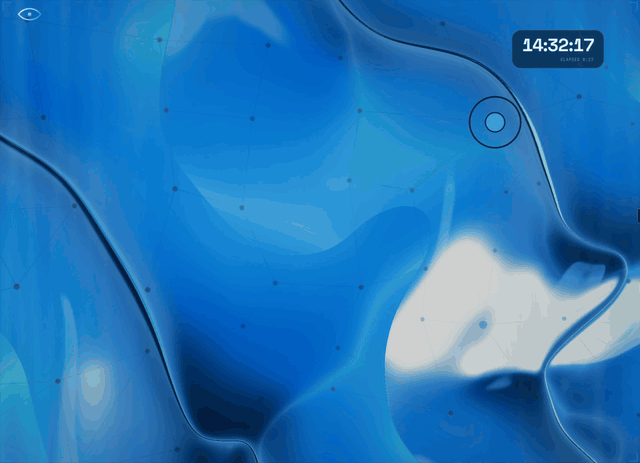

# Clarity

**6 minutes and 17 seconds.** That's the median amount of time it takes to call the police about a serious crime. With Clarity, it happens instantly.

## How it works

Every camera is a node on a graph of the city's cameras, linked to the cameras next to it. Each camera has its own agent, and agents relay context about the crime to each other.

1. **Spot:** a camera's agent sees a crime and names it.
2. **Describe:** it writes down what the suspect looks like.
3. **Relay:** it sends that description to the neighboring cameras the suspect is likely to pass.
4. **Follow:** when a neighbor spots a match, it relays again, so the chase moves camera to camera.
5. **Dispatch:** the dispatcher tells officers where to go, and a person approves every alert.

## Under the hood

Three small AI models, all running on one GPU with vLLM:

1. **Spotter** (Qwen 2B, fine-tuned by us): watches every camera and spots the crime.
2. **Checker** (NVIDIA Nemotron 12B): describes what the suspect is wearing, so the next cameras can find them.
3. **Dispatcher** (NVIDIA Nemotron 9B): tells officers where to go. A person approves every alert.

Only text moves between cameras, never video.

## Results

Tested in NeMo Gym on our own videos the model never trained on:

- The spotter makes the right call on **89%** of cameras (crime, someone running, or nothing), up from **67%** before fine-tuning.
- The full system gets **82%** of its checks right.

## Links

- Fine-tuned model: https://huggingface.co/waliviqas/clarity-spotter-qwen3vl-2b
- Our videos (open data): https://huggingface.co/datasets/waliviqas/clarity-crime-clips
- NeMo Gym setup and scores: [`nemo_gym/`](nemo_gym/), [`results/`](results/)
- vLLM write-up: [`VLLM_BOUNTY.md`](VLLM_BOUNTY.md)
- Everything else (how to run, data sources, limitations): [`DETAILS.md`](DETAILS.md)

## Team

Wali Viqas, Michael Venecia, Mina Abdel-Masih

Built at the NVIDIA x Red Hat Small Models Hack, Raleigh, Oct 17–18 2026. Track: **Fine-Tuned**.
