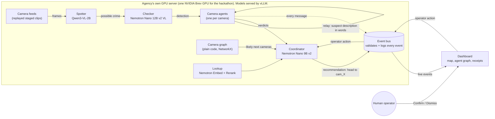

# Clarity

> When a crime happens, one dispatcher is watching dozens of camera feeds and has minutes to act. Clarity follows the suspect from camera to camera and tells officers where to head next, even with three incidents at once.

Clarity is a team of small AI agents, one beside each security camera. When a camera sees a crime, its agent describes the suspect in words and passes that description to the cameras along the suspect's likely path. A coordinator agent pulls the reports together and recommends where officers should go. A human operator confirms or dismisses every recommendation on a map.

**Design principle:** video stays on the agency's own hardware; only text descriptions move between agents.

Built in 24 hours at the **NVIDIA x Red Hat Small Models Hack** (Raleigh, Oct 17–18, 2026). **Track: Multi-Agent Systems.**

| | |
|---|---|
| Demo video | TODO: unlisted YouTube or Vimeo link |
| Screen capture of the working app | TODO: link (short clip of the dashboard during a run) |
| Staged clip dataset | TODO: dataset link (planned: Hugging Face, CC BY 4.0) |

> Naming: on screen and in this README the AI dispatcher agent is called the **coordinator**. In code and message contracts it is `dispatcher`. "Dispatcher" in the pitch above means the human at the console.

---

## Status at a glance

| Part | Folder | Owner | Status |
|---|---|---|---|
| Message contracts (JSON Schema) + validator | `contracts/` | shared | Built |
| Event bus: server, client, scripted scenario, replay | `bus/` | Mina | Built (runs without any model) |
| Camera feeds (replay staged clips as cameras) | `feeds/` | Mina | In progress |
| Staged clips, camera map, ground truth | `data/` | Mina | In progress |
| Dashboard (map, agent graph, receipts) | `dashboard/` | Mina | In progress |
| Spotter + checker (crime detection) | `perception/` | Wali | In progress |
| Camera agents + camera graph | `agents/`, `graph/` | Wali | In progress |
| Model serving on vLLM (Brev) | `infra/` | Michael | In progress |
| Coordinator + lookup | `dispatcher/`, `lookup/` | Michael | In progress |
| NeMo Gym environment + scoring | `eval/` | Michael | In progress |

Wali's and Michael's parts live on their own branches until they merge. TODO: update this table before submission (Sun Oct 18, 10:30 AM ET).

---

## The problem and the user

**User:** the operator in a police agency's real-time crime center, watching many camera feeds at once.

**Problem:** when a crime happens on one camera, the suspect walks out of frame within seconds. To follow them, the operator has to guess which camera they'll show up on next, find that feed, and recognize the person, while other feeds keep running. With more than one incident at a time, nobody can keep up by hand.

**What Clarity gives them:** an alert with a plain description of the suspect, the path they took across cameras so far, the cameras they are likely to reach next, and a recommendation ("head to cam_07") with the evidence behind it. The operator decides; Clarity never acts on its own.

**Why on-site matters:** sending live footage of the public to an outside cloud service is a privacy risk. Clarity is designed to run entirely on the agency's own hardware, with the agents sharing only short text descriptions with each other.

---

## What the demo will show

The dashboard and the real model pipeline are still in progress. Today the same story runs end to end through the event bus as a scripted scenario (see Quick start). The demo will show:

1. Three crimes starting within about 20 seconds of each other on different cameras (one fistfight, two purse snatches).
2. Each camera agent lighting up when it spots the suspect and passing a description in words to the next cameras on the map.
3. On each route, one camera is a **decoy exit** the suspect never reaches. Its agent should answer "no match", and the real exit "match".
4. The coordinator combining the reports with the camera map and recommending where to send officers.
5. Clicking any message to see its **receipt**: what the agent saw and which earlier events it relied on.
6. The operator clicking **Confirm**.

If any part runs without its model during a recording, the screen will say so (for example "coordinator: rules mode").

The video's closing line (narration): *"No video ever left this building. Only words moved between agents."*

What that line means, stated precisely: it describes how Clarity is **designed to be deployed**. In a real deployment every part (models, event bus, dashboard) runs on the agency's own hardware, so video stays inside the building and the agents exchange only text. In our hackathon demo, a rented NVIDIA Brev GPU box stands in for that hardware: the staged clips are copied to it, and the bus streams a camera's clip to the operator's laptop when the operator opens a sighting. Between agents, only text moves in the demo too.

---

## Architecture



- Each agent sees only its own camera. Between agents, and from agents to the coordinator, **only words travel**.
- **Deployment vs. our demo.** In a real deployment the dashboard runs inside the agency too, so video stays on its own hardware. In the demo, the Brev GPU box plays the agency's server and the dashboard runs on a laptop that reaches the bus through `brev port-forward`. Over that link the laptop receives the events and, when the operator opens a sighting, that camera's clip (`GET /clips/{camera_id}`).
- Every message is a small JSON event defined in [`contracts/`](contracts/README.md): `detection`, `relay`, `agent_verdict`, `dispatch`, `operator_action`, `camera_status`.
- Every decision lists the event IDs it relied on (`evidence_event_ids`). That's the receipts trail on the dashboard.
- The bus appends every accepted event to `runs/<run_id>/events.jsonl`, so any run can be replayed into the dashboard later.
- Deterministic work (timing, graph math, validation, scoring) is plain Python, not a model.

TODO: Wali to confirm which model, if any, the camera agents call to match a description at the next camera.
TODO: Michael to describe what the lookup step retrieves for the coordinator.

### Tech stack

| Layer | Tools |
|---|---|
| Models | Qwen3-VL-2B, Nemotron Nano 12B v2 VL, Nemotron Nano 9B v2, Nemotron Embed + Rerank |
| Serving | vLLM (OpenAI-compatible API) on an NVIDIA Brev GPU instance |
| Agents and pipeline | Python 3.10+, OpenAI-compatible client with structured outputs (JSON schema), NetworkX |
| Event bus | FastAPI, uvicorn, WebSockets, jsonschema |
| Dashboard | Vite, React, TypeScript, react-leaflet, OpenStreetMap tiles |
| Evaluation | NeMo Gym |

---

## Track fit: Multi-Agent Systems

The track asks for several small models that divide the work, pass context, and build on each other's output. In Clarity:

- **Divide the work.** A 2B vision model screens every frame cheaply. A 12.6B vision model checks only the frames the spotter flags. A 9B language model makes the final recommendation.
- **Pass context.** Each camera agent hands a written suspect description to its neighbors along the likely path. The next agent uses it to decide "match" or "no match" on its own camera.
- **Build on each other's output.** The coordinator's recommendation cites the exact agent messages it used, and the operator's decision feeds back to the coordinator.

Our claim is that this team of small models follows a suspect better than one model given the same job. Results section 3 tests that claim against a single-model baseline.

---

## Models and parameter budget

The hackathon cap is **33B parameters in total** across all generative language models, counting verifiers and routers too. Embedding and reranking models don't count.

| Role | Model | Parameters[^cards] | Counts toward cap | Served on |
|---|---|---|---|---|
| Spotter (screens frames) | Qwen3-VL-2B | 2B | Yes | vLLM |
| Checker (confirms crimes) | Nemotron Nano 12B v2 VL | 12.6B | Yes | vLLM |
| Coordinator (recommends) | Nemotron Nano 9B v2 | 9B | Yes | vLLM |
| Lookup embeddings | Nemotron Embed | n/a | No (embedding model) | TODO: confirm serving |
| Lookup reranking | Nemotron Rerank | n/a | No (reranking model) | TODO: confirm serving |
| **Total generative** | | **≈23.6B** (2 + 12.6 + 9) | **≤ 33B** | |

TODO: exact model IDs (Hugging Face repo names, variant and precision) for all five models, from `infra/`.

[^cards]: Counted from each model's official model card. TODO: add the five model card links.

### Why these models, and why vLLM

- **Small enough to run on site.** The design is for all three generative models to share one GPU server the agency owns, so footage stays in the building (for the hackathon, a Brev GPU box plays that server). TODO: measured result (GPU type and memory used with all three loaded).
- **Right size for each job.** By design, the cheap spotter runs on every frame, the larger checker runs only when the spotter flags something, and the coordinator works with text only.
- **vLLM to serve all three side by side.** The design puts every model behind the same OpenAI-compatible API, and vLLM batches requests that arrive together; that is how we plan to handle three incidents at once. TODO: measured result (Results section 1).
- TODO: Michael to add the deciding reasons from serving tests (memory fit, speed, structured output support).

---

## Data

### Sources and licenses

| Source | What we use it for | License | Attribution |
|---|---|---|---|
| **Our staged clips** (filmed during the hack) | Camera feeds for the demo, ground truth for evaluation and NeMo Gym tasks | TODO: license (planned: CC BY 4.0) | TODO: dataset link |
| **OpenStreetMap** | Dashboard base map around the Red Hat Annex, Raleigh | ODbL | "© OpenStreetMap contributors" (shown on the map) |

TODO: add any other public dataset we actually used (source, license, how we used it), or delete this line.

We looked at other public datasets (see [`data/README.md`](data/README.md)) and kept the demo to footage we could film safely and publish with consent.

**Stabbing** stays in the label set the models can output, but it is **not in the demo**: we found no openly licensed stabbing footage, and we don't stage scenes with knives or anything that looks like one.

### How the staged clips were made

The full method (filming, clock sync, clip conversion, ground truth) is in [`data/staged/README.md`](data/staged/README.md). This is the short version.

TODO: check every line below against what we actually filmed (written from the filming plan, before filming).

- **Who:** only consenting teammates on camera. No bystanders' faces. No weapons or props that look like weapons.
- **Where:** outside the Red Hat Annex, Raleigh, with iPhones placed like fixed security cameras.
- **What:** three incidents, one fistfight and two purse snatches. Each suspect wears a distinct outfit.
- **Camera layout:** 12 camera spots, 4 per incident route: crime spot, junction, real exit, and a decoy exit the suspect never passes. TODO: real camera positions (planned: GPS read on the phone at each spot).
- **Filmed separately, replayed together.** Each incident is filmed as its own take. Right after recording starts, each phone films a clock showing seconds (time.is). The converter [`data/build_site.py`](data/build_site.py) reads that clock time from the clip log and lines all clips of a take up on one run clock. Decoy clips (an empty path, filmed separately) are aligned to their route's junction camera. Each take is lined up on its crime, so the three crimes replay 10 s apart, at run-clock 5, 15 and 25 s (`data/build_site.py`). The three incidents did not really happen at the same moment; the video says so.
- **Clip format.** [`data/convert_clips.py`](data/convert_clips.py) (ffmpeg) turns each iPhone clip into a 720p, constant 10 fps, H.264 copy with the audio removed, so every clip decodes the same way and no bystander voices are kept. The originals are not changed.
- **Ground truth:** for every take we log, per camera, when the suspect enters and leaves (template: `data/staged/clip_log_template.csv`). `data/build_site.py` turns that log into the ground truth (`data/ground_truth/take<N>.json`), the camera map (`data/sites/annex/cameras.json`) and the clip manifest (`data/manifests/annex.json`). Walking times between cameras come from the logged times; the walk to each decoy is timed with a stopwatch.
- **Train/test split:** TODO: if the spotter is fine-tuned, list which clips were training and which were held-out test clips (never mixed); otherwise delete this line.
- **Published:** method in [`data/staged/README.md`](data/staged/README.md). TODO: clip dataset link. TODO: commit `data/ground_truth/` and `data/sites/annex/` once built from the filled log. The filled clip log stays out of git because it names phone owners; only its outputs are published.

### Attribution

- Map data © OpenStreetMap contributors, ODbL.
- TODO: credit line for the staged clip dataset once it is published.

---

## Quick start (no GPU needed)

These steps use only the parts that exist today: the event bus, the camera feeds, the site builder and the dashboard. No models are involved.

Run the Python steps from the repo root, on Linux or macOS (the Brev box is Linux). Quote paths if your clone path has spaces.

### 1. Event bus with a scripted incident

This plays three overlapping scripted incidents through the real bus. Every scripted event is tagged `source: "fake_scenario"` so the dashboard can label it as scripted.

```bash
git clone https://github.com/waliviqas/clarity-hackathon-n-r.git
cd clarity-hackathon-n-r
python3 -m venv .venv && source .venv/bin/activate
pip install -r bus/requirements.txt
```

Fastest check, no server: write the scripted run to a file and validate it against the contracts.

```bash
python -m bus.fake_scenario --out runs/fake/events.jsonl
python contracts/validate.py runs/fake/events.jsonl
```

Full check, through the bus:

```bash
# Terminal 1: start the bus on 127.0.0.1:8080
cp .env.example .env                                   # sample settings; never commit .env
set -a; source .env; set +a
export CLARITY_CAMERAS=data/sites/annex_placeholder/cameras.json   # 12-camera placeholder map
export CLARITY_RUN_ID=run_fake1
python -m bus.server
```

```bash
# Terminal 2: publish the scripted incidents, then inspect them
python -m bus.fake_scenario --speed 5
curl -s http://127.0.0.1:8080/health
curl -s "http://127.0.0.1:8080/events?type=dispatch"
python contracts/validate.py runs/run_fake1/events.jsonl
```

Replay a recorded run (this is also our demo fallback). Restart the bus with a new run ID so the copy is logged separately, then:

```bash
python -m bus.replay runs/run_fake1/events.jsonl --speed 2
```

Bus endpoints (details in [`contracts/README.md`](contracts/README.md) and [`bus/server.py`](bus/server.py)):

| Endpoint | What it does |
|---|---|
| `POST /events` | Publish one event; checked against `contracts/schemas/` |
| `GET /events?type=&since_ts=` | Read past events (polling) |
| `WS /ws` | Dashboard stream: one `bus_snapshot`, then every new event |
| `GET /cameras` | The active `cameras.json` |
| `GET /clips/{camera_id}` | That camera's replay clip, for the dashboard's sighting pop-up. Supports seeking (HTTP Range). Serves only clips named in `cameras.json`. |
| `GET /clips/{camera_id}/info` | Whether the clip is available, its `start_ts` (clip second = run-clock `ts` − `start_ts`), and why not if it isn't |
| `GET /health` | Liveness and counts of valid/invalid events |

### 2. Camera feeds (clips replayed as cameras)

```bash
pip install -r feeds/requirements.txt
```

No real clips yet? Make small synthetic ones (numbered frames, no people) in a folder outside the repo, and print the frames all cameras send, in run-clock order:

```bash
python -m feeds.fake_clips /tmp/clarity_fake --cameras 3 --seconds 10
python -m feeds.base /tmp/clarity_fake/cameras.json --fps 1
```

With a real site (step 3), check every clip, then play the cameras:

```bash
python -m feeds.replay --cameras data/sites/annex/cameras.json --check   # opens every clip: resolution, fps, frames, duration; exit 1 if any is missing or unreadable
python -m feeds.replay --cameras data/sites/annex/cameras.json           # plays all cameras on one run clock and publishes camera_status to the bus
```

`feeds.replay` options: `--fps` (frames sampled per camera per second, default 1), `--speed` (default 1; 0 = as fast as possible), `--max-width` (default 960; 0 = full size), `--no-status` (don't publish `camera_status`), `--drop-late` (skip samples that are already late). `--cameras` defaults to `$CLARITY_CAMERAS`. Perception reads frames through `feeds.base.open_feeds`; `feeds.replay` on its own prints one line per run-clock second.

### 3. Site data from the staged clips

Clips live in `data/raw/staged/take<N>/` on the GPU box and are never committed.

```bash
sudo apt-get install -y ffmpeg                       # convert_clips.py needs ffmpeg on PATH
python data/convert_clips.py data/raw/staged         # 720p, constant 10 fps, H.264, no audio .mp4 copy next to each clip
python data/build_site.py data/staged/clip_log.csv --check-clips data/raw/staged
python contracts/validate.py data/sites/annex/cameras.json
```

- After converting, point the clip log's `clip_file` cells at the `.mp4` names. `convert_clips.py` skips copies that already exist (`--force` redoes them; `--out <folder>` writes elsewhere).
- `build_site.py` reads the filled clip log (template: `data/staged/clip_log_template.csv`) and writes `data/sites/annex/cameras.json`, `data/ground_truth/take<N>.json` and `data/manifests/annex.json`. `--check-clips` also checks that every clip file exists with the exact upper/lower case (Linux is case-sensitive). `--takes 1` builds only some takes.
- The filled log (`data/staged/clip_log.csv`) is not in the repo because it names phone owners.

### 4. Dashboard (laptop)

Status: the dashboard's app shell and bus connection are committed. The main view (map, agent graph, incident cards) is **in progress** and not committed yet.

We use Node 24. In a terminal on the laptop (PowerShell works too; use `copy` instead of `cp`):

```bash
cd dashboard
npm install
cp .env.example .env      # VITE_BUS_URL, default http://127.0.0.1:8080
npm run dev               # http://127.0.0.1:5173
```

- If the bus runs on the Brev box, forward it first: `brev port-forward <instance> --port 8080:8080`.
- The dev server must stay on port 5173: the bus accepts browser requests only from that origin (`CLARITY_BUS_CORS`).
- With the bus and `python -m bus.fake_scenario` running (step 1), the scripted incidents stream in.

---

## Configuration (sample .env)

Copy [`.env.example`](.env.example) to `.env` and fill it in. It contains only placeholders; never commit `.env`.

| Variable | What it sets |
|---|---|
| `CLARITY_BUS_URL` | Where every part sends events (default `http://127.0.0.1:8080`). The bus server reads only the port from it. |
| `CLARITY_BUS_HOST` | Interface the bus binds to (default `127.0.0.1`; not in `.env.example`, set it only if needed) |
| `CLARITY_BUS_STRICT` | `1` rejects events that break the contracts (HTTP 422); `0` accepts them with a warning |
| `CLARITY_RUN_ID` | Names the log folder `runs/<run_id>/` |
| `CLARITY_CAMERAS` | The site's `cameras.json` |
| `CLARITY_CLIP_ROOT` | Folder that relative clip paths in `cameras.json` start from, for feeds and `GET /clips` (default the repo root; not in `.env.example`) |
| `CLARITY_BUS_CORS` | Browser origins the bus accepts (default the dashboard dev server, `http://localhost:5173,http://127.0.0.1:5173`; not in `.env.example`) |
| `DISPATCHER_*`, `SPOTTER_*`, `CHECKER_*` | Base URL and served model name for each vLLM server |
| `EMBED_BASE_URL`, `RERANK_BASE_URL` | Lookup servers |
| `OPENAI_API_KEY` | Must match the vLLM `--api-key`, if one is set (`EMPTY` otherwise) |
| `HF_TOKEN` | Only if a model download needs it |
| `VITE_BUS_URL` | Bus address for the dashboard (goes in `dashboard/.env`; never put secrets in `VITE_` variables) |

The bus binds to `127.0.0.1` on the GPU box by default. From a laptop, reach it with `brev port-forward <instance> --port 8080:8080`. TODO: confirm the model servers also bind to `127.0.0.1`.

---

## Reproduce the full demo

TODO: fill in once each part is merged. Planned order:

1. **Get the staged clips.** TODO: download command from the dataset link into `data/raw/staged/`.
2. **Site data.** Convert the clips and build the site as in Quick start step 3 (`data/convert_clips.py`, then `data/build_site.py data/staged/clip_log.csv --check-clips data/raw/staged`). Then `python -m feeds.replay --cameras data/sites/annex/cameras.json --check` must report every camera OK. TODO: confirm once the log is filled.
3. **Model servers (GPU box).** TODO: exact `vllm serve` commands and flags for the spotter, checker and coordinator, plus how to start Embed and Rerank (from `infra/`).
4. **Bus.** `python -m bus.server` with `CLARITY_CAMERAS=data/sites/annex/cameras.json` and a fresh `CLARITY_RUN_ID`.
5. **Pipeline.** Feeds: `python -m feeds.replay --cameras data/sites/annex/cameras.json` (plays the clips and publishes `camera_status`). TODO: commands for perception, camera agents and coordinator, in start order (perception reads frames through `feeds.base.open_feeds`).
6. **Dashboard (laptop).** `cd dashboard && npm install && npm run dev`, then open http://127.0.0.1:5173 with the bus port-forwarded (Quick start step 4). TODO: confirm once the map view is committed.

**The demo video** will be recorded from a saved run replayed through the bus. TODO: run ID and how to replay it (`python -m bus.replay runs/<run_id>/events.jsonl`).

---

## Results

Every number here comes from our own logged runs, with the source next to it. No estimates. Nothing is filled in yet.

### 1. Three incidents at once on vLLM

| Setup | Time from crime on camera to coordinator recommendation | vLLM throughput | Source |
|---|---|---|---|
| One incident alone | TODO: measure (median and worst over TODO: number of runs) | TODO: measure (requests/s, tokens/s) | TODO: run ID |
| Three incidents at once | TODO: measure | TODO: measure | TODO: run ID |

TODO: define exactly how the time is measured (wall clock, which event starts and stops the timer).

### 2. Spotter alone vs. spotter + checker

| Setup | Precision | Recall | False alarms | Source |
|---|---|---|---|---|
| Spotter (Qwen3-VL-2B) alone | TODO: measure | TODO: measure | TODO: measure | TODO: run ID |
| Spotter + checker (Nemotron Nano 12B v2 VL) | TODO: measure | TODO: measure | TODO: measure | TODO: run ID |

Measured on held-out staged clips. TODO: number of clips and how they were labeled.

### 3. Our agents vs. one model

| Setup | Picks the real exit over the decoy | Next-camera accuracy | Source |
|---|---|---|---|
| One model, same job (baseline) | TODO: measure | TODO: measure | TODO: run ID |
| Clarity's camera agents + coordinator | TODO: measure | TODO: measure | TODO: run ID |

Scored against the staged ground truth. TODO: which model the baseline uses and what it is given.

### 4. NeMo Gym: baseline vs. final

See the NeMo Gym section below. TODO: one-line summary of the score change.

### 5. Spotter fine-tuning (only if we fine-tune)

TODO: before/after table on held-out test clips, or delete this section if the spotter is not fine-tuned.

---

## Best Use of Red Hat vLLM

TODO: Michael to write. Planned contents:

- **Where vLLM sits.** One vLLM server per generative model on one Brev GPU (spotter, checker, coordinator), all behind the same OpenAI-compatible API. Every agent decision uses structured outputs (a JSON schema) at temperature 0. TODO: confirm.
- **How we configured it.** TODO: GPU type, `vllm serve` flags for each model (context length, GPU memory share, max concurrent sequences, precision), and how the three models share one GPU.
- **What we tuned, and what it changed.** TODO: each change with a measured before/after.
- **Measured results.** TODO: three incidents at once (Results section 1): latency and throughput from our runs.
- **Why vLLM.** TODO: why it fits on-site deployment (local inference, privacy, serving several models at once).

---

## Best Model Improvement with NeMo Gym

TODO: Michael to write. Planned contents:

- **Environment.** TODO: tasks built from the staged ground truth (which cameras the suspect reached, in what order), the tools the agent can call, and the code that scores each attempt.
- **Baseline vs. final.** TODO: scores on the same held-out tasks with the same config.
- **What caused the gain.** TODO: each change and its effect.
- **How to run the scoring.** TODO: command from `eval/`.

---

## Known limitations

- **Staged, not real, footage.** The clips are short scenes acted by teammates at one site in daylight. TODO: confirm conditions (time of day, number of takes).
- **Simultaneity is replayed.** The three incidents were filmed separately and replayed together. That tests the system under three-at-once load, but not three real chases in the same crowd.
- **No stabbing in the demo.** The label exists, but we had no safe footage to test it.
- **Replay, not live cameras.** Feeds are recorded clips played back as cameras, not live streams.
- **Hand-built camera map.** Walking times between cameras come from our filmed takes, not from street routing.
- **Camera names reveal the routes.** Camera names start with "Route N:" and `cameras.json` carries a `take` field, so anything that reads the camera map can tell which cameras belong to the same incident. We kept this on purpose so the demo can lay out the three routes clearly. Names never say a camera's role (crime spot, junction, exit or decoy); `data/build_site.py` writes roles only to the ground truth and rejects a spot name that mentions one.
- **Not on agency hardware yet.** The demo runs on a rented Brev cloud GPU box standing in for the agency's server, and the dashboard on a laptop over a port-forward.
- **Descriptions can be wrong.** A clothing description can match an innocent person or miss a suspect who changes clothes. That's why a human confirms every recommendation, and why each recommendation shows its evidence.
- **No login on the bus.** It has no user accounts; it binds to `127.0.0.1` on the GPU box and is reached through a port-forward. TODO: confirm how the model servers are protected (vLLM `--api-key`, localhost only, or both).
- **Small scale.** Tested with 12 cameras on one GPU. TODO: confirm, and note anything that failed under load.

## Next steps

- Connect live camera streams instead of replayed clips.
- Use street routing (OpenStreetMap) for walking times between cameras.
- Test on more sites, lighting conditions, and openly licensed footage.
- Package the stack to install on an agency's own servers.
- TODO: add the next steps the team agrees on after the demo.

---

## Repo layout

| Folder | What's inside |
|---|---|
| `contracts/` | JSON Schemas and examples for every message, plus `validate.py` |
| `bus/` | Event server, client, scripted scenario, replay |
| `data/` | Camera maps, clip log template, `convert_clips.py`, `build_site.py`, dataset notes and licenses |
| `dashboard/` | Operator map, agent graph, receipts log (in progress) |
| `feeds/` | Plays staged clips back as synchronized cameras (in progress) |

The bus writes event logs to `runs/<run_id>/` when it runs.

TODO: added when Wali's branch merges: `perception/` (spotter and checker), `agents/` (camera agents), `graph/` (camera graph).
TODO: added when Michael's branch merges: `infra/` (vLLM serving), `dispatcher/` (coordinator), `lookup/`, `eval/` (NeMo Gym).

---

## Team

| Name | Role | GitHub |
|---|---|---|
| Mina | Event bus, camera feeds, staged clips and data, dashboard, video and write-up | TODO: handle |
| Wali | Crime detection (spotter + checker), camera agents, camera graph | TODO: handle |
| Michael | vLLM serving on Brev, coordinator, lookup, NeMo Gym | TODO: handle |

---

## How we built it

- All code in this repo was written during the hackathon (Oct 17–18, 2026). Open-source libraries are listed in each folder's `requirements.txt` (and `dashboard/package.json`).
- **Claude Code was used as a development tool only** (writing and reviewing code and docs). It is not part of Clarity: no hosted or closed model is called when Clarity runs.
- No faces of people who didn't consent, no secrets, and no raw video are committed to this repo.

## License

TODO: choose a license for the code. The staged clip dataset is licensed separately (see Data).
