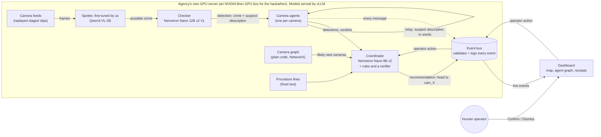

# Clarity

> When a crime happens, one dispatcher is watching dozens of camera feeds and has minutes to act. Clarity follows the suspect from camera to camera and tells officers where to head next, even with three incidents at once.

**At Clarity's core is a small vision model we are fine-tuning for one job.** Our spotter is Qwen3-VL-2B, being fine-tuned on clips our team filmed (training in progress; base-model results below). It looks at a few frames from one security camera, says whether a crime is happening and what kind (stabbing, assault or theft) or whether someone is running away, and describes the suspect in words.

**Clarity is the application that puts that model to work.** A small agent beside each camera passes the spotter's suspect description to the cameras along the suspect's likely path. A coordinator agent pulls the reports together and recommends where officers should go. A human operator confirms or dismisses every recommendation on a map.

**Design principle:** video stays on the agency's own hardware; only text descriptions move between agents.

Built in 24 hours at the **NVIDIA x Red Hat Small Models Hack** (Raleigh, Oct 17–18, 2026). **Track: Fine-Tuned.** <!-- source: team decision, Sat Oct 17 evening -->

| | |
|---|---|
| Fine-tuned spotter (model) | TODO: published model link |
| Base vs. fine-tuned on held-out test clips | [The fine-tuned spotter](#the-fine-tuned-spotter) (base measured; fine-tuned TODO) |
| Demo video | TODO: unlisted YouTube or Vimeo link |
| Screen capture of the working app | TODO: link (short clip of the dashboard during a run) |
| Staged clips + method (open data) | TODO: Hugging Face dataset link (planned license: CC BY 4.0) |

> Naming: on screen and in this README the AI dispatcher agent is called the **coordinator**. In code and message contracts it is `dispatcher`. "Dispatcher" in the pitch above means the human at the console.

---

## The fine-tuned spotter

**Its one job.** Given a few frames from one camera, in time order, the spotter answers in a fixed format:

- what happens, in one or two sentences;
- what is on screen: a **crime**, someone **fleeing**, or **nothing**;
- the crime type: **stabbing**, **assault** or **stealing**;
- the suspect, field by field: build, height, shirt, pants, shoes, hair, glasses, headwear, bag, weapon, vehicle.

That answer becomes a `detection` event (see [`contracts/`](contracts/README.md)), and its suspect description is what the camera agents pass from camera to camera. TODO: label names. The spotter says `assault` and `stealing`; the contract's `activity` labels are `fistfight` and `purse_snatch` (plus `stabbing` and `none`). The coordinator accepts both sets, but the event bus checks every event against the contract and rejects `assault` and `stealing`. Proposed: the step that turns the spotter's answer into a `detection` converts them to the contract names. The other option, renaming the contract labels, is a team decision. Also open (Wali): which label a "fleeing" answer gets. <!-- source: ACTIVITY_ALIASES in dispatcher/rules.py and the "Spotter-shaped input" run in dispatcher/IMPROVEMENTS.md (Michael branch, cdac7b5); closed activity enum in contracts/schemas/detection.schema.json; the bus rejects invalid events by default (CLARITY_BUS_STRICT=1, bus/server.py) -->

**Why fine-tune.** We scored the base model, `Qwen/Qwen3-VL-2B-Instruct`, on our held-out test clips before any training. It picked the right one of crime / fleeing / nothing in about half its answers, but it named the crime type wrong every time and almost never got the suspect's clothes right in its fields (table below). On our demo clip (clip 8, camera 1), it saw a crime but called a phone snatch an "assault", and its fields gave the suspect glasses and no shirt description, although its own summary mentions the man in the black hoodie. <!-- source: before.json on Wali's branch, clip8 cam1, same answer in 3 of 3 runs --> A 2B model is small enough to run beside every camera on an agency's own hardware, so we teach it this one job instead of using a bigger model.

**How it is trained.** TODO: Wali to confirm every line.

- **Base model:** `Qwen/Qwen3-VL-2B-Instruct` (2.13B parameters, see [Models and parameter budget](#models-and-parameter-budget)).
- **Test split (held out, never trained on):** clips 1, 3, 4, 7, 8, 12 and 13, 18 camera views in total. Each view is asked 3 times. <!-- source: before.json on Wali's branch -->
- **Training split:** TODO: list of training clips.
- **External check:** clips from CAVIAR (8) and MEVA example clips, public datasets filmed elsewhere. ex085, the MEVA theft clip, was dropped on Oct 18 because its burned-in labels give the answer away, so the external rows below will be rerun without it. TODO: say whether any of them are also used in training (if so, they stop being a fair check).
- **Method:** TODO: full fine-tune or LoRA, tools, epochs, GPU and training time.
- **Labels:** every camera view of our clips has a label (what happens, crime type, suspect fields). The CAVIAR and MEVA labels come from the datasets and were not checked frame by frame. <!-- source: "check" field in before_external.json --> TODO: how our clips were labeled, and who checked the labels.

**Base vs. fine-tuned.** Same clips, prompt and settings for both rows of each split. TODO: confirm.

| Spotter | Split | Camera views | On-screen accuracy | Crime-type accuracy | False-alarm rate | Description accuracy | Failed requests | Source |
|---|---|---|---|---|---|---|---|---|
| Qwen3-VL-2B-Instruct, base | test | 18 | 0.537 | 0.0 | 0.0 | 0.253 | 7 of 54 | `results/before.json`, Oct 17 9:22 PM |
| Qwen3-VL-2B, fine-tuned (ours) | test | 18 | TODO | TODO | TODO | TODO | TODO | TODO |
| Qwen3-VL-2B-Instruct, base | external (CAVIAR + MEVA) | 11 | 0.485 | 0.133 | 0.167 | n/a (no suspect labels) | 8 of 33 | `results/before_external.json`, Oct 17 9:29 PM |
| Qwen3-VL-2B, fine-tuned (ours) | external (CAVIAR + MEVA) | 11 | TODO | TODO | TODO | n/a | TODO | TODO |

The external base row was measured on 11 clips including ex085; TODO: Wali reruns both external rows on the same reduced set. Sources are Wali's result files on his branch (`wali-branch`, commit `cc8d3ae`) until it merges, also logged in `results/history.csv`. TODO: confirm the folder name at merge.

How to read the columns (our reading of the result files; TODO: Wali to confirm):

- **On-screen accuracy:** share of all answers that pick the right one of crime / fleeing / nothing. A failed request counts as wrong.
- **Crime-type accuracy:** on views where a crime happens, share of answers with the right crime type.
- **False-alarm rate:** on views where nothing happens, share of answers that report a crime. In the test split that is only 2 views (6 answers), so this number says little.
- **Description accuracy:** share of the suspect's description fields that match the label. Base model per field on the test split: shirt 0.062, pants 0.0, hair 0.0, build 0.0, versus headwear 0.854, bag 0.854 and weapon 1.0, where the right answer was usually "none". <!-- source: description_accuracy_by_field in before.json -->
- **Failed requests:** answers that came back unusable (out of 18 views × 3 tries = 54 on test, 11 × 3 = 33 external).

Caveats: two test clips (4 and 12) are not in the published dataset, so the published clips reproduce only part of the test split. The MEVA example clips have the dataset's activity labels burned into the video (see [`data/README.md`](data/README.md)); the base model's only correct crime types on the external set (2 answers) were on the MEVA theft clip, which shows such a label (that clip, ex085, is now dropped from the external check). <!-- source: before_external.json, meva_ex085_theft -->

**Published model:** TODO: Hugging Face model link and license.

---

## Track fit: Fine-Tuned

In our own words, the Fine-Tuned track asks for three things: a small open model specialized with data for one clear job; a fair before-and-after on test data the model never saw; and a working system in which the specialized model does real work.

| What the track looks for (our paraphrase) | In Clarity |
|---|---|
| A small model, specialized for one job | Qwen3-VL-2B (2.13B), fine-tuned to spot a crime and describe the suspect from a few camera frames |
| Data behind the specialization | Clips our team filmed and labeled during the hack, published with the method (see [Data](#data)) |
| A fair before-and-after | Base vs. fine-tuned on the same held-out test clips, never used in training, plus an external check on public clips ([table above](#the-fine-tuned-spotter)) |
| The model doing real work | In progress: its suspect descriptions are meant to feed the camera relay, the coordinator's recommendation and the operator's dashboard; in the current demo run the detections are still scripted (see [The application](#the-application-a-camera-relay-for-the-operator)) |

---

## Status at a glance

| Part | Folder | Owner | Status |
|---|---|---|---|
| **Spotter fine-tune** (Qwen3-VL-2B, team clips, train/test split) | TODO: folder | Wali | Base model scored (Oct 17, 9:22 PM); fine-tune running. Published model: TODO |
| Spotter + checker in the pipeline (crime detection) | `perception/` | Wali | In progress. Scripted in the current demo run |
| Camera agents + camera graph | `agents/`, `graph/` | Wali | In progress. The camera agents are scripted in the current demo run |
| Message contracts (JSON Schema) + validator | `contracts/` | shared | Built |
| Event bus: server, client, scripted scenario, replay, run metrics | `bus/` | Mina | Built (runs without any model) |
| Camera feeds (replay staged clips as cameras) | `feeds/` | Mina | In progress |
| Staged clips, camera map, ground truth | `data/` | Mina | In progress |
| Dashboard (map, agent graph, incident cards, receipts, sighting video) | `dashboard/` | Mina | Built; polishing |
| Model serving on vLLM (Brev) | `infra/` | Michael | Coordinator model served (port 8003); base spotter served for its load test. TODO: fine-tuned spotter and checker |
| Coordinator (Nemotron Nano 9B v2, rules for clear cases, a verifier) | `dispatcher/` | Michael | Built, on the `Michael` branch until it merges |
| Lookup (RAG with Nemotron Embed + Rerank) | — | Michael | **Cut.** Replaced by fixed procedure lines in `dispatcher/guidance.py` |
| NeMo Gym environment + scoring | — | — | **Cut.** Not used in Clarity; we don't enter that bounty |

Wali's and Michael's parts live on their own branches until they merge. TODO: update this table before submission (Sun Oct 18, 10:30 AM ET).

---

## The problem and the user

**User:** the operator in a police agency's real-time crime center, watching many camera feeds at once.

**Problem:** when a crime happens on one camera, the suspect walks out of frame within seconds. To follow them, the operator has to guess which camera they'll show up on next, find that feed, and recognize the person, while other feeds keep running. With more than one incident at a time, nobody can keep up by hand.

**What Clarity gives them:** an alert with a plain description of the suspect, the path they took across cameras so far, the cameras they are likely to reach next, and a recommendation ("head to cam_07") with the evidence behind it. The operator decides; Clarity never acts on its own.

**Why on-site matters:** sending live footage of the public to an outside cloud service is a privacy risk. Clarity is designed to run entirely on the agency's own hardware, with the agents sharing only short text descriptions with each other.

---

## The application: a camera relay for the operator

Clarity is built to show the fine-tuned spotter doing its job in a realistic setting (wiring in progress; the table below says what is real and what is scripted today). Several small models split the work: the spotter screens each camera, a larger checker model double-checks what it flags (if it is served; not confirmed yet), camera agents pass the suspect description along, and the coordinator recommends where to send officers.

**What the demo shows (current scope: one incident)**

1. **Test clip 8 only:** a phone snatched at a bus shelter, seen by 3 cameras along the suspect's run (bus shelter, sidewalk, covered walkway). It is a test clip, never used in training. The three views were filmed one after another and are replayed together as live cameras. <!-- source: camera_positions.csv on Wali's branch (clip8 cam1-cam3, recorded 4:41-4:43 PM) --> TODO: add more incidents if the multi-incident demo comes back.
2. The crime camera's agent lights up and passes a description in words to the next cameras on the map. Each next camera's agent answers "match" or "no match".
3. The coordinator combines those reports with the camera map. A stabbing would go to the operator at once; a theft like this one (contract label `purse_snatch`) goes to the coordinator's model and becomes an alert once another camera's agent confirms a match. Every model answer is checked by plain-code rules (the verifier) before it goes out, and the recommendation ends with a fixed procedure line. <!-- source: dispatcher/README.md on the Michael branch -->
4. On the dashboard, the incident card turns to **Needs your decision**. The operator clicks **Confirm** or **Dismiss**, can open **Watch last sighting** to see the clip from the newest sighting, and can click any message in **Receipts** to see the earlier events it relied on.

**What is real and what is scripted in the current demo run**

| Part | In the demo run |
|---|---|
| Camera feeds | Real: test clip 8's three camera views, replayed as cameras |
| Spotter, checker, camera agents | **Scripted** until the fine-tuned spotter is wired in. `python -m bus.fake_scenario --ground-truth data/ground_truth/take1.json --cameras data/sites/annex/cameras.json` plays clip 8 from its ground truth: the snatch detection at the bus shelter, the relays, and the camera agents' match answers at the next two cameras, each tagged `source: "fake_scenario"`; the dashboard's header shows a **Scripted run** tag. The spotter's real results so far are the base vs. fine-tuned table above. |
| Coordinator | Real model: Nemotron Nano 9B v2 on vLLM makes the decisions. If a recording runs it in rules-only mode (`--no-model`), the video says so ("coordinator: rules mode"). |
| Event bus, dashboard, the operator's Confirm / Dismiss | Real |

TODO: update this table when the fine-tuned spotter and the checker are wired in. TODO: run ID of the recorded demo run.

**Three incidents at once (tested without the camera footage).** With three overlapping scripted incidents from `bus.fake_scenario`, the live coordinator model kept up: the slowest bus poll went from 3.9 s to 2.3 s after batching, with no fallbacks, and officers were never sent to a decoy exit (0 of 14 dispatches). <!-- source: dispatcher/IMPROVEMENTS.md on the Michael branch, changes #5 and #9 (1 run each) -->

The video's closing line (narration): *"In a real deployment, no video leaves the building. Only words move between agents."*

What that line means, stated precisely: it describes how Clarity is **designed to be deployed**. In a real deployment every part (models, event bus, dashboard) runs on the agency's own hardware, so video stays inside the building and the agents exchange only text. In our hackathon demo, a rented NVIDIA Brev GPU box stands in for that hardware: the staged clips are copied to it, and the bus streams a camera's clip to the operator's laptop when the operator opens a sighting. Between agents, only text moves in the demo too.

---

## Architecture



- Each agent sees only its own camera. Between agents, and from agents to the coordinator, **only words travel**.
- **Today's demo run:** the spotter, checker and camera agents are stood in for by a script that publishes their events (see [The application](#the-application-a-camera-relay-for-the-operator)). The feeds, bus, coordinator and dashboard run for real.
- **The coordinator** handles clear cases (such as a confident stabbing) with rules and no model call, sends ambiguous ones to the model with a JSON schema, and checks every model answer with a verifier: it must cite only evidence from the case, mention only the case's cameras, send officers where the suspect is heading, and stay within the priority the crime allows. A rejected answer gets one retry, then a safe fallback ("Operator review needed"). <!-- source: dispatcher/README.md on the Michael branch -->
- **Deployment vs. our demo.** In a real deployment the dashboard runs inside the agency too, so video stays on its own hardware. In the demo, the Brev GPU box plays the agency's server and the dashboard runs on a laptop that reaches the bus through `brev port-forward`. Over that link the laptop receives the events and, when the operator opens a sighting, that camera's clip (`GET /clips/{camera_id}`).
- Every message is a small JSON event defined in [`contracts/`](contracts/README.md): `detection`, `relay`, `agent_verdict`, `dispatch`, `operator_action`, `camera_status`.
- Every decision lists the event IDs it relied on (`evidence_event_ids`). That's the receipts trail on the dashboard.
- The bus appends every accepted event to `runs/<run_id>/events.jsonl`, so any run can be replayed into the dashboard later.
- Deterministic work (timing, graph math, validation, scoring, the verifier) is plain Python, not a model.
- **No lookup step.** We planned a search over procedures (RAG with Nemotron Embed + Rerank) and cut it. The coordinator appends a fixed procedure line per crime type from `dispatcher/guidance.py` instead, for example "Procedure: take the victim's statement and broadcast the suspect description." for a purse snatch.

TODO: Wali to confirm which model, if any, the camera agents call to match a description at the next camera.

### Tech stack

| Layer | Tools |
|---|---|
| Models | Qwen3-VL-2B, fine-tuned (spotter); Nemotron Nano 12B v2 VL (checker); Nemotron Nano 9B v2 (coordinator) |
| Spotter fine-tune | TODO: training tools (Wali) |
| Serving | vLLM 0.11.0 (OpenAI-compatible API) on an NVIDIA Brev GPU instance (A100 80 GB) <!-- source: dispatcher/IMPROVEMENTS.md --> |
| Agents and pipeline | Python 3.10+, OpenAI-compatible client with structured outputs (JSON schema), NetworkX |
| Event bus | FastAPI, uvicorn, WebSockets, jsonschema |
| Dashboard | Vite, React, TypeScript, react-leaflet, OpenStreetMap tiles |
| Measurement | Wali's spotter scoring and load test, Michael's `scripts/bench_dispatcher.py`, `bus/metrics.py` |

---

## Models and parameter budget

The hackathon cap is **33B parameters in total** across all generative language models, counting verifiers and routers too. Embedding and reranking models don't count. Our verifier is plain code, not a model. <!-- source: the event's published rules -->

| Role | Model | Parameters[^params] | Counts toward cap | Served on |
|---|---|---|---|---|
| Spotter (screens frames), fine-tuned by us | `Qwen/Qwen3-VL-2B-Instruct` (base) | 2,127,532,032 | Yes | vLLM. TODO: port and served model name |
| Checker (confirms crimes) | `nvidia/NVIDIA-Nemotron-Nano-12B-v2-VL-BF16` | 13,181,860,358 | Yes | vLLM. TODO: port and served model name |
| Coordinator (recommends) | `nvidia/NVIDIA-Nemotron-Nano-9B-v2` | 8,888,227,328 | Yes | vLLM, port 8003, served model name `dispatcher` |
| **Total** | | **24.20B** | **≤ 33B** (8.80B to spare) | |

- No embedding or reranking models are used: the lookup step (Nemotron Embed + Rerank) was cut.
- TODO: Wali to confirm how the fine-tuned spotter is stored (full weights or a LoRA adapter). If it is an adapter, add its parameters to the table.
- TODO: confirm the spotter and checker checkpoints on the Brev box are exactly these (Michael's note).

[^params]: Exact counts from the published safetensors files, as listed in `dispatcher/README.md` on the `Michael` branch ("Models and the 33B cap"). Earlier team notes rounded these to ≈23.6B (2 + 12.6 + 9).

### Why these models, and why vLLM

- **Small enough to run on site.** All three models share one GPU (on the hackathon Brev box: one A100 80 GB; the coordinator's vLLM server uses a 0.30 share of its memory). <!-- source: dispatcher/IMPROVEMENTS.md, setup line ("shared with the team's other two models") --> TODO: memory share of the spotter and checker servers.
- **Right size for each job.** By design, the fine-tuned 2B spotter runs on every camera, the larger checker runs only when the spotter flags something, and the coordinator works with text only.
- **vLLM for many cameras and incidents at once.** Every model sits behind the same OpenAI-compatible API, and vLLM batches requests that arrive together. Measured results are in [Best Use of Red Hat vLLM](#best-use-of-red-hat-vllm).

---

## Data

### Sources and licenses

| Source | What we use it for | License | Attribution |
|---|---|---|---|
| **Our staged clips** (13 clips filmed by the team on Oct 17) | Training and test clips for the spotter fine-tune, kept apart; the demo camera feeds (test clip 8); ground truth for evaluation. To be published with the method, except clips 4, 11 and 12, audio stripped: test clip 8 first (package and dataset card ready, `data/staged/DATASET_CARD.md`), the rest after a bystander check (clips 2, 5 and 6 show passers-by). | TODO: license (planned: CC BY 4.0) | TODO: dataset link |
| **CAVIAR** (8 acted clips from one lobby camera) | External check set for the spotter (4 fights, 4 without a crime). TODO: say whether any are also used in training | CC BY-SA | See Attribution below |
| **MEVA** (3 example clips) | External check set for the spotter (1 theft, 2 without a crime; the theft clip, ex085, was dropped on Oct 18 because of its burned-in labels). TODO: say whether any are also used in training | CC BY 4.0 | See Attribution below |
| **OpenStreetMap** | Dashboard base map around the Red Hat Annex, Raleigh | ODbL | "© OpenStreetMap contributors" (shown on the map) |

The clip names, license checks and caveats for CAVIAR and MEVA are in [`data/README.md`](data/README.md). We looked at other public datasets there too and kept to footage we could film safely and publish with consent.

**Stabbing is mimed.** We found no openly licensed stabbing footage, and we never stage scenes with knives or anything that looks like one. So teammates act the stabbing out with empty hands.

### How the staged clips were made

The method for the demo clip (test clip 8: filming, positions, timing, conversion, ground truth) is in [`data/staged/README.md`](data/staged/README.md); the other clips were filmed the same way. This is the short version. Filming facts come from Wali's `camera_positions.csv` (on his branch until it merges).

- **Who:** only consenting teammates act. No weapons or props that look like weapons; the stabbing is mimed with empty hands.
- **What:** 13 clips, each showing one incident or a scene with no crime. The test clips hold mimed stabbings (clips 1, 3 and 4), a pickpocket (7), a phone snatch (8), an assault (13) and a no-crime scene (12). <!-- source: labels in before.json --> TODO: describe the training clips.
- **Where and when:** sidewalks, a plaza, a cafe patio, a bus shelter and a parking garage around the Red Hat Annex in Raleigh, plus a few indoor views, filmed on Oct 17 between about 4:05 and 5:40 PM. <!-- source: camera_positions.csv (recorded_at, spot_name) -->
- **Cameras:** one iPhone (the clips are consecutive files from one camera roll), moved from spot to spot along the suspect's path; for clip 8 it was handheld, not mounted, so its views move a little. 1 to 4 views per clip, 34 camera views in total. <!-- source: camera_positions.csv (source_file IMG_7352-IMG_7390, recorded_at); data/staged/README.md --> The team's camera-position sheet lists each spot's GPS fix (accuracy 5 to 189 m, worse indoors), the distance from the previous camera and an estimated running time. <!-- source: camera_positions.csv --> On the demo map, clip 8's cameras are placed by hand in route order, not at their raw GPS fixes (±14–28 m, more than the 11–22 m between the cameras, and out of route order): they form a straight line heading north (an assumption), spaced by the distances between the rounded GPS fixes. The raw GPS stays in the clip log's `gps_lat`, `gps_lon` and `gps_accuracy_m` columns. <!-- source: data/staged/README.md ("Raw GPS vs placed positions") and data/staged/clip_log_take1.csv -->
- **Filmed separately, replayed together.** The views of one clip are short shots (2.4 to 12.5 s) filmed one after another, not at the same moment. For the demo they are replayed on one shared clock as if several cameras watched the same run. Each view is placed on that clock by the estimated running time from the previous spot (3 s and 6 s for clip 8), because the clips share no clock. <!-- source: camera_positions.csv (duration_s, gap_from_prev_cam_s) -->
- **Clip format.** [`data/convert_clips.py`](data/convert_clips.py) (ffmpeg) turns each iPhone clip into a 720p, constant 10 fps, H.264 copy with the audio removed, so every clip decodes the same way and no bystander voices are kept. The originals are not changed.
- **Labels and ground truth:** per camera view, what happens, the crime type and the suspect's description (see [The fine-tuned spotter](#the-fine-tuned-spotter)). For replay, [`data/build_site.py`](data/build_site.py) turns a clip log (clip 8's is committed as `data/staged/clip_log_take1.csv`; template: `data/staged/clip_log_template.csv`) into the camera map (`data/sites/annex/cameras.json`), ground truth (`data/ground_truth/take<N>.json`) and clip manifest (`data/manifests/annex.json`), all built and committed for clip 8.
- **Train/test split:** test clips 1, 3, 4, 7, 8, 12 and 13 are never used in training; the demo replays only test clip 8. TODO: list the training clips.
- **Published:** planned for every clip except 4, 11 and 12, audio stripped, with the method in [`data/staged/README.md`](data/staged/README.md). Test clip 8 goes first (passers-by blurred; dataset card in [`data/staged/DATASET_CARD.md`](data/staged/DATASET_CARD.md)); the others follow after a bystander check (clips 2, 5 and 6 show passers-by). TODO: dataset link. The site files and a cleaned clip log (no phone owners) are committed.

### Attribution

- Map data © OpenStreetMap contributors, ODbL.
- CAVIAR: EC Funded CAVIAR project/IST 2001 37540, http://homepages.inf.ed.ac.uk/rbf/CAVIAR/. CC BY-SA. We modified the clips (frame extraction, labels).
- MEVA: "Multiview Extended Video with Activities" (MEVA) dataset by Kitware Inc., https://mevadata.org. CC BY 4.0 (https://mevadata.org/resources/MEVA-data-license.txt). We modified the clips (frame extraction, labels). Paper: Corona, K., Osterdahl, K., Collins, R., Hoogs, A. "MEVA: A Large-Scale Multiview, Multimodal Video Dataset for Activity Detection." WACV 2021.
- TODO: credit line for the staged clip dataset once it is published.

---

## Quick start (no GPU needed)

These steps use only the parts that exist today: the event bus, the camera feeds, the site builder and the dashboard. No models are involved.

Run the Python steps from the repo root, on Linux or macOS (the Brev box is Linux). Quote paths if your clone path has spaces.

### 1. Event bus with a scripted incident

This plays three overlapping scripted example incidents through the real bus, on a 12-camera placeholder map (not our filmed clips). Every scripted event is tagged `source: "fake_scenario"` so the dashboard can label it as scripted.

```bash
git clone https://github.com/waliviqas/clarity-hackathon-n-r.git
cd clarity-hackathon-n-r
python3 -m venv .venv && source .venv/bin/activate
pip install -r bus/requirements.txt
```

Fastest check, no server: write the scripted run to a file and validate it against the contracts.

```bash
python -m bus.fake_scenario --out runs/fake/events.jsonl
python contracts/validate.py runs/fake/events.jsonl
```

Full check, through the bus:

```bash
# Terminal 1: start the bus on 127.0.0.1:8080
cp .env.example .env                                   # sample settings; never commit .env
set -a; source .env; set +a
export CLARITY_CAMERAS=data/sites/annex_placeholder/cameras.json   # 12-camera placeholder map
export CLARITY_RUN_ID=run_fake1
python -m bus.server
```

```bash
# Terminal 2: publish the scripted incidents, then inspect them
python -m bus.fake_scenario --speed 5
curl -s http://127.0.0.1:8080/health
curl -s "http://127.0.0.1:8080/events?type=dispatch"
python contracts/validate.py runs/run_fake1/events.jsonl
```

`python -m bus.fake_scenario --no-dispatch` leaves out the scripted coordinator decisions, so a running coordinator makes them instead. `python -m bus.fake_scenario --ground-truth data/ground_truth/take1.json --cameras data/sites/annex/cameras.json` plays test clip 8 on its real site instead, also without scripted decisions (see [Reproduce the full demo](#reproduce-the-full-demo)).

Replay a recorded run (this is also our demo fallback). Restart the bus with a new run ID so the copy is logged separately, and stop any running coordinator (it would add a second set of decisions), then:

```bash
python -m bus.replay runs/run_fake1/events.jsonl --speed 2
```

Timings for a recorded run (from the bus's own logs; runs with scripted events are labeled as scripted):

```bash
python -m bus.metrics runs/run_fake1
```

Bus endpoints (details in [`contracts/README.md`](contracts/README.md) and [`bus/server.py`](bus/server.py)):

| Endpoint | What it does |
|---|---|
| `POST /events` | Publish one event; checked against `contracts/schemas/` |
| `GET /events?type=&since_ts=` | Read past events (polling) |
| `WS /ws` | Dashboard stream: one `bus_snapshot`, then every new event |
| `GET /cameras` | The active `cameras.json` |
| `GET /clips/{camera_id}` | That camera's replay clip, for the dashboard's sighting pop-up. Supports seeking (HTTP Range). Serves only clips named in `cameras.json`. |
| `GET /clips/{camera_id}/info` | Whether the clip is available, its `start_ts` (clip second = run-clock `ts` − `start_ts`), and why not if it isn't |
| `GET /health` | Liveness and counts of valid/invalid events |

### 2. Camera feeds (clips replayed as cameras)

```bash
pip install -r feeds/requirements.txt
```

No real clips yet? Make small synthetic ones (numbered frames, no people) in a folder outside the repo, and print the frames all cameras send, in run-clock order:

```bash
python -m feeds.fake_clips /tmp/clarity_fake --cameras 3 --seconds 10
python -m feeds.base /tmp/clarity_fake/cameras.json --fps 1
```

With a real site (step 3), check every clip, then play the cameras:

```bash
python -m feeds.replay --cameras data/sites/annex/cameras.json --check   # opens every clip: resolution, fps, frames, duration; exit 1 if any is missing or unreadable
python -m feeds.replay --cameras data/sites/annex/cameras.json           # plays all cameras on one run clock and publishes camera_status to the bus
```

`feeds.replay` options: `--fps` (frames sampled per camera per second, default 1), `--speed` (default 1; 0 = as fast as possible), `--max-width` (default 960; 0 = full size), `--no-status` (don't publish `camera_status`), `--drop-late` (skip samples that are already late). `--cameras` defaults to `$CLARITY_CAMERAS`. Perception reads frames through `feeds.base.open_feeds`; `feeds.replay` on its own prints one line per run-clock second.

### 3. Site data from the staged clips

Clips live in `data/raw/staged/take<N>/` on the GPU box and are never committed.

```bash
sudo apt-get install -y ffmpeg                       # convert_clips.py needs ffmpeg on PATH
python data/convert_clips.py data/raw/staged         # 720p, constant 10 fps, H.264, no audio .mp4 copy next to each clip
python data/build_site.py data/staged/clip_log_take1.csv --takes 1 --check-clips data/raw/staged
python contracts/validate.py data/sites/annex/cameras.json
```

- After converting, point the clip log's `clip_file` cells at the `.mp4` names. `convert_clips.py` skips copies that already exist (`--force` redoes them; `--out <folder>` writes elsewhere).
- `build_site.py` reads the filled clip log (template: `data/staged/clip_log_template.csv`) and writes `data/sites/annex/cameras.json`, `data/ground_truth/take<N>.json` and `data/manifests/annex.json`. `--check-clips` also checks that every clip file exists with the exact upper/lower case (Linux is case-sensitive). `--takes 1` builds only some takes.
- The filled log (`data/staged/clip_log.csv`) is not in the repo because it names phone owners.

### 4. Dashboard (laptop)

Status: the map (camera markers, chase paths, predicted next cameras), agent graph, incident cards with Confirm / Dismiss, receipts log and the "Watch last sighting" video pop-up are committed.

We use Node 24. In a terminal on the laptop (PowerShell works too; use `copy` instead of `cp`):

```bash
cd dashboard
npm install
cp .env.example .env      # VITE_BUS_URL, default http://127.0.0.1:8080
npm run dev               # http://127.0.0.1:5173
```

- If the bus runs on the Brev box, forward it first: `brev port-forward <instance> --port 8080:8080`.
- The dev server must stay on port 5173: the bus accepts browser requests only from that origin (`CLARITY_BUS_CORS`).
- With the bus and `python -m bus.fake_scenario` running (step 1), the scripted incidents stream in.
- "Watch last sighting" needs the bus started with a site whose `cameras.json` names real clips (step 3). Without a clip, the pop-up says "No video for this camera yet."

---

## Configuration (sample .env)

Copy [`.env.example`](.env.example) to `.env` and fill it in. It contains only placeholders; never commit `.env`.

| Variable | What it sets |
|---|---|
| `CLARITY_BUS_URL` | Where every part sends events (default `http://127.0.0.1:8080`). The bus server reads only the port from it. |
| `CLARITY_BUS_HOST` | Interface the bus binds to (default `127.0.0.1`; not in `.env.example`, set it only if needed) |
| `CLARITY_BUS_STRICT` | `1` rejects events that break the contracts (HTTP 422); `0` accepts them with a warning |
| `CLARITY_RUN_ID` | Names the log folder `runs/<run_id>/` |
| `CLARITY_CAMERAS` | The site's `cameras.json` |
| `CLARITY_CLIP_ROOT` | Folder that relative clip paths in `cameras.json` start from, for feeds and `GET /clips` (default the repo root; not in `.env.example`) |
| `CLARITY_BUS_CORS` | Browser origins the bus accepts (default the dashboard dev server, `http://localhost:5173,http://127.0.0.1:5173`; not in `.env.example`) |
| `CLARITY_LLM_BASE_URL` | Coordinator: its vLLM server, `http://localhost:8003/v1` |
| `CLARITY_LLM_MODEL` | Coordinator: the served model name, `dispatcher` |
| `CLARITY_LLM_API_KEY` | Coordinator: only needed if its vLLM server is started with `--api-key` |
| `SPOTTER_*`, `CHECKER_*` | Base URL and served model name for the spotter and checker servers. TODO: confirm the names with Wali |
| `HF_TOKEN` | Only if a model download needs it |
| `VITE_BUS_URL` | Bus address for the dashboard (goes in `dashboard/.env`; never put secrets in `VITE_` variables) |

The bus binds to `127.0.0.1` on the GPU box by default, and so does the coordinator's vLLM server (`--host 127.0.0.1` in `infra/serve_dispatcher.sh`; vLLM's own default listens on every interface). <!-- source: infra/serve_dispatcher.sh on the Michael branch (cdac7b5) --> From a laptop, reach them with `brev port-forward <instance> --port 8080:8080` (and `--port 8003:8003` for the coordinator's model server). TODO: the spotter's vLLM server should bind to `127.0.0.1` too (Michael asked Wali).

---

## Reproduce the full demo

TODO: fill in once each part is merged. Planned order:

1. **Get the staged clips.** TODO: download command from the dataset link into `data/raw/staged/`. The demo uses test clip 8.
2. **Site data.** Convert the clips and build the site as in Quick start step 3. Then `python -m feeds.replay --cameras data/sites/annex/cameras.json --check` must report every camera OK. TODO: confirm for clip 8.
3. **Spotter before/after.** TODO: Wali's command to score the base and the fine-tuned spotter on the test and external splits, and where to download the fine-tuned model.
4. **Coordinator model server (GPU box).** Start Michael's script inside tmux, so the server keeps running after you disconnect:

   ```bash
   tmux new -s dispatcher          # later: tmux attach -t dispatcher
   bash infra/serve_dispatcher.sh
   ```

   It serves Nemotron Nano 9B v2 as `dispatcher` on `127.0.0.1:8003`, with vLLM 0.11.0 from the virtual environment `~/vllm12`, because newer vLLM fails with this GPU's driver. Every flag is explained in [`VLLM_BOUNTY.md`](VLLM_BOUNTY.md) ("Configuration"). Both files are on the `Michael` branch until it merges. <!-- source: infra/serve_dispatcher.sh and VLLM_BOUNTY.md on the Michael branch (cdac7b5) --> TODO: spotter and checker servers, once they are wired in.
5. **Bus.** `python -m bus.server` with `CLARITY_CAMERAS=data/sites/annex/cameras.json` and a fresh `CLARITY_RUN_ID`.
6. **Coordinator.** `CLARITY_LLM_BASE_URL=http://localhost:8003/v1 CLARITY_LLM_MODEL=dispatcher python -m dispatcher.run`. Add `--no-model` for rules only (label any recording "coordinator: rules mode").
7. **Feeds.** `python -m feeds.replay --cameras data/sites/annex/cameras.json` (plays the clips and publishes `camera_status`).
8. **Perception (scripted for now).** `python -m bus.fake_scenario --ground-truth data/ground_truth/take1.json --cameras data/sites/annex/cameras.json` publishes clip 8's scripted detections, relays and camera-agent answers. Start the coordinator first; for each take, restart it and use a fresh `CLARITY_RUN_ID`, so every take gets its own log. TODO: the commands for the fine-tuned spotter and the camera agents once they are wired in.
9. **Dashboard (laptop).** `cd dashboard && npm install && npm run dev`, then open http://127.0.0.1:5173 with the bus port-forwarded (Quick start step 4).

**The demo video** will be recorded from a saved run replayed through the bus. TODO: run ID and how to replay it (`python -m bus.replay runs/<run_id>/events.jsonl`).

---

## Results

Every number here comes from our own logged runs, with the source next to it. No estimates. Sample sizes are small; read them as engineering measurements, not a benchmark.

### 1. Spotter: base vs. fine-tuned

The main result. Base model scored; fine-tuned row TODO. Table and caveats: [The fine-tuned spotter](#the-fine-tuned-spotter).

### 2. Spotter alone vs. spotter + checker

| Setup | On-screen accuracy | Crime-type accuracy | False-alarm rate | Source |
|---|---|---|---|---|
| Fine-tuned spotter alone | TODO: measure | TODO: measure | TODO: measure | TODO: run ID |
| Fine-tuned spotter + checker (Nemotron Nano 12B v2 VL) | TODO: measure | TODO: measure | TODO: measure | TODO: run ID |

On the test split only (never used in training).

### 3. Serving many cameras and incidents at once on vLLM

Load tests on the team's Brev GPU box (the coordinator's runs state an A100 80 GB, shared by our models). Throughput grows much faster than latency as requests overlap, because vLLM batches them.

**Spotter** (base `Qwen/Qwen3-VL-2B-Instruct`, 4 frames per request, 32 requests per level, 0 errors at every level): <!-- source: results/vllm_bench.json on Wali's branch (cc8d3ae) -->

| Cameras at once | p50 latency | p95 latency | Cameras per minute |
|---|---|---|---|
| 1 | 0.671 s | 0.784 s | 87.9 |
| 2 | 0.627 s | 0.743 s | 184.2 |
| 4 | 0.681 s | 0.790 s | 344.2 |
| 8 | 0.766 s | 0.927 s | 578.7 |
| 16 | 1.068 s | 1.363 s | 777.7 |
| 32 | 1.651 s | 1.805 s | 992.8 |

At 32 cameras at once: 11.3× the throughput of one camera, for 2.5× the median latency. TODO: rerun with the fine-tuned spotter.

**Coordinator** (Nemotron Nano 9B v2, real coordinator prompt and JSON schema, 16 requests per level, every answer passed the verifier). Two runs with the same settings; the table is run 1: <!-- source: dispatcher/IMPROVEMENTS.md on the Michael branch, "Serving throughput" -->

| Requests at once | p50 latency | p95 latency | Requests/s | Output tokens/s |
|---|---|---|---|---|
| 1 | 1.53 s | 1.54 s | 0.65 | 68 |
| 4 | 1.85 s | 1.86 s | 2.16 | 223 |
| 8 | 2.25 s | 2.34 s | 3.51 | 362 |
| 16 | 3.14 s | 3.16 s | 4.99 | 514 |

Run 2 (a repeat on Sat Oct 17 night, GPU shared with the spotter): 65 → 477 output tokens/s and p50 1.55 → 3.39 s from 1 to 16 at once; 64 of 64 answers passed the verifier; one slow outlier at 4 at once (p95 5.6 s). <!-- source: dispatcher/IMPROVEMENTS.md on the Michael branch, "Run-to-run variation" (code at df3a804) -->

At 16 at once, over both runs: 477–514 output tokens/s, about 7× one request (7.3–7.6×), for about 2× the latency. <!-- source: the two runs above; 477/65 = 7.3x, 514/68 = 7.6x; p50 3.39/1.55 = 2.2x, 3.14/1.53 = 2.1x -->

**End to end** (crime on camera to the coordinator's recommendation, from the bus logs with `python -m bus.metrics runs/<run_id>`): TODO: measure on the clip 8 run. Runs that contain `bus.fake_scenario` events are labeled SCRIPTED: their timings follow the script's pacing, not model speed.

### 4. Our agents vs. one model

| Setup | Next-camera accuracy | Source |
|---|---|---|
| One model, same job (baseline) | TODO: measure | TODO: run ID |
| Clarity's camera agents + coordinator | TODO: measure | TODO: run ID |

TODO: which model the baseline uses and what it is given, or delete this section.

---

## Best Use of Red Hat vLLM

vLLM serves the coordinator's model and the spotter on one GPU box, behind one OpenAI-compatible API (the checker is planned on it too). This is the short version. Michael's full write-up, with every flag and both coordinator load-test runs: [`VLLM_BOUNTY.md`](VLLM_BOUNTY.md). Sources: `VLLM_BOUNTY.md`, `dispatcher/IMPROVEMENTS.md` and `dispatcher/README.md` (Michael's branch until it merges) and `results/vllm_bench.json` (Wali's branch).

**How it fits.** The coordinator's model, Nemotron Nano 9B v2, runs on vLLM 0.11.0 on port 8003 with the served model name `dispatcher`; the coordinator calls it with `temperature=0`, `max_tokens=400` and a JSON schema, so answers come back in the shape of a `dispatch`, and the verifier checks each one. The base spotter is served by vLLM too (load test in Results section 3). TODO: spotter and checker serve commands.

**How we configured it.** One A100 80 GB shared by the team's models; the coordinator's server takes a 0.30 memory share, an 8192-token context and up to 16 concurrent sequences, and listens only on `127.0.0.1`. vLLM stays pinned at 0.11.0 because newer releases fail with this GPU's driver. Full command: `infra/serve_dispatcher.sh` (step 4 of [Reproduce the full demo](#reproduce-the-full-demo)); each flag is explained in `VLLM_BOUNTY.md`. The coordinator sends model calls for different incidents in parallel (up to 8, below vLLM's 16) so vLLM can batch them. <!-- source: infra/serve_dispatcher.sh and VLLM_BOUNTY.md, "Configuration" (Michael branch, cdac7b5) -->

**What we changed, and what it measured** (one change at a time, same scenario; small samples):

| Change | Before | After |
|---|---|---|
| Removed `maxLength` from the JSON schema (lengths are checked by the verifier instead) | 13.3 s per call, 8 tokens/s | 1.6 s per call, ~65 tokens/s (2 + 2 calls) |
| Removed `/no_think` from the system prompt | 0 of 5 answers valid, 5.6 s | 5 of 5 valid, 1.5 s |
| Batch each bus poll, call the model for different incidents in parallel, skip repeated events (3 overlapping incidents) | slowest poll 3.9 s, 18 model calls | slowest poll 2.3 s, 15 model calls, 0 fallbacks (1 run) |
| Retry once on unparseable JSON | 1 fallback in 15 dispatches | 0 fallbacks in 36 calls |

**Measured results.** Continuous batching. The coordinator reaches 477–514 output tokens/s at 16 requests at once (two runs): about 7× one request (7.3–7.6×), for about 2× the latency, and every answer passed the verifier. The spotter handles 992.8 cameras per minute at 32 at once: 11.3× one camera, for 2.5× the median latency, with no errors. Tables: [Results section 3](#3-serving-many-cameras-and-incidents-at-once-on-vllm). <!-- source: coordinator: dispatcher/IMPROVEMENTS.md on the Michael branch, "Serving throughput" (run 1: 68 -> 514 tok/s) and "Run-to-run variation" (run 2: 65 -> 477 tok/s, 64/64 verified); spotter: results/vllm_bench.json on Wali's branch (cc8d3ae) -->

**Tried, didn't help.** Prefix caching is switched on but vLLM 0.11 does not apply it to this hybrid Mamba model (its cache counter stayed at 0), so we don't claim it. A per-request setting to drop whitespace from structured output was accepted but ignored.

**Why vLLM.** Local inference on hardware we control (the privacy case), one API for a vision model and a language model, JSON-schema outputs the coordinator can rely on, and batching that lets one GPU keep up with many cameras at once.

---

## Known limitations

- **The fine-tuned spotter is not in the demo run yet.** Until it is wired in, the detections, relays and camera-agent answers come from a script (tagged `fake_scenario`, shown as "Scripted run"). The spotter's own results are the base vs. fine-tuned table. The coordinator's decisions are real model calls, or labeled "coordinator: rules mode".
- **One incident in the demo.** The demo replays only test clip 8. Three overlapping incidents were tested with scripted events, not with our footage.
- **Small test set.** 18 test camera views, only 2 of them without a crime, so the false-alarm rate rests on 6 answers.
- **Train and test clips share one site, day and cast.** They come from the same afternoon around one building with the same teammates, so the test shows the spotter learned this setting, not that it works anywhere. The external CAVIAR and MEVA check helps only if those clips stay out of training.
- **Not all test clips are published.** Clips 4 and 12 are test clips but are left out of the dataset, so outsiders can re-score only part of the test split.
- **Burned-in labels on MEVA clips.** The MEVA example videos show the dataset's activity labels, which a model can read.
- **Staged, not real, footage.** Short scenes acted by teammates, in daylight.
- **The stabbing is mimed.** It is acted with empty hands and no props, so it looks unlike a real attack. We found no openly licensed stabbing footage to test against.
- **Camera views were filmed one after another.** The views of a clip are separate short shots replayed on one clock, not one moment seen by several cameras.
- **Rough camera positions.** GPS accuracy ranges from 5 to 189 m, worst indoors and in the garage. So clip 8's cameras on the demo map are placed by hand in route order, not at their GPS fixes: a straight line heading north, which is an assumption, spaced by the distances between the rounded GPS fixes. The positions, and the compass directions between cameras that follow from them, are approximate. The raw GPS stays in the clip log (`gps_lat`, `gps_lon`, `gps_accuracy_m`). <!-- source: data/staged/README.md ("Raw GPS vs placed positions", "Known limitations") and data/staged/clip_log_take1.csv -->
- **Replay, not live cameras.** Feeds are recorded clips played back as cameras, not live streams.
- **Fixed procedure text.** The coordinator's guidance is a fixed line per crime type in `dispatcher/guidance.py`, not a search over an agency's real procedures (we cut the lookup step).
- **Not on agency hardware yet.** The demo runs on a rented Brev cloud GPU box standing in for the agency's server, and the dashboard on a laptop over a port-forward.
- **Descriptions can be wrong.** A clothing description can match an innocent person or miss a suspect who changes clothes. That's why a human confirms every recommendation, and why each recommendation shows its evidence.
- **No login on the bus or the coordinator's model server.** Neither has user accounts or an API key; both bind to `127.0.0.1` on the GPU box and are reached through a port-forward. <!-- source: bus/server.py; infra/serve_dispatcher.sh on the Michael branch (--host 127.0.0.1, no --api-key) --> TODO: the spotter's vLLM server, once it binds to `127.0.0.1` too (Michael asked Wali).

## Next steps

- Wire the fine-tuned spotter, the checker and the camera agents into the live pipeline, replacing the scripted perception.
- Fine-tune and test the spotter on footage from other places, times of day and people, including more openly licensed footage.
- Bring back several overlapping incidents on real footage.
- Bring back the lookup step over an agency's real procedures (Nemotron Embed + Rerank).
- Connect live camera streams instead of replayed clips.
- Package the stack to install on an agency's own servers.
- TODO: add the next steps the team agrees on after the demo.

---

## Repo layout

| Folder | What's inside |
|---|---|
| `contracts/` | JSON Schemas and examples for every message, plus `validate.py` |
| `bus/` | Event server, client, scripted scenario, replay, run metrics |
| `data/` | Camera maps, clip log template, `convert_clips.py`, `build_site.py`, dataset notes and licenses |
| `dashboard/` | Operator map, agent graph, incident cards, receipts log, sighting video |
| `feeds/` | Plays staged clips back as synchronized cameras (in progress) |

The bus writes event logs to `runs/<run_id>/` when it runs.

TODO: added when Wali's branch merges: the spotter fine-tune and scoring code and results, `perception/` (spotter and checker), `agents/` (camera agents), `graph/` (camera graph).
TODO: added when Michael's branch merges: `infra/` (vLLM serving, `serve_dispatcher.sh`), `dispatcher/` (coordinator, verifier, procedure lines in `guidance.py`), `scripts/bench_dispatcher.py`, `VLLM_BOUNTY.md` (vLLM write-up).

---

## Team

| Name | Role | GitHub |
|---|---|---|
| Mina | Event bus, camera feeds, staged clips and data, dashboard, video and write-up | [@WilwilMina](https://github.com/WilwilMina) |
| Wali | Spotter fine-tune and scoring, crime detection (spotter + checker), camera agents, camera graph | [@waliviqas](https://github.com/waliviqas) |
| Michael | vLLM serving on Brev, coordinator, vLLM write-up | [@venecia-mv](https://github.com/venecia-mv) |

---

## How we built it

- All code in this repo was written during the hackathon (Oct 17–18, 2026). Open-source libraries are listed in each folder's `requirements.txt` (and `dashboard/package.json`).
- **Claude Code was used as a development tool only** (writing and reviewing code and docs). It is not part of Clarity: no hosted or closed model is called when Clarity runs.
- No faces of people who didn't consent, no secrets, and no raw video are committed to this repo.

## License

TODO: choose a license for the code. The staged clip dataset and the fine-tuned model are licensed separately (see Data and The fine-tuned spotter).
