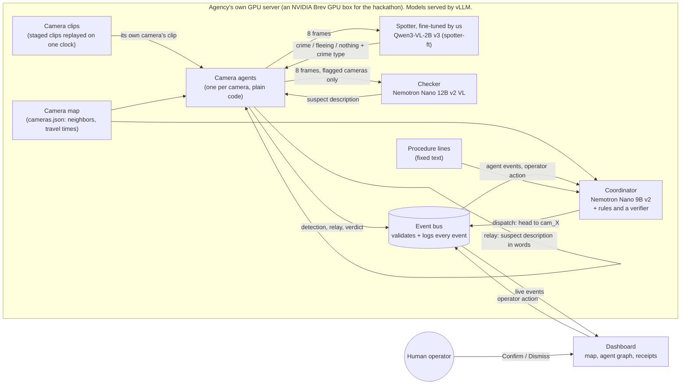

# Clarity

> When a crime happens, one dispatcher is watching dozens of camera feeds and has minutes to act. Clarity spots the crime, follows the suspect from camera to camera, and tells officers where to head next.

Clarity puts a small AI agent beside each security camera. When its camera shows a crime, the agent describes the suspect in words and passes the description to the cameras along the suspect's likely path. A coordinator agent pulls the reports together and recommends where officers should go, and a human operator confirms or dismisses every recommendation on a map. Video stays on the agency's own hardware; only text moves between agents.

**At its core is a small vision model we fine-tuned for one job.** Our spotter, Qwen3-VL-2B with a LoRA fine-tune (version "v3"), watches one camera and decides whether it shows a crime, someone fleeing, or nothing, and names the crime type. A larger vision model, NVIDIA Nemotron Nano 12B v2 VL (the **checker**), then describes the suspect on the cameras the spotter flags. Both look at 8 frames per camera. On 18 held-out test camera views, 3 runs each, scored the same way in NeMo Gym, the fine-tune raised the full system's score from 0.723 to 0.821, and the share of right calls (crime, fleeing or nothing) from 67% to 89%. <!-- source: hf_model/README.md ("Base vs this model") and results/history.csv (rows before_nemo_gym_8f, after_nemo_gym_v3_8f), Wali's commit e710f89; full system: mean reward of results/nemo_gym/clarity_system_before_gym_8f.jsonl and clarity_system_8f_v2.jsonl -->

Built in 24 hours at the **NVIDIA x Red Hat Small Models Hack** (Raleigh, Oct 17–18, 2026). **Track: Fine-Tuned.**

| | |
|---|---|
| Fine-tuned model | Qwen3-VL-2B + our LoRA, version v3, 2.13B parameters. **TODO (model link):** Hugging Face page. Model card: [`hf_model/README.md`](hf_model/README.md) |
| Base vs. fine-tuned | Full system 0.723 → **0.821**; spotter alone 0.374 → **0.456** (NeMo Gym, 18 held-out test views × 3 runs): [Results](#results) <!-- source: hf_model/README.md; mean reward of results/nemo_gym/clarity_system_before_gym_8f, clarity_system_8f_v2, clarity_before_gym_8f and clarity_after_gym_8f (.jsonl), Wali's commit e710f89 --> |
| Models and size | Spotter 2.13B + checker 13.18B + coordinator 8.89B = **24.20B**, under the 33B cap: [Models](#models-and-parameter-budget) <!-- source: exact counts in dispatcher/README.md ("Models and the 33B cap"), Michael's commit 56712cc --> |
| Demo | Live run on test clip 1: **pending** (the pipeline, checker included, is wired; the run on the GPU box is still to be recorded). The same chase already runs from the final system's recorded answers, without a GPU. Fallback: a [scripted replay of clip 8](#fallback-a-scripted-replay-of-clip-8). **TODO (live run):** demo video and screen-capture links |
| Open data | Test clip 8 published as [WilwilMina/clarity-clip8](https://huggingface.co/datasets/WilwilMina/clarity-clip8) (CC BY 4.0), with the [filming method](data/staged/README.md). Test clip 1, the live demo, published as [WilwilMina/clarity-clip1](https://huggingface.co/datasets/WilwilMina/clarity-clip1) (CC BY 4.0) |
| Bounty write-ups | [Best Use of Red Hat vLLM](#best-use-of-red-hat-vllm) · [Best Model Improvement with NeMo Gym](#best-model-improvement-with-nemo-gym) |

> **Names.** On screen and in this README the AI dispatcher agent is the **coordinator**; in code and message contracts it is `dispatcher`. "Dispatcher" in the opening line means the human at the console. The **spotter** is our fine-tuned 2B model; the **checker** is Nemotron Nano 12B v2 VL.

**Contents:** [Problem](#the-problem-and-the-user) · [Demo](#the-demo) · [How it works](#how-it-works) · [Results](#results) · [Track fit](#track-fit-fine-tuned) · [NeMo Gym](#best-model-improvement-with-nemo-gym) · [Models](#models-and-parameter-budget) · [vLLM](#best-use-of-red-hat-vllm) · [Data](#data) · [How to run](#how-to-run) · [Limitations](#known-limitations) · [Team](#team)

---

## The problem and the user

**User:** the operator in a police agency's real-time crime center, watching many camera feeds at once.

**Problem:** when a crime happens on one camera, the suspect leaves the frame within seconds. To follow them, the operator has to guess which camera they'll appear on next, find that feed and recognize the person, while every other feed keeps running. With more than one incident at a time, nobody can keep up by hand.

**What Clarity gives them:** an alert with a plain description of the suspect, the path across cameras so far, the cameras they are likely to reach next, and a recommendation ("head to cam_09") with the evidence behind it. The operator decides; Clarity never acts on its own.

**Why on site:** sending live footage of the public to an outside cloud service is a privacy risk. Clarity is designed to run entirely on the agency's own hardware, with the agents sharing only short text descriptions.

---

## The demo

### Live demo: test clip 1 (run pending)

Test clip 1 (take 3 in our clip log) is a mimed stabbing on a sidewalk, staged by our team with empty hands and no prop, and seen by 4 camera views along the suspect's escape: `cam_07` (the attack) → `cam_08` → `cam_09` → `cam_10`. It is a test clip, so the spotter never trained on it. Each view is a separate run of the scene, filmed one after another with one phone and replayed together as live cameras ([how](#how-the-staged-clips-were-made)). Its four views are published as [WilwilMina/clarity-clip1](https://huggingface.co/datasets/WilwilMina/clarity-clip1) (CC BY 4.0; no audio, no file metadata; [dataset card](data/staged/DATASET_CARD_clip1.md)). <!-- source: data/staged/README.md ("Clip 1: a second demo site"); labels.csv (split = test), Wali's commit e710f89; upload status from the main session -->

**Status:** every part of the live pipeline is built, and the camera agents now call both the spotter and the checker. The live run on the GPU box has not been recorded yet.

How the chase unfolds:

1. `cam_07`'s agent sends 8 frames to the spotter, which reports a crime, and the checker describes the suspect. The agent relays that description in words to the next camera on the map.
2. Each next camera's agent compares what its own camera shows with the description and answers "match", "uncertain" or "no match"; after a match it relays onward.
3. The coordinator combines these reports with the camera map and recommends where to send officers. Plain-code checks (the verifier) test every model answer first, and a fixed procedure line closes each recommendation.
4. The incident card turns to **Needs your decision**. The operator clicks **Confirm** or **Dismiss**, can open **Watch last sighting** to see the newest sighting's clip, and can click any message in **Receipts** to see the events it relied on.

**What the final system answered on clip 1** when we scored it (NeMo Gym, 8 frames, 3 runs per camera): <!-- source: results/nemo_gym/clarity_system_8f_v2.jsonl, tasks 0-3 (= clip1 cam1-cam4), Wali's commit e710f89; the same answers, text only, are in data/answers/clip1_system_v3_checker.json (written by data/gym_answers.py) -->

| Camera | Spotter (v3) | Checker: the suspect's top |
|---|---|---|
| `cam_07` (view 1) | crime, type "assault", in 3 of 3 runs | black hoodie |
| `cam_08` (view 2) | fleeing, 3 of 3 | black long-sleeve |
| `cam_09` (view 3) | fleeing, 3 of 3 | black hoodie |
| `cam_10` (view 4) | fleeing, 3 of 3 | black hoodie |

- **The crime type is wrong.** The spotter calls the mimed stabbing an "assault", as the base model does. The camera agents map `assault` to the contract label `fistfight`, so the incident is reported as a fistfight (medium priority), not a stabbing (high).
- **The chase works on these answers.** Replaying them through the real camera agents (no models, no GPU) gives the same chase in all 3 recorded runs: a crime at `cam_07`, reported as a fistfight, then a match at `cam_08`, `cam_09` and `cam_10` (confidence 0.95 each). All 10 events pass the contract check. These are recorded model answers, not a live run. <!-- source: reported by the main session, Sun Oct 18: python -m agents.run --answers data/answers/clip1_system_v3_checker.json --cameras data/sites/annex_clip1/cameras.json, once per recorded run; events checked with contracts/validate.py (10/10 valid) -->
- On clip 1 the base model makes the same crime and fleeing calls, so this clip shows the system at work rather than the gain from fine-tuning. That gain is measured over all test views in [Results](#results). <!-- source: results/nemo_gym/clarity_system_before_gym_8f.jsonl, tasks 0-3, Wali's commit e710f89 -->
- **TODO (live run):** run ID, what the live pipeline did on clip 1, and its timing.

### Fallback: a scripted replay of clip 8

If the live run isn't ready, the video uses the recorded run [`runs/run_1018-0028_r2s`](runs/run_1018-0028_r2s/RUN.md) (Sun Oct 18, 00:28–00:31 ET): test clip 8, a phone snatched at a bus shelter and seen by 3 camera views. In it the spotter and camera agents are **scripted** from clip 8's ground truth, and the coordinator's real code runs in **rules mode**. The dashboard shows **Scripted run**, and the video labels it "coordinator: rules mode". All 16 events pass `contracts/validate.py`. <!-- source: runs/run_1018-0028_r2s/RUN.md ("Event counts": 16/16) -->

**Why clip 8 is not the live clip:** on clip 8's crime camera, the fine-tuned spotter answers "nothing happens" in 3 of 3 runs, where the base model said crime. A live run on clip 8 would most likely start no chase, because only a crime report opens one. <!-- source: results/nemo_gym/clarity_system_8f_v2.jsonl task 13 (= clip8 cam1): on_screen "none" in 3 of 3; clarity_system_before_gym_8f.jsonl task 13: "crime" in 3 of 3 (Wali's commit e710f89); agents/adapter.py: only on_screen "crime" gives a crime activity -->

### What is real and what is scripted

| Part | Live demo (clip 1, pending) | Fallback `run_1018-0028_r2s` (clip 8) |
|---|---|---|
| Camera views | Real: clip 1's four views, replayed as cameras | Real: clip 8's three views (blurred copies), shown in **Watch last sighting** |
| Spotter | Real: fine-tuned v3 (`spotter-ft`) on vLLM, 8 frames per camera | **Scripted** from ground truth (events tagged `source: "fake_scenario"`) |
| Checker | Real: Nemotron Nano 12B v2 VL (`checker`) on vLLM, on the cameras the spotter flags, 8 frames | Not used |
| Camera agents | Real: plain code (`python -m agents.run --live`) | **Scripted** (same script) |
| Coordinator | Real: Nemotron Nano 9B v2 on vLLM | Real code in **rules mode** (the 9B model was stopped while the GPU trained the spotter) |
| Event bus, dashboard, the operator's Confirm / Dismiss | Real | Real |

<!-- source: runs/run_1018-0028_r2s/RUN.md; agents/README.md -->

**Three incidents at once (scripted events).** With three overlapping scripted incidents from `bus.fake_scenario`, the coordinator's live model kept up: the slowest bus poll went from 3.9 s to 2.3 s after batching, with no fallbacks, and officers were never sent to a decoy exit (0 of 14 dispatches). Our filmed demo shows one incident. <!-- source: dispatcher/IMPROVEMENTS.md, changes #5 and #9 (1 run each), Michael's commit 56712cc -->

The video's closing line: *"In a real deployment, no video leaves the building. Only words move between agents."* It describes how Clarity is **designed to be deployed**: every part runs on the agency's own hardware, and the agents exchange only text. In our hackathon demo, a rented NVIDIA Brev GPU box stands in for that hardware: the staged clips are copied to it, and the bus streams a camera's clip to the operator's laptop only when the operator opens a sighting. Between agents, only text moves in the demo too.

---

## How it works



- **Each agent sees only its own camera.** Between agents, and from agents to the coordinator, only words travel.
- **Two models look at video, each with one job.** The fine-tuned spotter screens every camera: crime, fleeing or nothing, and which crime. The checker runs only on the cameras the spotter flags and describes the suspect (clothing and build). The camera agents themselves are plain code: matching a relayed description at the next camera is a field-by-field comparison (`agents/matching.py`). Fields either side couldn't see are skipped, a match needs at least one agreeing feature, and an impossible travel time is a no-match. <!-- source: nemo_gym/combine_gym.py (checker only on flagged cameras), Wali's commit e710f89; agents/README.md -->
- **The coordinator** handles clear cases (such as a stabbing) with rules and no model call, sends ambiguous ones to its model with a JSON schema, and checks every model answer with a verifier: it must cite only evidence from the case, mention only the case's cameras, send officers where the suspect is heading, and stay within the priority the crime allows. A rejected answer gets one retry, then a safe fallback ("Operator review needed"). The coordinator stops at startup if its model isn't served, instead of falling back silently. Each recommendation ends with a fixed procedure line per crime type (`dispatcher/guidance.py`); we cut the planned search over procedures (RAG). <!-- source: dispatcher/README.md, Michael's commit 56712cc; startup check: Michael's commit b99d126, as reported by the main session -->
- **Every message is a small JSON event** defined in [`contracts/`](contracts/README.md): `detection`, `relay`, `agent_verdict`, `dispatch`, `operator_action`, `camera_status`. Every decision lists the event IDs it relied on (`evidence_event_ids`), which is the receipts trail on the dashboard. The bus appends every accepted event to `runs/<run_id>/events.jsonl`, so any run can be replayed.
- **Deterministic work is plain Python**, not a model: timing, matching, validation, scoring, the verifier.
- **Deployment vs. our demo.** In a real deployment the dashboard runs inside the agency too. In the demo, the Brev GPU box plays the agency's server, and the dashboard runs on a laptop that reaches the bus through `brev port-forward`. Over that link the laptop receives the events and, when the operator opens a sighting, that camera's clip (`GET /clips/{camera_id}`).

### The fine-tuned spotter

**Its one job.** Given 8 frames from one camera, in time order, the spotter answers in a fixed JSON format: what happens, in a sentence; what is on screen (a **crime**, someone **fleeing**, or **nothing**); the crime type (**stabbing**, **assault** or **stealing**); and the suspect, field by field. In the final system the checker's suspect fields replace the spotter's on the cameras it flags. The camera agents turn the answer into a `detection` event and rename the crime to the contract's labels: `assault` becomes `fistfight`, `stealing` becomes `purse_snatch`, `stabbing` stays. Only the camera where the crime is on screen gets a crime label. <!-- source: src/spotter_prompt.py and nemo_gym/combine_gym.py (Wali's commit e710f89); agents/adapter.py -->

**Why fine-tune.** A 2B model is small enough to run beside every camera on an agency's own hardware, but out of the box it misreads the scene: with 8 frames per camera, the base model made the right call in 67% of its answers and named the crime type right in 17%. <!-- source: results/history.csv row before_nemo_gym_8f (0.667, 0.167), Wali's commit e710f89 -->

**How it is trained.** <!-- source: src/finetune.py, src/make_train_data.py, src/merge_lora.py and hf_model/README.md (Wali's commit e710f89); VLLM_BOUNTY.md (Michael's commit 56712cc) -->

- **Base model:** `Qwen/Qwen3-VL-2B-Instruct` (2.13B parameters).
- **Method:** a LoRA fine-tune, rank 16 (`src/finetune.py`; PyTorch, Transformers, PEFT). The LoRA add-on sits on the language model; the vision encoder stays frozen. Each training example is the exact request the spotter sends when Clarity runs (frames + prompt) followed by the correct JSON answer, and the loss counts only the answer.
- **v3 learns only the crime fields:** what is on screen and the crime type (`src/finetune.py --learn-fields` limits training to chosen answer fields). Why: [How we chose v3](#how-we-chose-v3).
- **Data:** the train split of our staged clips, possibly plus 11 public clips ([details](#what-the-final-spotter-was-trained-on)). Never the test split.
- **Served as merged weights:** vLLM 0.11 crashes when serving a LoRA on Qwen3-VL with image inputs, so `src/merge_lora.py` merges the add-on into a full copy of the base model, which vLLM serves as `spotter-ft`.
- **Published:** **TODO (model link).** Model card: [`hf_model/README.md`](hf_model/README.md).

### Parts and status

| Part | Where | Owner | Status |
|---|---|---|---|
| Spotter fine-tune (Qwen3-VL-2B, LoRA, train/test split) | `src/finetune.py`, `src/merge_lora.py` | Wali | Built: v3 trained, merged, served as `spotter-ft` and scored in NeMo Gym |
| Checker (Nemotron Nano 12B v2 VL) | `src/checker.py`, `src/checker_prompt.py` | Wali | Built: `describe()`, scored in NeMo Gym as part of the system |
| NeMo Gym environment and scoring | `nemo_gym/`, `src/make_gym_tasks.py` | Wali | Built |
| Camera agents and spotter adapter | `agents/` | Mina's side (with Claude Code), Wali's OK | Built: they call the spotter, then the checker on flagged cameras; unit tests in `agents/tests` |
| Camera graph (`graph.predict_next`) | — | Wali | Not merged; the coordinator uses its built-in fallback (unvisited neighbors of the last camera, weighted by direction) |
| Coordinator (rules, model, verifier) | `dispatcher/` | Michael | Built |
| Model serving on vLLM | `infra/` | Michael | Built: coordinator (port 8003), fine-tuned spotter (8005) and checker (8002) on one A100, base spotter (8001) for the comparison. The checker runs from Wali's `infra/serve_checker.sh`; the three models haven't run side by side on the box yet |
| Message contracts and validator | `contracts/` | shared | Built |
| Event bus (server, client, scripted scenario, replay, run metrics) | `bus/` | Mina | Built |
| Camera feeds (clips replayed as cameras) | `feeds/` | Mina | Built |
| Staged clips, camera maps, ground truth, recorded answers | `data/` | Mina | Clips 8 and 1 published; clip 1's site built |
| Dashboard | `dashboard/` | Mina | Built |
| Lookup (RAG with Nemotron Embed + Rerank) | — | Michael | Cut; replaced by fixed procedure lines |

<!-- source: VLLM_BOUNTY.md and dispatcher/README.md (Michael's commit 56712cc); hf_model/README.md and results/history.csv (Wali's commit e710f89); data/staged/README.md -->

### Tech stack

| Layer | Tools |
|---|---|
| Models | Qwen3-VL-2B with our LoRA merged in (spotter, `spotter-ft`); Nemotron Nano 12B v2 VL (checker); Nemotron Nano 9B v2 (coordinator) |
| Fine-tuning | PyTorch, Hugging Face Transformers and PEFT (LoRA), in their own environment on the Brev box |
| Serving | vLLM 0.11.0 (OpenAI-compatible API) on an NVIDIA Brev GPU instance (A100 80 GB) <!-- source: VLLM_BOUNTY.md --> |
| Measurement | NeMo Gym environment `clarity_spotter`; `src/bench.py` (spotter load test); `scripts/bench_dispatcher.py` (coordinator load test); `bus/metrics.py` (run timings) |
| Agents and pipeline | Python 3.10+, OpenAI-compatible client with JSON-schema outputs, OpenCV |
| Event bus | FastAPI, uvicorn, WebSockets, jsonschema |
| Dashboard | Vite, React, TypeScript, react-leaflet, OpenStreetMap tiles |

---

## Results

Every number here comes from our own logged runs; the source is noted next to each one in the page source. Samples are small, so read them as engineering measurements, not a benchmark.

### The fine-tuned spotter: base vs. v3

The same 18 held-out test camera views (from 7 test clips: 6 views show the crime, 10 show the suspect fleeing, 2 show nothing happening), 3 runs each (54 answers per model), 8 frames per camera, the same NeMo Gym tasks and scoring. Only the spotter changes; the checker is the same in both columns. <!-- source: labels.csv (split = test) and hf_model/README.md, Wali's commit e710f89 -->

| | Base `Qwen/Qwen3-VL-2B-Instruct` | Fine-tuned v3 |
|---|---|---|
| **Full system score**: spotter decides crime and type, checker describes the suspect on flagged cameras | 0.723 | **0.821** |
| **Spotter score**: the spotter alone, its own suspect description included | 0.374 | **0.456** |
| Right call: crime, fleeing or nothing (all 54 answers; "crime spotted" in the model card) | 67% | **89%** |
| Right crime type (answers on the 6 crime views) | 17% | **33%** |
| False alarms (answers on the 2 views where nothing happens) | 0% | 0% |
| Suspect description with the checker (crime and fleeing views) | 0.751 | **0.804** |
| Suspect description, spotter alone (crime and fleeing views) | 0.293 | **0.329** |
| Spotter answers not cut off | 51 of 54 | **54 of 54** |

Sources, all in this repo and recomputable: [`hf_model/README.md`](hf_model/README.md), `results/history.csv`, and the rollouts in `results/nemo_gym/`: `clarity_before_gym_8f.jsonl` (base), `clarity_after_gym_8f.jsonl` (v3), `clarity_system_before_gym_8f.jsonl` (base + checker) and `clarity_system_8f_v2.jsonl` (v3 + checker), 54 rows each.
<!-- source detail (files from Wali's commit e710f89): hf_model/README.md ("Base vs this model"); results/history.csv rows before_nemo_gym_8f (0.667 / 0.167 / 0.0 / description 0.293 / failed 3), after_nemo_gym_v3_8f (0.889 / 0.333 / 0.0 / 0.329 / failed 0) and system_v3_plus_checker_v2_8f (description 0.804). Re-computed for this README: mean "reward" of the 54 rows = 0.3738 (clarity_before_gym_8f), 0.4560 (clarity_after_gym_8f), 0.7232 (clarity_system_before_gym_8f), 0.8210 (clarity_system_8f_v2); mean "description_score" over the 48 crime and fleeing rows = 0.7508 (clarity_system_before_gym_8f) and 0.8035 (clarity_system_8f_v2). The 3 base answers cut off show "incomplete_details": {"reason": "max_output_tokens"} in clarity_before_gym_8f.jsonl. The earlier 4-frame runs are not used here. -->

**How to read it.**

- **Score:** NeMo Gym gives each answer the share of checks it passes (1.0 = all right): the call (crime, fleeing or nothing) on every view, the crime type on crime views, "no false alarm" on views where nothing happens, and one check per labeled suspect field (build, height, shirt, pants, shoes, glasses, headwear, hair, bag, weapon, vehicle) on crime and fleeing views. Fields labeled blank or "unknown" are skipped; build, height and glasses must match exactly, the other fields when at least half of the label's words appear. The table shows the mean over 54 answers. <!-- source: nemo_gym/clarity_spotter/app.py verify(), Wali's commit e710f89 -->
- **Suspect description:** for each answer on a crime or fleeing view, the share of the labeled suspect fields it gets right, averaged over those answers.
- **Spotter alone vs. spotter + checker:** in the full system the spotter's answer still decides the call and the crime type; only on the cameras it flags does the checker's description replace the spotter's. So the call, type and false-alarm rows hold for both, and the jump from the spotter score to the full-system score (0.456 → 0.821 with v3) comes from the checker's descriptions (0.329 → 0.804). The fine-tune still matters there: the checker only describes cameras the spotter flags, and v3 flags fleeing suspects that the base model misses, which is why the description with the checker is better with v3 (0.804) than with the base model (0.751). <!-- source: nemo_gym/combine_gym.py; clarity_system_before_gym_8f.jsonl vs clarity_system_8f_v2.jsonl: tasks 8-9 (clip4 cam2-cam3, fleeing) base "none" -> own fields 0.29, v3 "fleeing" -> checker 0.86; task 13 (clip8 cam1) base flagged -> 0.6, v3 missed -> 0.3 (Wali's commit e710f89) -->
- **A cut-off answer** counts as a wrong call, and as no false alarm.

**Where v3 is worse.** On clip 8's crime camera (the phone snatch), v3 answers "nothing happens" in 3 of 3 runs, where the base model said crime. It is the only crime view v3 misses; the base model flagged all 6. v3 also calls clip 1's mimed stabbing an assault, as the base model does. <!-- source: results/nemo_gym/clarity_system_8f_v2.jsonl and clarity_system_before_gym_8f.jsonl, crime views = tasks 0, 4, 7, 11, 13, 17 (Wali's commit e710f89) -->

#### How we chose v3

Wali trained and scored several versions in NeMo Gym; every version's scores are in [`hf_model/README.md`](hf_model/README.md) and `results/history.csv`.

- **v1** learned every answer field from our clips; **v2** added 11 public clips. Both scored higher on the test views, but they had memorized the outfits of our few actors, who appear in the test clips in the same clothes. On a new clip they copied a training suspect's clothes onto the wrong person, and v1 raised false alarms on scenes where nothing happens.
- **v3** learns only the crime decision and the crime type. The suspect description comes from the checker instead.
- **v4 and v5** added the public training clips we prepared (AIRTLab, MEVA, Mixkit) and scored lower, and so did a v3 retrained on 8-frame examples. The final system uses v3.

<!-- source: hf_model/README.md ("Improvement at every training run" and its note); results/history.csv rows after_nemo_gym_v1 to v5 and after_nemo_gym_v3_trained_8f (Wali's commit e710f89) -->

**Caveats.**

- **Small test set from one setting.** 18 views from 7 clips, filmed the same afternoon at the same site with the same few people as the training clips. The test shows what the system learned in this setting, not that it works anywhere.
- **We also chose with these views.** Versions, frame counts and checker prompts were all compared on the same 18 test views, so the test split guided our choices too; a fresh test set would give a cleaner number. The checker's description prompt was developed on the train split. <!-- source: results/history.csv; src/checker_prompt.py ("Developed on the train split only"), Wali's commit e710f89 -->
- **False alarms rest on few answers.** Only 2 test views show nothing happening (6 answers per model), and 3 of the base model's 6 answers there were cut off; a cut-off answer counts as no false alarm. <!-- source: clarity_system_before_gym_8f.jsonl task 10 (= clip7 cam1): 3 failed answers; clarity_before_gym_8f.jsonl: 3 answers cut off at max_output_tokens (Wali's commit e710f89) -->
- **One easy field.** The checker answered height "average" every time, and every height label in the test split is "average", so that field is always right and the description part of the score is a little generous. <!-- source: results/history.csv row system_v3_plus_checker_v2_8f ("height always 'average'"); labels.csv (Wali's commit e710f89) -->
- **Labels.** Wali's notes say the labels were drafted with an AI assistant from sampled frames, then checked by the team. One disagreement is still open (the suspect's glasses and hair in some test clips); both models are scored against the same labels. <!-- source: Wali's labeling notes (commit e710f89); open label question from the team's review notes (glasses on the clip 1/7/8 suspect, hair in clips 1 and 7; labels.csv still says no glasses) -->
- **Partly re-scorable.** Only test clip 8 is published so far, and clips 4 and 12 won't be, so outsiders can re-score only part of the test split. The published clip 8 is blurred ([dataset card](data/staged/DATASET_CARD.md)), so scores on it may differ a little from runs on the originals.

### Serving many cameras and incidents at once on vLLM

Load tests on the team's Brev GPU box (one A100 80 GB, shared by our models). Throughput grows much faster than latency as requests overlap, because vLLM batches them.

**Spotter** (base `Qwen/Qwen3-VL-2B-Instruct` on 0.2 of the A100's memory, 4 frames per request, measured before we moved to 8 frames; 32 requests per level, 0 errors at every level): <!-- source: results/vllm_bench.json (Wali); memory share: VLLM_BOUNTY.md -->

| Cameras at once | p50 latency | p95 latency | Cameras per minute |
|---|---|---|---|
| 1 | 0.671 s | 0.784 s | 87.9 |
| 2 | 0.627 s | 0.743 s | 184.2 |
| 4 | 0.681 s | 0.790 s | 344.2 |
| 8 | 0.766 s | 0.927 s | 578.7 |
| 16 | 1.068 s | 1.363 s | 777.7 |
| 32 | 1.651 s | 1.805 s | 992.8 |

At 32 cameras at once: 11.3× the throughput of one camera, for 2.5× the median latency. <!-- source: 992.8 / 87.9 = 11.3; 1.651 / 0.671 = 2.5 -->

**Coordinator** (Nemotron Nano 9B v2, real coordinator prompt and JSON schema, 16 requests per level, every answer passed the verifier). Two runs with the same settings; the table is run 1: <!-- source: dispatcher/README.md and dispatcher/IMPROVEMENTS.md, "Serving throughput" (Michael's commit 56712cc) -->

| Requests at once | p50 latency | p95 latency | Requests/s | Output tokens/s |
|---|---|---|---|---|
| 1 | 1.53 s | 1.54 s | 0.65 | 68 |
| 4 | 1.85 s | 1.86 s | 2.16 | 223 |
| 8 | 2.25 s | 2.34 s | 3.51 | 362 |
| 16 | 3.14 s | 3.16 s | 4.99 | 514 |

Run 2 (a repeat on Sat Oct 17 night, GPU shared with the spotter): 65 → 477 output tokens/s and p50 1.55 → 3.39 s from 1 to 16 at once; 64 of 64 answers passed the verifier; one slow outlier at 4 at once (p95 5.6 s). <!-- source: dispatcher/IMPROVEMENTS.md, "Run-to-run variation" (code at df3a804) -->

At 16 at once, over both runs: 477–514 output tokens/s, about 7× one request (7.3–7.6×), for about 2× the latency. <!-- source: the two runs above; 477/65 = 7.3x, 514/68 = 7.6x; p50 3.39/1.55 = 2.2x, 3.14/1.53 = 2.1x -->

### End to end

**TODO (live run):** time from the crime on camera to the coordinator's recommendation, from the bus logs of the live clip-1 run (`python -m bus.metrics runs/<run_id>`). The scripted fallback's timings follow the script's pacing, not model speed, so we don't report them (`bus.metrics` labels such runs as scripted).

### Not measured

- Our camera agents against one model doing the whole job.
- Load tests with v3 at 8 frames per camera, and with the checker on the same GPU.
- A check on footage filmed elsewhere that was never used in training ([why](#what-the-final-spotter-was-trained-on)).

---

## Track fit: Fine-Tuned

In our own words, the Fine-Tuned track asks for a small open model specialized with data for one clear job, a fair before-and-after on test data the model never saw, and a working system in which the specialized model does real work.

| What the track looks for (our paraphrase) | In Clarity |
|---|---|
| A small model, specialized for one job | Qwen3-VL-2B (2.13B), LoRA fine-tuned (v3) to call crime, fleeing or nothing on one camera and name the crime type |
| Data behind the specialization | Clips our team filmed and labeled during the hack (train split), possibly with 11 public clips ([what v3 was trained on](#what-the-final-spotter-was-trained-on)). Test clip 8 is published with the method |
| A fair before-and-after | Base vs. v3 on the same 18 held-out test views, 3 runs each, with the same NeMo Gym tasks, frames, checker and scoring: full system 0.723 → 0.821 ([Results](#results)) <!-- source: hf_model/README.md and results/nemo_gym/ (Wali's commit e710f89) --> |
| The model doing real work | v3 screens every camera, and its crime call is what starts a chase: the camera agents open an incident only where it reports a crime, then relay the suspect description from camera to camera, and the coordinator recommends where to send officers. On clip 1's recorded answers the chase runs end to end through the camera agents ([The demo](#the-demo)). **TODO (live run):** run ID of the live clip-1 run |
| The published model | **TODO (model link)** |

---

## Best Model Improvement with NeMo Gym

Wali built a NeMo Gym environment that scores the spotter's one job, and we used it to measure every training version and the full system. Sources, all in this repo: `nemo_gym/clarity_spotter/` (`app.py`, `configs/clarity_spotter.yaml`), `nemo_gym/combine_gym.py`, `nemo_gym/gym_summary.py`, `src/make_gym_tasks.py`, `results/history.csv` and the 8-frame rollouts in `results/nemo_gym/`. <!-- files from Wali's commit e710f89 -->

**Setup.**

- **Tasks:** one per held-out test camera view, 18 in all, built by `src/make_gym_tasks.py` from `labels.csv`. Each task is exactly the request the spotter sends when Clarity runs (the same frames, prompt and JSON answer format, temperature 0) plus the hand-made label. `--frames 8` gives the final setting; `--task describe` builds the checker's request for the same views.
- **Agent:** NeMo Gym's `simple_agent` with `max_steps: 1`: the model under test (`policy_model`) answers once per task. It has no tools; the job is one answer per camera.
- **Scoring:** `verify()` in `app.py` grades each answer against the label: the call, the crime type, false alarms and the suspect's fields ([how to read the scores](#the-fine-tuned-spotter-base-vs-v3)). The reward is the share of checks passed. NeMo Gym collected 3 rollouts per task.
- **Full system:** `nemo_gym/combine_gym.py` takes the spotter's rollouts and the checker's description rollouts, uses the checker's suspect fields only on the cameras the spotter flagged (as the pipeline does), and grades the result with the same rules.

**Baseline vs. final** (same tasks, environment and scoring; full table in [Results](#the-fine-tuned-spotter-base-vs-v3)): <!-- source: hf_model/README.md and results/history.csv, Wali's commit e710f89 -->

- full system score 0.723 → **0.821**
- spotter score 0.374 → **0.456**
- right call 67% → **89%**
- right crime type 17% → **33%**
- false alarms 0% → 0% (2 views, see the caveats)
- suspect description with the checker 0.751 → **0.804** (spotter alone 0.293 → 0.329)
- spotter answers not cut off: 51 of 54 → **54 of 54**

**What caused the gain.** Between baseline and final only the spotter changed: same tasks, frames, prompt, checker and scoring. The final spotter is our LoRA fine-tune of the same base model (`src/finetune.py`), supervised training in which each example is a spotter request with its correct JSON answer, and v3 learns only the crime fields. NeMo Gym is where we compared every version, and those comparisons shaped the final design: learn only the crime fields (v1 and v2 memorized outfits), let the checker write the description, leave out the extra public clips (v4 and v5 scored lower), and run v3 with 8 frames ([How we chose v3](#how-we-chose-v3)).

**How to run the scoring.** Build the tasks from the repo root:

```bash
python src/make_gym_tasks.py --frames 8                                    # spotter tasks -> nemo_gym/clarity_spotter/data/test.jsonl
python src/make_gym_tasks.py --frames 8 --task describe --out <describe.jsonl>   # the checker's tasks for the same views
```

Its defaults read `labels.csv` and the clips in `video-data/custom-clips` (not in this repo; test clip 8 is published, see [Data](#data)). In NeMo Gym, the environment goes in `resources_servers/clarity_spotter/` (where `configs/clarity_spotter.yaml` expects it), `policy_model` points at the model under test (base spotter on port 8001, fine-tuned on 8005, or the checker), and NeMo Gym collects 3 rollouts per task. Then, from the NeMo Gym folder:

```bash
python <repo>/nemo_gym/combine_gym.py SPOTTER.jsonl DESCRIBE.jsonl SYSTEM.jsonl   # the two-model system, same grader
python <repo>/nemo_gym/gym_summary.py base BEFORE.jsonl v3 AFTER.jsonl            # mean reward, call, crime type, false alarm, description, answered
```

**Limits.** 18 tasks, only 2 of them without a crime; one site and cast, shared with the training clips; the same views were used to compare versions.

---

## Models and parameter budget

The hackathon cap is **33B parameters in total** across all generative language models, verifiers and routers included; embedding and reranking models don't count. Our verifier is plain code, not a model.

| Role | Model | Parameters[^params] | In the final system | Served |
|---|---|---|---|---|
| Spotter, fine-tuned by us: crime, fleeing or nothing and the crime type, on every camera | `Qwen/Qwen3-VL-2B-Instruct` with our LoRA (v3) merged in | 2,127,532,032 | Yes | vLLM, port 8005, as `spotter-ft` (0.2 of the A100, ~14.8 GB measured) |
| Checker: describes the suspect on flagged cameras | `nvidia/NVIDIA-Nemotron-Nano-12B-v2-VL-BF16` | 13,181,860,358 | Yes | vLLM, port 8002, as `checker` (0.40 of the A100, `infra/serve_checker.sh`) |
| Coordinator: recommends where to send officers | `nvidia/NVIDIA-Nemotron-Nano-9B-v2` | 8,888,227,328 | Yes | vLLM, `127.0.0.1:8003`, as `dispatcher` (0.30 of the A100, ~26.8 GB measured) |
| Base spotter, for the before/after only | `Qwen/Qwen3-VL-2B-Instruct` | 2,127,532,032 | No | vLLM, port 8001 (0.2 of the A100, ~14.8 GB measured); off during the live run |

| What we count | Total | Within 33B? |
|---|---|---|
| **Final system:** spotter + checker + coordinator | **24.20B** | Yes, 8.80B to spare |
| Every model we served, adding the base spotter kept for the comparison | 26.33B | Yes |

<!-- source: exact counts from dispatcher/README.md ("Models and the 33B cap") and VLLM_BOUNTY.md (Michael: 56712cc; checker on :8002 as part of the final system since 79c6bff); measured memory shares from VLLM_BOUNTY.md; checker 0.40 and base-off plan from the main session; sums: 2,127,532,032 + 13,181,860,358 + 8,888,227,328 = 24,197,619,718; + 2,127,532,032 = 26,325,151,750 -->

- No embedding or reranking models: the lookup step (Nemotron Embed + Rerank) was cut.
- The fine-tuned spotter is stored as full merged weights (`src/merge_lora.py`), so it has the same count as the base.

[^params]: Exact counts from the published safetensors files, as listed in `dispatcher/README.md` ("Models and the 33B cap"). The fine-tuned spotter has the base model's architecture, so the same count. Earlier team notes rounded the same three-model plan to ≈23.6B (2 + 12.6 + 9).

**Why these models.**

- **Small enough to run on site.** One A100 80 GB held the coordinator (0.30 of its memory) and both spotters (0.2 each), 0.70 in total. For the live run the plan is the checker (0.40), the coordinator (0.30) and the fine-tuned spotter (0.20) on the same GPU, with the base spotter off. <!-- source: VLLM_BOUNTY.md (measured shares); live-run plan from the main session -->
- **Right size for each job.** The 2B spotter looks at every camera; the larger checker only at the cameras the spotter flags; the coordinator works with text only.
- **vLLM for many cameras and incidents at once:** one OpenAI-compatible API for every model, JSON-schema outputs, and batching. Measured in [Results](#serving-many-cameras-and-incidents-at-once-on-vllm).

---

## Best Use of Red Hat vLLM

vLLM serves every model the pipeline runs: the coordinator's model, our fine-tuned spotter and the checker (plus the base spotter for the before/after comparison), on one A100 80 GB behind vLLM's OpenAI-compatible API. Michael's full write-up, with every flag and both coordinator load-test runs, is [`VLLM_BOUNTY.md`](VLLM_BOUNTY.md). Sources for this section: `VLLM_BOUNTY.md`, `dispatcher/IMPROVEMENTS.md`, `dispatcher/README.md` and `infra/serve_dispatcher.sh` (Michael), and `results/vllm_bench.json` (Wali). <!-- source: Michael's commits 56712cc (dispatcher, measurements) and 79c6bff (VLLM_BOUNTY.md: checker served on :8002 as part of the final system) -->

**How it fits.** The coordinator's model, Nemotron Nano 9B v2, runs on vLLM 0.11.0 on port 8003 as `dispatcher`. The coordinator calls it with `temperature=0`, `max_tokens=400` and a JSON schema, so answers come back in the shape of a `dispatch`, and the verifier checks each one. The fine-tuned spotter runs as `spotter-ft` on port 8005 (the base on 8001) and the checker as `checker` on port 8002. Both answer through a JSON schema at temperature 0, so the spotter's `on_screen` and `crime` fields are fixed choices our code can check, and the checker returns exactly the suspect fields the agents compare. The camera agents call the models for each camera's clip as soon as it has played, in parallel, so vLLM can batch the calls. <!-- source: VLLM_BOUNTY.md ("What vLLM does", "Why vLLM" point 2); src/spotter.py; src/checker.py; agents/run.py -->

**How we configured it.** During the hack one A100 80 GB was shared by three vLLM servers: the coordinator took 0.30 of its memory (~26.8 GB measured) and the base and fine-tuned spotters 0.2 each (~14.8 GB each), 0.70 in total. For the live run the plan is the checker at 0.40 with the base spotter off. The coordinator's server has an 8,192-token context and up to 16 concurrent sequences; the spotter servers allow 16,384 tokens, because each request carries several camera frames as images. The coordinator's server listens only on `127.0.0.1`; the runbook starts the other servers the same way (the spotter servers running during the hack get `--host 127.0.0.1` at their next restart). vLLM stays pinned at 0.11.0 because newer releases fail with this GPU's driver. The coordinator sends model calls for different incidents in parallel (up to 8, below vLLM's 16) so vLLM can batch them. Full commands: [Reproduce the demo](#reproduce-the-demo), step 3; each flag is explained in `VLLM_BOUNTY.md`. <!-- source: infra/serve_dispatcher.sh and VLLM_BOUNTY.md, "Configuration" (Michael); live-run plan from the main session -->

**What we changed, and what it measured** (coordinator; one change at a time, same scenario; small samples): <!-- source: dispatcher/IMPROVEMENTS.md (Michael's commit 56712cc) -->

| Change | Before | After |
|---|---|---|
| Removed `maxLength` from the JSON schema (lengths are checked by the verifier instead) | 13.3 s per call, 8 tokens/s | 1.6 s per call, ~65 tokens/s (2 + 2 calls) |
| Removed `/no_think` from the system prompt | 0 of 5 answers valid, 5.6 s | 5 of 5 valid, 1.5 s |
| Batch each bus poll, call the model for different incidents in parallel, skip repeated events (3 overlapping incidents) | slowest poll 3.9 s, 18 model calls | slowest poll 2.3 s, 15 model calls, 0 fallbacks (1 run) |
| Retry once on unparseable JSON | 1 fallback in 15 dispatches | 0 fallbacks in 36 calls |

**Measured results.** Continuous batching: the coordinator reaches 477–514 output tokens/s at 16 requests at once (two runs), about 7× one request (7.3–7.6×), for about 2× the latency, and every answer passed the verifier. The base spotter handles 992.8 cameras per minute at 32 at once: 11.3× one camera, for 2.5× the median latency, with no errors. Tables: [Results](#serving-many-cameras-and-incidents-at-once-on-vllm). <!-- source: dispatcher/IMPROVEMENTS.md, "Serving throughput" (run 1: 68 -> 514 tok/s) and "Run-to-run variation" (run 2: 65 -> 477 tok/s, 64/64 verified); results/vllm_bench.json -->

**Tried, didn't help.**

- **Serving the fine-tuned spotter as a LoRA add-on** (`--enable-lora`) crashes on vLLM 0.11 with Qwen3-VL and image inputs. Workaround: merge the LoRA into the base weights (`src/merge_lora.py`) and serve the merged model as its own model, `spotter-ft`.
- **Prefix caching** is switched on, but vLLM 0.11 does not apply it to this hybrid Mamba model (its cache counter stayed at 0), so we don't claim it.
- A per-request setting to drop whitespace from structured output was accepted but ignored; the one JSON retry covers the occasional runaway whitespace instead.

**Why vLLM.** Local inference on hardware we control (the privacy case), one API for vision models and a language model, JSON-schema outputs our code can rely on, several models on one GPU with a memory limit each, and batching that lets one GPU keep up with many cameras at once.

---

## Data

### Sources and licenses

| Source | How we use it | License | Attribution |
|---|---|---|---|
| **Our staged clips** (13 clips, 34 camera views, filmed by the team on Oct 17) | Spotter training (train split) and testing (test split), kept apart; the demo's camera views (clip 1 live, clip 8 fallback); ground truth. **Our published copies:** clip 8 as [WilwilMina/clarity-clip8](https://huggingface.co/datasets/WilwilMina/clarity-clip8) (passers-by blurred, no audio, no file metadata; [dataset card](data/staged/DATASET_CARD.md)). Clip 1 (the live demo) as [WilwilMina/clarity-clip1](https://huggingface.co/datasets/WilwilMina/clarity-clip1) (no blur needed, no audio, no file metadata; [dataset card](data/staged/DATASET_CARD_clip1.md)). | CC BY 4.0 (clips 8 and 1) | Credit line below |
| **CAVIAR** (8 acted clips from one lobby camera) | First set aside to check the spotter on footage filmed elsewhere; added to training in v2 ([see below](#what-the-final-spotter-was-trained-on)) | CC BY-SA | Below |
| **MEVA** | 3 example clips: as for CAVIAR. Cut clips (ours, and a batch Michael cut with `scripts/meva_training_clips.py`): extra training clips; MEVA cuts went into v4 and v5, not the final model | CC BY 4.0 | Below |
| **AIRTLab** violence dataset (staged clips by non-professional actors, 2 viewpoints) | Extra training clips, used in v4 and v5, not in the final model | Research/education only; a model trained on them must say so on its model card. Link only, never re-hosted | Below |
| **Mixkit** | Extra training clips (pages listed in `data/training/public_clips_candidates.csv`), used in v4 and v5, not in the final model | Mixkit Stock Video Free License, link only; its Acceptable Use Policy is unread | Not required by its license; see below |
| **OpenStreetMap** | Dashboard base map around the Red Hat Annex, Raleigh | ODbL | "© OpenStreetMap contributors" (shown on the map) |

<!-- source: data/README.md, data/training/SOURCES.md, data/staged/README.md and data/staged/DATASET_CARD.md; 13 clips / 34 camera views: labels.csv; v4/v5 data: results/history.csv model names ("v3 + Mina public clips"), hf_model/README.md (Wali's commit e710f89); public clip lists: data/training/labels_public.csv (AIRTLab, Mixkit, MEVA rows) -->

Clip names, license checks and caveats are in [`data/README.md`](data/README.md) and `data/training/SOURCES.md`, which also lists the public datasets we rejected and why.

**Stabbing is mimed.** We found no openly licensed stabbing footage, and we never stage scenes with knives or anything that looks like one, so the stabbings in our clips are acted out with empty hands. (The AIRTLab stabbing clips are research/education only, see above.)

### What the final spotter was trained on

- **Our staged clips, train split:** clips 2, 5, 6, 9, 10 and 11 (16 camera views), each view labeled with what happens, the crime type and the suspect's clothing and build. v3 learns only the crime fields of these labels. <!-- source: labels.csv (split = train), Wali's commit e710f89 -->
- **Possibly 11 public clips** (8 CAVIAR, 3 MEVA example clips). We first set them aside to check the spotter on footage filmed elsewhere. Wali's version history adds them in v2, and his label file marks all 11 as training data; it doesn't say whether v3's training kept them. So we report no check on outside footage. <!-- source: hf_model/README.md (v2 "+ 11 public clips"); labels_external.csv (split = train for all 11), Wali's commit e710f89 -->
- **Not** the extra public clips (AIRTLab, MEVA cuts, Mixkit): those went into v4 and v5, which scored lower.
- **Never** the test split: clips 1, 3, 4, 7, 8, 12 and 13. <!-- source: labels.csv (split column) and Wali's notes (commit e710f89); Wali confirmed clip 8 is test-only on Oct 17 -->

### How the staged clips were made

The full method, with clip 8's and clip 1's positions and timing, is in [`data/staged/README.md`](data/staged/README.md). The short version:

- **Who and what:** our team staged one incident per clip, or a scene where nothing happens; no weapons or weapon-like props, and stabbings are mimed with empty hands. Clip 8's two actors are team members who agreed to publication; both people in clip 1 agreed to be filmed, and a teammate checked its views for bystanders before upload.
- **The 13 clips:** test clips are mimed stabbings (1, 3, 4), a pickpocket (7), a phone snatch (8), an assault (13) and a scene with nothing happening (12). Training clips are mimed stabbings (2, 5), an assault with a theft (6), a car theft (9), an assault (10) and a scene with nothing happening (11). <!-- source: labels.csv, Wali's commit e710f89 -->
- **Where and when:** sidewalks, a plaza, a cafe patio, a bus shelter and a parking garage around the Red Hat Annex in Raleigh, plus a few indoor views, on Oct 17 between about 4:05 and 5:40 PM. <!-- source: the team's camera-position sheet, camera_positions.csv (recorded_at, spot_name), kept with Wali's raw clips outside this repo -->
- **Filmed separately, replayed together.** One handheld iPhone filmed each clip's views one after another: the scene was acted once per view, and the phone moved to the next spot along the suspect's path between runs. 1 to 4 views per clip, 34 in total. For the demo, a clip's views are replayed on one shared clock as if several cameras watched the same escape; each view is placed on that clock by the estimated running time from the previous spot, because the runs share no clock. <!-- source: data/staged/README.md ("How it was filmed", "Three runs, replayed as one", "Clip 1: a second demo site"); labels.csv -->
- **Camera positions:** GPS fixes from each clip's metadata, accurate to 5–189 m (worse indoors). Clip 8's fixes (±14–28 m) are less precise than the 11–22 m between its cameras, so its cameras are placed by hand in route order. Clip 1's first three cameras stay at their GPS fixes (about 24 m and 21 m apart, already in route order); `cam_10` shares `cam_09`'s rounded fix, so it is placed about 10 m further southeast with a 3 s running time, both our estimates. The raw GPS stays in the clip logs. <!-- source: data/staged/README.md ("Raw GPS vs placed positions", "Clip 1: a second demo site"); camera_positions.csv -->
- **Clip format:** [`data/convert_clips.py`](data/convert_clips.py) (ffmpeg) makes a 720p, constant 10 fps, H.264 copy of each iPhone clip with the audio removed, so every clip decodes the same way and no bystander voices are kept.
- **Ground truth for replay:** [`data/build_site.py`](data/build_site.py) turns a committed clip log into a camera map (`cameras.json`), ground truth and clip manifest: `data/sites/annex/` for clip 8 and `data/sites/annex_clip1/` for clip 1.
- **Published:** clip 8, CC BY 4.0: the three views (passers-by blurred, file metadata removed), the clip log and the ground truth. Clip 1, CC BY 4.0: the four views (no blur needed, file metadata removed), the clip log and the ground truth, as [WilwilMina/clarity-clip1](https://huggingface.co/datasets/WilwilMina/clarity-clip1).

### Attribution

- Clarity clip 8: "Clarity staged incident, three camera views (Raleigh, Oct 17, 2026), by the Clarity team, NVIDIA x Red Hat Small Models Hack. CC BY 4.0. https://huggingface.co/datasets/WilwilMina/clarity-clip8"
- Map data © OpenStreetMap contributors, ODbL.
- CAVIAR: EC Funded CAVIAR project/IST 2001 37540, http://homepages.inf.ed.ac.uk/rbf/CAVIAR/. CC BY-SA. We modified the clips (frame extraction, labels).
- MEVA (example clips and cut training clips): "Multiview Extended Video with Activities" (MEVA) dataset by Kitware Inc., https://mevadata.org. CC BY 4.0 (https://mevadata.org/resources/MEVA-data-license.txt). We modified the clips (cutting, re-encoding, frame extraction, labels). Paper: Corona, K., Osterdahl, K., Collins, R., Hoogs, A. "MEVA: A Large-Scale Multiview, Multimodal Video Dataset for Activity Detection." WACV 2021.
- AIRTLab (training clips for v4 and v5): M. Bianculli, N. Falcionelli, P. Sernani, S. Tomassini, P. Contardo, M. Lombardi, A.F. Dragoni, "A dataset for automatic violence detection in videos," Data in Brief 33 (2020), doi:10.1016/j.dib.2020.106587 (citation as given in the dataset's readme).
- Mixkit (training clips for v4 and v5): stock videos from mixkit.co under the Mixkit Stock Video Free License; clip pages listed in `data/training/public_clips_candidates.csv`.

---

## How to run

Run the Python steps from the repo root, on Linux or macOS (the Brev box is Linux), with Python 3.10+. Quote paths that contain spaces. The commands assume the merged repo, with every team member's folders on one branch.

### Quick start (no GPU)

These steps use only the parts that run without a model: the event bus, the camera feeds, the site builder, the dashboard, and the camera agents on recorded model answers.

#### 1. Event bus with scripted incidents

This plays three overlapping scripted example incidents through the real bus, on a 12-camera placeholder map (not our filmed clips). Every scripted event is tagged `source: "fake_scenario"`, so the dashboard can label it as scripted.

```bash
git clone https://github.com/waliviqas/clarity-hackathon-n-r.git
cd clarity-hackathon-n-r
python3 -m venv .venv && source .venv/bin/activate
pip install -r bus/requirements.txt
```

Fastest check, no server: write the scripted run to a file and validate it against the contracts.

```bash
python -m bus.fake_scenario --out runs/fake/events.jsonl
python contracts/validate.py runs/fake/events.jsonl
```

Full check, through the bus:

```bash
# Terminal 1: start the bus on 127.0.0.1:8080
cp .env.example .env                                   # sample settings; never commit .env
set -a; source .env; set +a
export CLARITY_CAMERAS=data/sites/annex_placeholder/cameras.json   # 12-camera placeholder map
export CLARITY_RUN_ID=run_fake1
python -m bus.server
```

```bash
# Terminal 2: publish the scripted incidents, then inspect them
python -m bus.fake_scenario --speed 5
curl -s http://127.0.0.1:8080/health
curl -s "http://127.0.0.1:8080/events?type=dispatch"
python contracts/validate.py runs/run_fake1/events.jsonl
```

- `python -m bus.fake_scenario --no-dispatch` leaves out the scripted coordinator decisions, so a running coordinator makes them instead.
- `--ground-truth data/ground_truth/take3.json --cameras data/sites/annex_clip1/cameras.json` scripts test clip 1 on its own site (`take1.json` with `data/sites/annex/cameras.json` scripts clip 8), also without scripted decisions.
- Replay a recorded run: restart the bus with a new run ID so the copy is logged separately, stop any running coordinator (it would add a second set of decisions), then `python -m bus.replay runs/run_fake1/events.jsonl --speed 2`.
- Timings for a recorded run, from the bus's own logs (runs with scripted events are labeled as scripted): `python -m bus.metrics runs/run_fake1`.

Bus endpoints (details in [`contracts/README.md`](contracts/README.md) and [`bus/server.py`](bus/server.py)):

| Endpoint | What it does |
|---|---|
| `POST /events` | Publish one event; checked against `contracts/schemas/` |
| `GET /events?type=&since_ts=` | Read past events (polling) |
| `WS /ws` | Dashboard stream: one `bus_snapshot`, then every new event |
| `GET /cameras` | The active `cameras.json` |
| `GET /clips/{camera_id}` | That camera's replay clip, for the dashboard's sighting pop-up. Supports seeking (HTTP Range). Serves only clips named in `cameras.json` |
| `GET /clips/{camera_id}/info` | Whether the clip is available, its `start_ts` (clip second = run-clock `ts` − `start_ts`), and why not if it isn't |
| `GET /health` | Liveness and counts of valid/invalid events |

#### 2. Camera feeds (clips replayed as cameras)

```bash
pip install -r feeds/requirements.txt
```

No real clips? Make small synthetic ones (numbered frames, no people) in a folder outside the repo, and print the frames all cameras send, in run-clock order:

```bash
python -m feeds.fake_clips /tmp/clarity_fake --cameras 3 --seconds 10
python -m feeds.base /tmp/clarity_fake/cameras.json --fps 1
```

With a real site and its clips (step 3), check every clip, then play the cameras:

```bash
python -m feeds.replay --cameras data/sites/annex_clip1/cameras.json --check   # resolution, fps, frames, duration; exit 1 if a clip is missing or unreadable
python -m feeds.replay --cameras data/sites/annex_clip1/cameras.json           # plays all cameras on one run clock and publishes camera_status to the bus
```

`feeds.replay` options: `--fps` (frames sampled per camera per second, default 1), `--speed` (default 1; 0 = as fast as possible), `--max-width` (default 960; 0 = full size), `--no-status` (don't publish `camera_status`), `--drop-late` (skip samples that are already late). `--cameras` defaults to `$CLARITY_CAMERAS`.

#### 3. Site data from the staged clips

Clips live in `data/raw/staged/take<N>/` on the GPU box and are never committed. Clip 8's and clip 1's published views can be downloaded (see [Reproduce the demo](#reproduce-the-demo), step 2). The site files below are already committed; these commands rebuild them.

```bash
sudo apt-get install -y ffmpeg                       # convert_clips.py needs ffmpeg on PATH
python data/convert_clips.py data/raw/staged         # 720p, constant 10 fps, H.264, no audio .mp4 copy next to each clip
python data/build_site.py data/staged/clip_log_take1.csv --check-clips data/raw/staged      # clip 8 -> data/sites/annex/
python data/build_site.py data/staged/clip_log_take3.csv --site annex_clip1 --site-name "Red Hat Annex (staged clip 1)" --run-offset 0 --check-clips data/raw/staged   # clip 1 -> data/sites/annex_clip1/
python contracts/validate.py data/sites/annex/cameras.json data/sites/annex_clip1/cameras.json
```

- `build_site.py` reads a filled clip log (template: `data/staged/clip_log_template.csv`) and writes `data/sites/<site>/cameras.json`, `data/ground_truth/take<N>.json` and `data/manifests/<site>.json`. `--check-clips` also checks that every clip file exists with the exact upper/lower case (Linux is case-sensitive). Details: [`data/README.md`](data/README.md).
- The full team log (`data/staged/clip_log.csv`) is not in the repo because it names phone owners; the committed per-take logs leave that column blank.

#### 4. Dashboard (laptop)

The map (camera markers, chase paths, predicted next cameras), agent graph, incident cards with Confirm / Dismiss, receipts log and the "Watch last sighting" video pop-up. We use Node 24. In a terminal on the laptop (PowerShell works too; use `copy` instead of `cp`):

```bash
cd dashboard
npm install
cp .env.example .env      # VITE_BUS_URL, default http://127.0.0.1:8080
npm run dev               # http://127.0.0.1:5173
```

- If the bus runs on the Brev box, forward it first: `brev port-forward <instance> --port 8080:8080`.
- The dev server must stay on port 5173: the bus accepts browser requests only from that origin (`CLARITY_BUS_CORS`).
- With the bus and `python -m bus.fake_scenario` running (step 1), the scripted incidents stream in.
- "Watch last sighting" needs the bus started with a site whose clips are on the machine (step 3). Without a clip, the pop-up says "No video for this camera yet."

#### 5. Camera agents on the final system's recorded answers

The camera agents turn model answers into `detection`, `relay` and `agent_verdict` events. With `--answers` they replay answers the models really gave in an earlier run instead of calling them, so no GPU is needed. `data/answers/clip1_system_v3_checker.json` holds the final system's answers on clip 1 (v3 + checker, 3 NeMo Gym runs per camera, text only). Write every event to a file and validate it:

```bash
pip install -r agents/requirements.txt
python -m agents.run --answers data/answers/clip1_system_v3_checker.json --cameras data/sites/annex_clip1/cameras.json \
  --speed 0 --no-publish --out /tmp/clip1.jsonl
python contracts/validate.py /tmp/clip1.jsonl
```

`--run 0`, `1` or `2` picks the recorded run (default: the first that didn't fail). Tests: `python -m unittest discover -s agents/tests -t .`. Every option: [`agents/README.md`](agents/README.md).

### Configuration (sample .env)

Copy [`.env.example`](.env.example) to `.env` and fill it in. It contains only placeholders, and its defaults are the live demo's settings; never commit `.env`. Nothing loads `.env` by itself: run `set -a; . ./.env; set +a` in each terminal.

| Variable | What it sets |
|---|---|
| `CLARITY_BUS_URL` | Where every part sends events (default `http://127.0.0.1:8080`). The bus server reads only the port from it |
| `CLARITY_BUS_HOST` | Interface the bus binds to (default `127.0.0.1`; not in `.env.example`, set it only if needed) |
| `CLARITY_BUS_STRICT` | `1` rejects events that break the contracts (HTTP 422); `0` accepts them with a warning |
| `CLARITY_RUN_ID` | Names the log folder `runs/<run_id>/` |
| `CLARITY_RUNS_DIR` | Folder for run logs (default `runs`) |
| `CLARITY_CAMERAS` | The site's `cameras.json`: `data/sites/annex_clip1/cameras.json` (clip 1, the live demo; the `.env.example` default), `data/sites/annex/cameras.json` (clip 8) or `data/sites/annex_placeholder/cameras.json` (12-camera placeholder) |
| `CLARITY_CLIP_ROOT` | Folder that relative clip paths in `cameras.json` start from, for feeds, the camera agents and `GET /clips` (default: the repo root; not set in `.env.example`) |
| `CLARITY_BUS_CORS` | Browser origins the bus accepts (default: the dashboard dev server, `http://localhost:5173,http://127.0.0.1:5173`; not in `.env.example`) |
| `CLARITY_LLM_BASE_URL`, `CLARITY_LLM_MODEL` | Coordinator: its vLLM server and served model name, `http://localhost:8003/v1` and `dispatcher` |
| `CLARITY_LLM_API_KEY` | Coordinator: only needed if its vLLM server is started with `--api-key` |
| `SPOTTER_URL`, `SPOTTER_MODEL` | Spotter server and served model name, read by `src/spotter.py`. Fine-tuned (the `.env.example` default): `http://localhost:8005/v1` and `spotter-ft`; base, for the before/after only: `http://localhost:8001/v1` and `Qwen/Qwen3-VL-2B-Instruct` |
| `CHECKER_BASE_URL`, `CHECKER_MODEL` | Checker server and served model name, read by `src/checker.py`: `http://localhost:8002/v1` and `checker` (the name the checker must be served under) |
| `HF_TOKEN` | Only if a model download needs it |
| `VITE_BUS_URL` | Bus address for the dashboard (goes in `dashboard/.env`; never put secrets in `VITE_` variables) |

The bus binds to `127.0.0.1` on the GPU box by default, and so does the coordinator's vLLM server (`--host 127.0.0.1` in `infra/serve_dispatcher.sh`; vLLM's own default listens on every interface). The runbook starts the other model servers with `--host 127.0.0.1` too. From a laptop, reach the bus with `brev port-forward <instance> --port 8080:8080` (and `--port 8003:8003` for the coordinator's model server). <!-- source: infra/serve_dispatcher.sh (Michael's commit 56712cc); bus/server.py -->

### Reproduce the demo

The live demo runs on the team's Brev GPU box (Linux, one A100 80 GB), with the dashboard on a laptop. In start order:

**1. Clone and install** (on the Brev box):

```bash
git clone -b Integration https://github.com/waliviqas/clarity-hackathon-n-r.git   # the merged branch (main, once merged there)
cd clarity-hackathon-n-r
python3 -m venv .venv && source .venv/bin/activate
pip install -r requirements.txt -r bus/requirements.txt -r feeds/requirements.txt -r agents/requirements.txt
```

**2. Copy the clips** (they are gitignored and never committed).

- **Clip 1** (the live demo): download `cam1.mp4` to `cam4.mp4` from [WilwilMina/clarity-clip1](https://huggingface.co/datasets/WilwilMina/clarity-clip1) into `data/raw/staged/take3/` as `clip1_cam1.mp4` to `clip1_cam4.mp4`, from the repo root on the GPU box:

  ```bash
  mkdir -p data/raw/staged/take3
  for i in 1 2 3 4; do curl -L -o "data/raw/staged/take3/clip1_cam$i.mp4" "https://huggingface.co/datasets/WilwilMina/clarity-clip1/resolve/main/cam$i.mp4"; done
  ```

- **Clip 8** (the fallback): download `cam1.mp4`, `cam2.mp4` and `cam3.mp4` from [WilwilMina/clarity-clip8](https://huggingface.co/datasets/WilwilMina/clarity-clip8) into `data/raw/staged/take1/` as `clip8_cam1.mp4`, `clip8_cam2.mp4` and `clip8_cam3.mp4` (see the dataset card).

Check them on the box: `python -m feeds.replay --cameras data/sites/annex_clip1/cameras.json --check` (exit 1 if a clip is missing or unreadable; `data/sites/annex/cameras.json` for clip 8).

**3. Model servers, one at a time.** Each in its own tmux window, with the team's vLLM 0.11.0 environment (`~/vllm12`); start the next one only when the previous one is ready. Keep the base spotter (port 8001) off so the three fit on the A100, with planned shares of 0.40 + 0.30 + 0.20 of its memory. <!-- source: start order and shares from the main session (Sun Oct 18); coordinator and spotter commands from VLLM_BOUNTY.md "Configuration" and infra/serve_dispatcher.sh (Michael's commit 56712cc), with --host 127.0.0.1 added to the spotter command; checker from infra/serve_checker.sh (Wali's commit 99c80f2) -->

```bash
# Checker on port 8002, 0.40 of the GPU, served as "checker" (the script activates ~/vllm12 itself;
# its first request after startup takes ~15-60 s, then ~5 s per camera)
bash infra/serve_checker.sh
```

```bash
# Coordinator model on port 8003, 0.30 of the GPU (the script activates ~/vllm12 itself)
bash infra/serve_dispatcher.sh
```

```bash
# Fine-tuned spotter on port 8005, 0.20 of the GPU
source ~/vllm12/bin/activate
vllm serve models/spotter-ft-merged --served-model-name spotter-ft --host 127.0.0.1 --port 8005 --gpu-memory-utilization 0.2 --max-model-len 16384
```

- `models/spotter-ft-merged` is v3 with its LoRA merged in, written by `src/merge_lora.py` (or the published model, once its link is in the table at the top).
- The base spotter is needed only for the before/after comparison, with the checker off: `vllm serve Qwen/Qwen3-VL-2B-Instruct --host 127.0.0.1 --port 8001 --gpu-memory-utilization 0.2 --max-model-len 16384`.

**4. The same environment in every terminal on the box**, with a fresh `CLARITY_RUN_ID` for every take. `.env.example` already holds the live demo's values: copy it to `.env`, set `CLARITY_RUN_ID`, and in every terminal run `cd ~/clarity-hackathon-n-r && source .venv/bin/activate && set -a && . ./.env && set +a`. The same settings, spelled out:

```bash
export CLARITY_BUS_URL=http://127.0.0.1:8080 CLARITY_RUN_ID=<new id per take> CLARITY_CAMERAS=data/sites/annex_clip1/cameras.json
export CLARITY_LLM_BASE_URL=http://localhost:8003/v1 CLARITY_LLM_MODEL=dispatcher
export SPOTTER_URL=http://localhost:8005/v1 SPOTTER_MODEL=spotter-ft
export CHECKER_BASE_URL=http://localhost:8002/v1 CHECKER_MODEL=checker
```

**5. Start the pipeline**, in this order:

| Where | Command |
|---|---|
| Box, terminal 1: bus | `python -m bus.server` |
| Box, terminal 2: coordinator | `python -m dispatcher.run` |
| Laptop: dashboard | `brev port-forward clarity --port 8080:8080`, then `cd dashboard && npm install && npm run dev` and open http://127.0.0.1:5173 ([Quick start step 4](#4-dashboard-laptop)). Open it before the agents start, to watch the chase live |
| Box, terminal 3: camera agents, live | `python -m agents.run --live --save-answers "runs/$CLARITY_RUN_ID/answers.json"` |

The same agents command with every setting spelled out, from the repo root:

```bash
SPOTTER_URL=http://localhost:8005/v1 SPOTTER_MODEL=spotter-ft CHECKER_BASE_URL=http://localhost:8002/v1 CHECKER_MODEL=checker python -m agents.run --live --save-answers "runs/$CLARITY_RUN_ID/answers.json"
```

- **Dry run first.** Before the recorded take, run the agents once without publishing: `python -m agents.run --live --no-publish --out /tmp/dry_run.jsonl`. It warms both models (the checker's first request takes 15-60 s) and shows whether the spotter calls a crime at `cam_07` on these exact files: the NeMo Gym scores came from Wali's copies of the clips, while the live run reads our 720p, 10 fps conversions, so the same answer isn't guaranteed.
- **The coordinator** uses its model on port 8003 as `dispatcher` by default and stops at startup if that model isn't served. `--no-model` runs it on rules only; label any recording made that way "coordinator: rules mode". <!-- source: main session report of Michael's commit b99d126 -->
- **The camera agents** send each camera's clip to the spotter once it has played on the run clock, then ask the checker (`describe()` in `src/checker.py`) about every camera the spotter flags (crime or fleeing), 8 frames each. Before publishing anything, `--live` checks that both models are served under the names in `SPOTTER_MODEL` and `CHECKER_MODEL` (the checker must be served as `checker`) and stops with one line if not. `--no-checker` runs the spotter alone. The site defaults to clip 1's (`data/sites/annex_clip1/cameras.json`). <!-- source: agents/run.py and agents/README.md (commit d6c8aaf) -->
- `--save-answers` keeps the answers, so `--answers <file>` can replay the same take later without a GPU. `--relay-uncertain` keeps a chase going when descriptions are thin: an uncertain look at someone running is relayed onward too.
- For the next take, restart the bus and the coordinator with a new `CLARITY_RUN_ID`, so every take gets its own log.

**Without the live models.** Keep the bus and the dashboard (and the coordinator, except for the recorded replay), and swap the camera agents for one of these:

| Instead of the live agents | Site (`CLARITY_CAMERAS`) | Command |
|---|---|---|
| The final system's recorded answers on clip 1 (real model output from NeMo Gym, replayed; label a recording "recorded model answers") | `data/sites/annex_clip1/cameras.json` | `python -m agents.run --answers data/answers/clip1_system_v3_checker.json --cameras data/sites/annex_clip1/cameras.json` |
| Clip 1, scripted from its ground truth (shown as **Scripted run**) | `data/sites/annex_clip1/cameras.json` | `python -m bus.fake_scenario --ground-truth data/ground_truth/take3.json --cameras data/sites/annex_clip1/cameras.json` |
| The recorded fallback run on clip 8 (shown as **Scripted run**, "coordinator: rules mode") | `data/sites/annex/cameras.json` | `python -m bus.replay runs/run_1018-0028_r2s/events.jsonl --speed 1`, with no coordinator running (the recording already holds its decisions) |

<!-- source: commands reported by the main session, Sun Oct 18 (recorded answers: 10/10 events valid; scripted clip 1: 14/14 valid); runs/run_1018-0028_r2s/RUN.md ("Replay") -->

**Spotter before/after:** score the base (port 8001) and fine-tuned (port 8005) servers with the NeMo Gym environment, see [Best Model Improvement with NeMo Gym](#best-model-improvement-with-nemo-gym).

---

## Known limitations

- **The live run is still to come.** The pipeline is wired end to end, checker included, but no live run on the GPU box has been recorded yet, and the three models haven't run side by side on the box yet. Until then the demo runs from the final system's recorded answers or from scripts: in the fallback run `run_1018-0028_r2s`, a script stands in for the spotter and camera agents, and the coordinator runs in rules mode.
- **Modest scores.** v3 makes the right call in 89% of answers but names the crime type right in only 33%. It misses the crime on clip 8's crime camera in all 3 runs, and calls clip 1's mimed stabbing an assault, so the demo incident is reported as a fistfight. <!-- source: results/history.csv after_nemo_gym_v3_8f; clarity_system_8f_v2.jsonl (Wali's commit e710f89) -->
- **Small, familiar test set.** 18 test views from the same afternoon, site and people as the training clips, also used to compare versions; only 2 views show nothing happening, so the false-alarm rate rests on very few answers.
- **No check on footage filmed elsewhere.** The public clips we set aside for that may have gone into v3's training ([details](#what-the-final-spotter-was-trained-on)).
- **One incident in the demo.** Three overlapping incidents were tested with scripted events only.
- **Staged footage.** Short scenes acted in daylight. The stabbings are mimed with empty hands, so they look unlike a real attack; we found no openly licensed stabbing footage.
- **Views filmed one after another, replayed, not live.** A clip's views are separate runs of the scene placed on one clock by estimated running times, and the feeds are recorded clips played back as cameras, not live streams.
- **Rough camera positions.** GPS accuracy ranges from 5 to 189 m. Clip 8's cameras are placed by hand in route order; clip 1's last camera and its running time are our estimates. The compass directions between cameras follow from these positions. <!-- source: data/staged/README.md; 5-189 m from the team's camera_positions.csv (gps_accuracy_m) -->
- **Descriptions can be wrong.** A clothing description can match an innocent person or miss a suspect who changes clothes. That's why a human confirms every recommendation, and why each recommendation shows its evidence.
- **Fixed procedure text.** The coordinator's guidance is a fixed line per crime type, not a search over an agency's real procedures (we cut the lookup step).
- **Not on agency hardware yet.** The demo runs on a rented Brev cloud GPU box standing in for the agency's server, with the dashboard on a laptop over a port-forward.
- **No login on the bus or the model servers.** None of them has user accounts or an API key. The bus and the coordinator's server bind to `127.0.0.1` on the GPU box and are reached through a port-forward; the runbook starts the other model servers the same way (the spotter servers running during the hack get `--host 127.0.0.1` at their next restart). <!-- source: bus/server.py; infra/serve_dispatcher.sh and VLLM_BOUNTY.md (Michael's commit 56712cc) -->
- **Our published copies cover clips 8 and 1 only.** Each comes with a dataset card, no audio and no file metadata; clip 8's passers-by are blurred, and clip 1 needed no blur (its distant passers-by aren't recognizable). We haven't made copies of the other staged clips.
- **Raw clips in a working branch's history.** This branch holds no raw video, but Wali's working branch (`wali-branch`) still has raw videos of our staged clips in its git history; removing them is an open item.
- **Public training clips with limited terms.** AIRTLab is for research and education only, and Mixkit's Acceptable Use Policy is unread. Both were used only in v4 and v5, not in the final model, and neither is re-hosted.

## Next steps

- Record the live clip-1 run on the GPU box and use it for the video.
- Score the system on footage filmed elsewhere that was never used in training.
- Get the crime type right more often (stabbing vs. assault) and fix misses like clip 8's, with more varied training data: other places, times of day and people.
- Make published copies of the other staged clips the same way (bystander check, blur where needed, dataset card), and remove the raw clips from `wali-branch`'s history.
- Rerun the load tests with v3 at 8 frames and with the checker on the same GPU.
- Run several overlapping incidents on real footage.
- Compare our camera agents with one model doing the whole job.
- Bring back the lookup step over an agency's real procedures (Nemotron Embed + Rerank), connect live camera streams, and package the stack for an agency's own servers.

---

## Team

| Name | Role | GitHub |
|---|---|---|
| Mina | Event bus, camera feeds, staged clips and data (published clip 8), dashboard, camera agents and spotter adapter (built on his side with Claude Code, with Wali's OK), video and write-up | [@WilwilMina](https://github.com/WilwilMina) |
| Wali | Spotter fine-tune (v1 to v5, final v3), checker prompts, NeMo Gym environment and scoring | [@waliviqas](https://github.com/waliviqas) |
| Michael | Coordinator, vLLM serving and its write-up, MEVA training batch | [@venecia-mv](https://github.com/venecia-mv) |

## How we built it

- All code in this repo was written during the hackathon (Oct 17–18, 2026). Open-source libraries are listed in each folder's `requirements.txt` (and `dashboard/package.json`).
- **Claude Code was used as a development tool only** (writing and reviewing code and docs). It is not part of Clarity: no hosted or closed model is called when Clarity runs.
- The camera agents (`agents/`) live in Wali's part of the project but were written on Mina's side, with his OK, as a thin layer that imports his spotter and checker code unchanged.
- This branch holds no secrets and no raw video (see [Known limitations](#known-limitations) for Wali's working branch).

## License

The code has no license file yet. Test clip 8 is CC BY 4.0. The fine-tuned model's card declares Apache 2.0 ([`hf_model/README.md`](hf_model/README.md)). Third-party data keeps its own license ([Data](#data)).

## Repo layout

| Path | What's inside |
|---|---|
| `contracts/` | JSON Schemas and examples for every message, plus `validate.py` |
| `bus/` | Event server, client, scripted scenario, replay, run metrics |
| `agents/` | Camera agents: model answer → `detection`, description matching, one inbox per camera, the runner (`python -m agents.run`) |
| `feeds/` | Plays staged clips back as synchronized cameras |
| `data/` | Camera maps (`sites/`), ground truth, clip logs, recorded model answers (`answers/`), clip tools, training-clip lists, dataset notes and licenses |
| `dashboard/` | Operator map, agent graph, incident cards, receipts log, sighting video |
| `src/` | Spotter and checker clients and prompts, fine-tuning (`finetune.py`, `make_train_data.py`, `merge_lora.py`), scoring (`eval.py`, `make_gym_tasks.py`), spotter load test (`bench.py`) |
| `nemo_gym/` | The NeMo Gym environment `clarity_spotter`, plus `combine_gym.py` and `gym_summary.py` |
| `results/` | Scores and NeMo Gym result files (`history.csv`, `nemo_gym/`, `vllm_bench.json`) |
| `hf_model/` | The fine-tuned model's card |
| `labels.csv`, `labels_external.csv` | Wali's per-camera labels for our clips and the 11 public clips |
| `dispatcher/` | Coordinator: rules, model calls, verifier, procedure lines |
| `infra/` | vLLM serving (`serve_dispatcher.sh`, Michael; `serve_checker.sh`, Wali) |
| `scripts/` | Coordinator load test, MEVA clip cutter |
| `runs/run_1018-0028_r2s/` | The recorded fallback run: events and `RUN.md` |
| `VLLM_BOUNTY.md` | Michael's full vLLM write-up |

The bus writes event logs to `runs/<run_id>/` when it runs.
