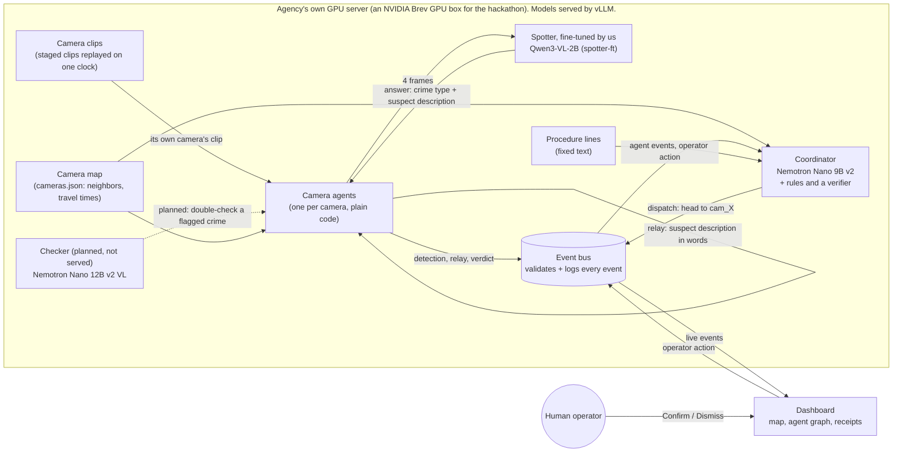

# Clarity

> When a crime happens, one dispatcher is watching dozens of camera feeds and has minutes to act. Clarity follows the suspect from camera to camera and tells officers where to head next, even with three incidents at once.

**At Clarity's core is a small vision model we fine-tuned for one job.** Our spotter is Qwen3-VL-2B with a LoRA fine-tune, trained on clips our team filmed. It looks at a few frames from one security camera, says whether a crime is happening and what kind (stabbing, assault or theft) or whether someone is running away, and describes the suspect in words. On 18 held-out test camera views, scored the same way before and after in NeMo Gym, fine-tuning raised on-screen accuracy from 0.556 to 0.778 and crime-type accuracy from 0.0 to 0.333, with no false alarms before or after (on the 2 views without a crime). <!-- source: results/history.csv (rows before_nemo_gym, after_nemo_gym_v3) and results/nemo_gym/*_aggregate_metrics.json on wali-branch, commit 884318d; 2 no-crime views: labels in results/before.json -->

**Clarity is the application that puts that model to work.** A small agent beside each camera sends its camera's clip to the spotter and passes the suspect description to the cameras along the suspect's likely path. A coordinator agent pulls the reports together and recommends where officers should go. A human operator confirms or dismisses every recommendation on a map.

**Design principle:** video stays on the agency's own hardware; only text descriptions move between agents.

Built in 24 hours at the **NVIDIA x Red Hat Small Models Hack** (Raleigh, Oct 17–18, 2026). **Track: Fine-Tuned.** <!-- source: team decision, Sat Oct 17 evening -->

| | |
|---|---|
| Fine-tuned spotter (model) | TODO: published model link. In the runbook it is served as `spotter-ft` on vLLM |
| Base vs. fine-tuned on held-out test clips | [The fine-tuned spotter](#the-fine-tuned-spotter): on-screen accuracy 0.556 → 0.778, crime type 0.0 → 0.333 (18 test views, NeMo Gym) |
| Demo video | TODO: unlisted YouTube or Vimeo link |
| Screen capture of the working app | TODO: link (short clip of the dashboard during a run) |
| Staged clips + method (open data) | [WilwilMina/clarity-clip8](https://huggingface.co/datasets/WilwilMina/clarity-clip8) on Hugging Face (test clip 8, CC BY 4.0, passers-by blurred); method in [`data/staged/README.md`](data/staged/README.md) |
| Bounty write-ups | [Best Use of Red Hat vLLM](#best-use-of-red-hat-vllm) · [Best Model Improvement with NeMo Gym](#best-model-improvement-with-nemo-gym) |

> Naming: on screen and in this README the AI dispatcher agent is called the **coordinator**. In code and message contracts it is `dispatcher`. "Dispatcher" in the pitch above means the human at the console.

---

## The fine-tuned spotter

**Its one job.** Given a few frames from one camera, in time order, the spotter answers in a fixed format:

- what happens, in one or two sentences;
- what is on screen: a **crime**, someone **fleeing**, or **nothing**;
- the crime type: **stabbing**, **assault** or **stealing**;
- the suspect, field by field: build, height, shirt, pants, shoes, hair, glasses, headwear, bag, weapon, vehicle.

The camera agents turn that answer into a `detection` event (see [`contracts/`](contracts/README.md)), and its suspect description is what they pass from camera to camera. On the way, `agents/adapter.py` renames the spotter's crime words to the contract's labels: `assault` becomes `fistfight` and `stealing` becomes `purse_snatch` (`stabbing` stays). Only the camera where the crime is on screen gets the crime label; a camera that sees someone flee gets `none`, and its description is compared with the one relayed to it. <!-- source: agents/adapter.py (CRIME_TO_ACTIVITY, activity_of) and agents/README.md -->

**Why fine-tune.** We scored the base model, `Qwen/Qwen3-VL-2B-Instruct`, on our held-out test clips before any training. It picked the right one of crime / fleeing / nothing in about half its answers, but it named the crime type wrong every time and almost never got the suspect's clothes right in its fields (table below). On our demo clip (clip 8, camera 1), it saw a crime but called a phone snatch an "assault", and its fields gave the suspect glasses and no shirt description, although its own summary mentions the man in the black hoodie. <!-- source: before.json on Wali's branch, clip8 cam1, same answer in 3 of 3 runs --> A 2B model is small enough to run beside every camera on an agency's own hardware, so we teach it this one job instead of using a bigger model.

**How it is trained.** <!-- source: src/finetune.py and src/merge_lora.py on wali-branch; VLLM_BOUNTY.md on the Michael branch -->

- **Base model:** `Qwen/Qwen3-VL-2B-Instruct` (2.13B parameters, see [Models and parameter budget](#models-and-parameter-budget)).
- **Method:** a LoRA fine-tune (`src/finetune.py`; PyTorch, Transformers, PEFT). The LoRA add-on sits on the language model's attention and MLP layers; the vision encoder stays frozen. Each training example is the exact request the spotter sends when Clarity runs (frames + prompt), followed by the correct JSON answer, and the loss counts only the answer.
- **Version:** the results below are for v3, logged as "spotter-ft (v3: crime fields only)". TODO: Wali to say what "crime fields only" means, what changed from v1 and v2, and the epochs, LoRA rank, GPU and training time.
- **Served as merged weights:** vLLM 0.11 crashes serving a LoRA on Qwen3-VL with image inputs, so `src/merge_lora.py` merges the add-on into a full copy of the base model (`models/spotter-ft-merged`). vLLM serves that copy as `spotter-ft` on port 8005.
- **Training data for v3** (the results below): the team's staged clips, train split. TODO: Wali lists the clips and confirms whether any public clip was in v3.
- **Prepared for the next version** (Oct 18, after v3 was trained; licenses in [Sources and licenses](#sources-and-licenses)):
  - public clips:
    - **AIRTLab:** research/education only, disclosed on the model card;
    - **MEVA:** CC BY 4.0, cut clips; ours plus Michael's batch of 68, method in `scripts/meva_training_clips.py`; <!-- source: 68 = Michael's count for his batch, cut with scripts/meva_training_clips.py (Michael branch, writes labels_meva.csv on the Brev box); not re-counted here -->
    - **Mixkit:** free license, link only; its Acceptable Use Policy is unread.
  - TODO: number of training examples per source (Wali's `labels.csv`).
- **Test split (held out, never trained on):** clips 1, 3, 4, 7, 8, 12 and 13, 18 camera views in total. <!-- source: before.json on Wali's branch -->
- **External check:** CAVIAR (8 clips) and the MEVA example clips without ex085, public footage filmed elsewhere. ex085 was dropped on Oct 18 because its burned-in labels give the answer away. TODO: Wali confirms that no external-check clip is in the training data. Other MEVA clips are prepared for training (cut from MEVA's source videos; ex085's video is never used), so the MEVA part of the check is less independent. TODO: confirm no training clip shares a source video with ex007 or ex050. <!-- source: training sources as listed by the team on Oct 18 (staged train split, AIRTLab, MEVA, Mixkit; CAVIAR not among them; data/README.md still asks Wali to confirm); ex085: data/training/SOURCES.md ("ex085 and two MEVA thefts") -->
- **Labels:** every camera view of our clips has a label (what happens, crime type, suspect fields). The CAVIAR and MEVA labels come from the datasets and were not checked frame by frame. <!-- source: "check" field in before_external.json --> TODO: how our clips were labeled, and who checked the labels.

**Base vs. fine-tuned.** The before/after pair is the two NeMo Gym rows: the same 18 test views, the same tasks (same frames, prompt and answer format, temperature 0) and the same scoring; only the model changed. <!-- source: src/make_gym_tasks.py docstring (wali-branch); both runs average 1,130 input tokens per task (mean/input_tokens in results/nemo_gym/*_aggregate_metrics.json, 884318d) -->

Test split, 18 held-out camera views:

| Spotter | Scored with | On-screen accuracy | Crime-type accuracy | False-alarm rate | Description accuracy | Failed requests | Mean reward | When (ET) |
|---|---|---|---|---|---|---|---|---|
| **Before:** base `Qwen/Qwen3-VL-2B-Instruct` | NeMo Gym | 0.556 | 0.0 | 0.0 | 0.227 | 12 | 0.309 | Sat Oct 17, 11:05 PM |
| **After:** fine-tuned `spotter-ft` (v3) | NeMo Gym | **0.778** | **0.333** | 0.0 | **0.293** | **0** | **0.418** | Sat Oct 17, 11:40 PM |
| Earlier base run, for context | `src/eval.py` | 0.537 | 0.0 | 0.0 | 0.253 | 7 of 54 | n/a | Sat Oct 17, 9:22 PM |

<!-- source: NeMo Gym rows: results/history.csv rows before_nemo_gym and after_nemo_gym_v3 (logged 2026-10-18 03:05 and 03:40 UTC = Sat 11:05 and 11:40 PM EDT) and results/nemo_gym/*_aggregate_metrics.json (mean/reward 0.30896 and 0.41751), wali-branch commit 884318d. eval.py row: results/before.json (cc8d3ae), also row "before" in results/history.csv -->

The two base runs differ a little (separate runs: 0.537 vs. 0.556 on-screen, 7 vs. 12 failed requests); the before/after comparison uses the NeMo Gym pair, which ran the same way.

External check, public clips filmed elsewhere (they have no suspect labels, so no description score):

| Spotter | Clips | On-screen accuracy | Crime-type accuracy | False-alarm rate | Failed requests | Source |
|---|---|---|---|---|---|---|
| base `Qwen/Qwen3-VL-2B-Instruct` | 11: CAVIAR 8 + MEVA 3, ex085 included | 0.485 | 0.133 | 0.167 | 8 of 33 | `results/before_external.json` (`src/eval.py`), Sat Oct 17, 9:29 PM |
| fine-tuned `spotter-ft` | CAVIAR 8 + MEVA without ex085 | TODO | TODO | TODO | TODO | TODO: Wali reruns this row, and the base row, without ex085 |

Sources are Wali's result files on his branch (`wali-branch`) until it merges: `results/history.csv` and `results/nemo_gym/*_aggregate_metrics.json` at commit `884318d`; `results/before.json` and `results/before_external.json` at `cc8d3ae`.

How to read the columns (scoring rules in `nemo_gym/clarity_spotter/app.py`, the same rules as `src/eval.py`): <!-- source: app.py docstring and verify() on wali-branch (884318d) -->

- **On-screen accuracy:** share of answers that pick the right one of crime / fleeing / nothing. A failed answer counts as wrong.
- **Crime-type accuracy:** on views where the crime is visible, share of answers with the right crime type.
- **False-alarm rate:** on views where nothing happens, share of answers that report a crime. A failed answer counts as no false alarm. The test split has only 2 such views, so this number says little.
- **Description accuracy:** on crime and fleeing views, share of the suspect's fields that match the label (fields labeled blank or "unknown" are skipped). Build, height and glasses must match exactly; the other fields match when at least half of the label's words appear, with a few synonyms (gray = grey, hooded = hoodie). Base model per field, in the `src/eval.py` run: shirt 0.062, pants 0.0, hair 0.0, build 0.0, versus headwear 0.854, bag 0.854 and weapon 1.0, where the right answer was usually "none". <!-- source: description_accuracy_by_field in before.json -->
- **Failed requests:** answers that came back unusable. In the `src/eval.py` runs each view is asked 3 times (18 × 3 = 54 on test, 11 × 3 = 33 external). In the NeMo Gym runs, the share of answers that parsed as a JSON object went from 0.778 to 1.0. <!-- source: mean/answered in results/nemo_gym/*_aggregate_metrics.json (884318d) --> TODO: Wali to confirm the number of attempts per view in the NeMo Gym runs.
- **Mean reward** (NeMo Gym only): for each answer, the mean of every check above that applies to its view (1.0 = everything right), averaged over all answers.

Caveats: the test split is small (18 views) and comes from the same afternoon, site and cast as the training clips (see [Known limitations](#known-limitations)). Only test clip 8 is published so far, and clips 4 and 12 won't be, so outsiders can re-score only part of the test split. The published clip 8 is blurred, so scores on it may differ a little from runs on the originals (see its dataset card). The MEVA example clips have the dataset's activity labels burned into the video; the base model's only correct crime types on the external set (2 answers) were on ex085, which shows such a label, and ex085 is now out of the external check. <!-- source: before_external.json, meva_ex085_theft; data/staged/DATASET_CARD.md ("Blur edits") -->

**Published model:** TODO: Hugging Face model link and license. Its model card discloses that the AIRTLab clips are for research and education only.

---

## Track fit: Fine-Tuned

In our own words, the Fine-Tuned track asks for three things: a small open model specialized with data for one clear job; a fair before-and-after on test data the model never saw; and a working system in which the specialized model does real work.

| What the track looks for (our paraphrase) | In Clarity |
|---|---|
| A small model, specialized for one job | Qwen3-VL-2B (2.13B), LoRA fine-tuned to spot a crime and describe the suspect from a few camera frames |
| Data behind the specialization | Clips our team filmed and labeled during the hack, used for v3, the results above (clip 8 is published with the method). Public clips from AIRTLab, MEVA and Mixkit are prepared for the next version (see [Data](#data)) |
| A fair before-and-after | Base vs. fine-tuned on the same 18 held-out test views, never used in training, with the same NeMo Gym tasks and scoring; the external check on public clips is still to be rerun without ex085 ([tables](#the-fine-tuned-spotter)) |
| The model doing real work | The camera agents send each camera's clip to the fine-tuned spotter (`spotter-ft` on vLLM) and pass its suspect description from camera to camera; the coordinator turns their reports into a recommendation for the operator ([runbook](#reproduce-the-full-demo)). The recorded fallback run is scripted (see [The application](#the-application-a-camera-relay-for-the-operator)). TODO: run ID of a recorded full run |

---

## Status at a glance

| Part | Folder | Owner | Status |
|---|---|---|---|
| **Spotter fine-tune** (Qwen3-VL-2B, LoRA, train/test split) | `src/finetune.py`, `src/merge_lora.py` (Wali's branch) | Wali | Built: v3 trained, merged and served as `spotter-ft`; scored before and after in NeMo Gym (Sat Oct 17, 11:05 and 11:40 PM ET). Published model: TODO |
| **NeMo Gym environment + scoring** | `nemo_gym/clarity_spotter/`, `src/make_gym_tasks.py`, `src/eval.py` (Wali's branch) | Wali | Built: baseline vs. final measured on the 18 test views ([results](#2-nemo-gym-baseline-vs-final)) |
| Spotter client (frames → spotter → JSON answer) | `src/spotter.py` (Wali's branch) | Wali | Built; the camera agents call it unchanged |
| Checker (Nemotron Nano 12B v2 VL) | — | Wali | Planned only: downloaded, not served |
| Camera agents (spotter answer → detection, relays, match verdicts) | `agents/` | Built on Mina's side (with Claude Code), with Wali's OK | Built; unit tests in `agents/tests` |
| Camera graph (`graph.predict_next`) | `graph/` | Wali | TODO: not merged; until then the coordinator uses its built-in fallback (unvisited neighbors of the last camera, weighted by direction) |
| Message contracts (JSON Schema) + validator | `contracts/` | shared | Built |
| Event bus: server, client, scripted scenario, replay, run metrics | `bus/` | Mina | Built (runs without any model) |
| Camera feeds (replay staged clips as cameras) | `feeds/` | Mina | In progress |
| Staged clips, camera map, ground truth | `data/` | Mina | Clip 8 built and published ([WilwilMina/clarity-clip8](https://huggingface.co/datasets/WilwilMina/clarity-clip8)); other clips after a bystander check |
| Public training clips (AIRTLab, Mixkit, MEVA) | `data/training/`; `scripts/meva_training_clips.py` (Michael's branch) | Mina; Michael (MEVA batch) | Built: link lists and labels; Michael's MEVA batch of 68 clips |
| Dashboard (map, agent graph, incident cards, receipts, sighting video) | `dashboard/` | Mina | Built; polishing |
| Model serving on vLLM (Brev) | `infra/` | Michael | Built: coordinator (:8003), base spotter (:8001) and fine-tuned `spotter-ft` (:8005) on one A100, 0.70 of its memory |
| Coordinator (Nemotron Nano 9B v2, rules for clear cases, a verifier) | `dispatcher/` | Michael | Built, on the `Michael` branch until it merges |
| Lookup (RAG with Nemotron Embed + Rerank) | — | Michael | **Cut.** Replaced by fixed procedure lines in `dispatcher/guidance.py` |

<!-- source: serving: VLLM_BOUNTY.md (Michael branch); camera graph fallback: dispatcher/README.md (Michael branch); MEVA batch: Michael's count -->

Wali's and Michael's parts live on their own branches until they merge. TODO: final pass at merge (Sun Oct 18, 10:30 AM ET).

---

## The problem and the user

**User:** the operator in a police agency's real-time crime center, watching many camera feeds at once.

**Problem:** when a crime happens on one camera, the suspect walks out of frame within seconds. To follow them, the operator has to guess which camera they'll show up on next, find that feed, and recognize the person, while other feeds keep running. With more than one incident at a time, nobody can keep up by hand.

**What Clarity gives them:** an alert with a plain description of the suspect, the path they took across cameras so far, the cameras they are likely to reach next, and a recommendation ("head to cam_07") with the evidence behind it. The operator decides; Clarity never acts on its own.

**Why on-site matters:** sending live footage of the public to an outside cloud service is a privacy risk. Clarity is designed to run entirely on the agency's own hardware, with the agents sharing only short text descriptions with each other.

---

## The application: a camera relay for the operator

Clarity is built to show the fine-tuned spotter doing its job in a realistic setting. Two models split the work: the fine-tuned spotter screens each camera, and the coordinator's language model recommends where to send officers. In between, plain-code camera agents pass the suspect description along. A larger checker model that double-checks what the spotter flags is planned but not served.

**What the demo shows (current scope: one incident)**

1. **Test clip 8 only:** a phone snatched at a bus shelter, seen by 3 cameras along the suspect's run (bus shelter, sidewalk, covered walkway). It is a test clip, never used in training. The three views were filmed one after another and are replayed together as live cameras. <!-- source: camera_positions.csv on Wali's branch (clip8 cam1-cam3, recorded 4:41-4:43 PM) --> TODO: add more incidents if the multi-incident demo comes back.
2. The crime camera's agent lights up and passes a description in words to the next cameras on the map. Each next camera's agent answers "match", "uncertain" or "no match".
3. The coordinator combines those reports with the camera map. A stabbing would go to the operator at once; a theft like this one (contract label `purse_snatch`) goes to the coordinator's model and becomes an alert once another camera's agent confirms a match. Every model answer is checked by plain-code rules (the verifier) before it goes out, and the recommendation ends with a fixed procedure line. <!-- source: dispatcher/README.md on the Michael branch -->
4. On the dashboard, the incident card turns to **Needs your decision**. The operator clicks **Confirm** or **Dismiss**, can open **Watch last sighting** to see the clip from the newest sighting, and can click any message in **Receipts** to see the earlier events it relied on.

**What runs for real, and what is scripted**

| Part | Full pipeline ([runbook](#reproduce-the-full-demo)) | Recorded insurance run `run_1018-0028_r2s` |
|---|---|---|
| Camera views | Real: test clip 8's three views | Real: the same three views (blurred copies), shown in **Watch last sighting** |
| Spotter | Real: fine-tuned `spotter-ft` on vLLM, called on each camera's clip | **Scripted**: `bus.fake_scenario` plays clip 8's ground truth (events tagged `source: "fake_scenario"`; the dashboard header shows **Scripted run**) |
| Camera agents | Real: plain code (`python -m agents.run --live`) | **Scripted** (same script) |
| Checker | Not used (planned only) | Not used |
| Coordinator | Real model: Nemotron Nano 9B v2 on vLLM (`python -m dispatcher.run`) | Real code in **rules mode** (`--no-model`; the 9B model was stopped while the fine-tune used the GPU), labeled "coordinator: rules mode" |
| Event bus, dashboard, the operator's Confirm / Dismiss | Real | Real |

<!-- source: runs/run_1018-0028_r2s/RUN.md; agents/README.md; VLLM_BOUNTY.md (Michael branch) -->

TODO: run ID of a recorded full-pipeline run (fine-tuned spotter + camera agents + coordinator model), and which run the final video uses.

**Three incidents at once (tested without the camera footage).** With three overlapping scripted incidents from `bus.fake_scenario`, the live coordinator model kept up: the slowest bus poll went from 3.9 s to 2.3 s after batching, with no fallbacks, and officers were never sent to a decoy exit (0 of 14 dispatches). <!-- source: dispatcher/IMPROVEMENTS.md on the Michael branch, changes #5 and #9 (1 run each) -->

The video's closing line (narration): *"In a real deployment, no video leaves the building. Only words move between agents."*

What that line means, stated precisely: it describes how Clarity is **designed to be deployed**. In a real deployment every part (models, event bus, dashboard) runs on the agency's own hardware, so video stays inside the building and the agents exchange only text. In our hackathon demo, a rented NVIDIA Brev GPU box stands in for that hardware: the staged clips are copied to it, and the bus streams a camera's clip to the operator's laptop when the operator opens a sighting. Between agents, only text moves in the demo too.

---

## Architecture



- Each agent sees only its own camera. Between agents, and from agents to the coordinator, **only words travel**.
- **The camera agents call no model of their own.** Matching a relayed description at the next camera is plain code (`agents/matching.py`): field by field (fields either side couldn't see are skipped), a match needs at least one agreeing feature, and an impossible travel time is a no-match. The only model they call is the spotter, on their own camera's clip. <!-- source: agents/README.md ("What the agents do") -->
- **Two ways to run it today:** the full pipeline ([runbook](#reproduce-the-full-demo)) and the recorded insurance run, in which a script stands in for the spotter and camera agents (see [The application](#the-application-a-camera-relay-for-the-operator)).
- **The coordinator** handles clear cases (such as a confident stabbing) with rules and no model call, sends ambiguous ones to the model with a JSON schema, and checks every model answer with a verifier: it must cite only evidence from the case, mention only the case's cameras, send officers where the suspect is heading, and stay within the priority the crime allows. A rejected answer gets one retry, then a safe fallback ("Operator review needed"). <!-- source: dispatcher/README.md on the Michael branch -->
- **Deployment vs. our demo.** In a real deployment the dashboard runs inside the agency too, so video stays on its own hardware. In the demo, the Brev GPU box plays the agency's server and the dashboard runs on a laptop that reaches the bus through `brev port-forward`. Over that link the laptop receives the events and, when the operator opens a sighting, that camera's clip (`GET /clips/{camera_id}`).
- Every message is a small JSON event defined in [`contracts/`](contracts/README.md): `detection`, `relay`, `agent_verdict`, `dispatch`, `operator_action`, `camera_status`.
- Every decision lists the event IDs it relied on (`evidence_event_ids`). That's the receipts trail on the dashboard.
- The bus appends every accepted event to `runs/<run_id>/events.jsonl`, so any run can be replayed into the dashboard later.
- Deterministic work (timing, matching, validation, scoring, the verifier) is plain Python, not a model.
- **No lookup step.** We planned a search over procedures (RAG with Nemotron Embed + Rerank) and cut it. The coordinator appends a fixed procedure line per crime type from `dispatcher/guidance.py` instead, for example "Procedure: take the victim's statement and broadcast the suspect description." for a purse snatch.

### Tech stack

| Layer | Tools |
|---|---|
| Models | Qwen3-VL-2B with our LoRA merged in (spotter, `spotter-ft`); Nemotron Nano 9B v2 (coordinator); Nemotron Nano 12B v2 VL (checker, planned, not served) |
| Spotter fine-tune | PyTorch, Hugging Face Transformers and PEFT (LoRA), in their own environment on the Brev box, separate from vLLM |
| Serving | vLLM 0.11.0 (OpenAI-compatible API) on an NVIDIA Brev GPU instance (A100 80 GB) <!-- source: VLLM_BOUNTY.md; dispatcher/IMPROVEMENTS.md --> |
| Agents and pipeline | Python 3.10+, OpenAI-compatible client with structured outputs (JSON schema), OpenCV (frames, clip lengths) |
| Event bus | FastAPI, uvicorn, WebSockets, jsonschema |
| Dashboard | Vite, React, TypeScript, react-leaflet, OpenStreetMap tiles |
| Measurement | NeMo Gym environment `clarity_spotter` (spotter before/after), Wali's `src/eval.py` and `src/bench.py` (spotter load test), Michael's `scripts/bench_dispatcher.py`, `bus/metrics.py` |

---

## Models and parameter budget

The hackathon cap is **33B parameters in total** across all generative language models, counting verifiers and routers too. Embedding and reranking models don't count. Our verifier is plain code, not a model. <!-- source: the event's published rules -->

| Role | Model | Parameters[^params] | Part of the running system? | Served on (vLLM 0.11.0) | GPU memory share |
|---|---|---|---|---|---|
| Coordinator (recommends) | `nvidia/NVIDIA-Nemotron-Nano-9B-v2` | 8,888,227,328 | Yes | `127.0.0.1:8003`, served as `dispatcher` | 0.30 (~26.8 GB measured) |
| Spotter, fine-tuned by us (screens each camera) | `Qwen/Qwen3-VL-2B-Instruct` with our LoRA merged in (`models/spotter-ft-merged`) | 2,127,532,032 (same as the base) | Yes | port 8005, served as `spotter-ft` | 0.2 (~14.8 GB measured) |
| Spotter, base (only for the before/after comparison) | `Qwen/Qwen3-VL-2B-Instruct` | 2,127,532,032 | No: comparison only | port 8001 | 0.2 (~14.8 GB measured) |
| Checker (planned) | `nvidia/NVIDIA-Nemotron-Nano-12B-v2-VL-BF16` | 13,181,860,358 | No: downloaded, not served | — | — |

<!-- source: VLLM_BOUNTY.md on the Michael branch (models, ports, memory shares, "the running system: 11.02B; with the checker 24.20B") -->

| What we count | Total | Within 33B? |
|---|---|---|
| **Running system:** coordinator + fine-tuned spotter | **11.02B** | Yes, 21.98B to spare |
| Every model served on the box: adds the base spotter, kept for the comparison | 13.14B | Yes |
| With the planned checker: coordinator + fine-tuned spotter + checker | 24.20B | Yes |
| Everything we downloaded: both spotters + coordinator + checker | 26.33B | Yes |

<!-- source: sums of the exact counts above: 8,888,227,328 + 2,127,532,032 = 11,015,759,360; + 2,127,532,032 = 13,143,291,392; 11,015,759,360 + 13,181,860,358 = 24,197,619,718; all four = 26,325,151,750 -->

- No embedding or reranking models are used: the lookup step (Nemotron Embed + Rerank) was cut.
- The fine-tuned spotter is stored as full merged weights: its LoRA add-on is merged into a copy of the base model (`src/merge_lora.py`), so it adds no parameters beyond the base's count.

[^params]: Exact counts from the published safetensors files, as listed in `dispatcher/README.md` ("Models and the 33B cap") and `VLLM_BOUNTY.md` on the `Michael` branch. The fine-tuned spotter has the same architecture as the base, so the same count. Earlier team notes rounded the planned three-model system (spotter + checker + coordinator) to ≈23.6B (2 + 12.6 + 9).

### Why these models, and why vLLM

- **Small enough to run on site.** On the hackathon Brev box, one A100 80 GB holds all three vLLM servers: the coordinator (0.30 of its memory, ~26.8 GB measured), the fine-tuned spotter (0.2, ~14.8 GB) and the base spotter (0.2, ~14.8 GB), 0.70 in total. <!-- source: VLLM_BOUNTY.md on the Michael branch -->
- **Right size for each job.** The fine-tuned 2B spotter looks at every camera's clip, and the coordinator works with text only. The larger checker would run only when the spotter flags something (planned).
- **vLLM for many cameras and incidents at once.** Every model sits behind the same OpenAI-compatible API, and vLLM batches requests that arrive together. Measured results are in [Best Use of Red Hat vLLM](#best-use-of-red-hat-vllm).

---

## Data

### Sources and licenses

| Source | What we use it for | License | Attribution |
|---|---|---|---|
| **Our staged clips** (13 clips filmed by the team on Oct 17) | Spotter training (train split) and testing (test split), kept apart; the demo's camera views (test clip 8); ground truth. **Published:** clip 8 as [WilwilMina/clarity-clip8](https://huggingface.co/datasets/WilwilMina/clarity-clip8) (passers-by blurred, no audio, no file metadata; dataset card in [`data/staged/DATASET_CARD.md`](data/staged/DATASET_CARD.md)). The rest except clips 4, 11 and 12 follow after a bystander check (clips 2, 5 and 6 show passers-by). | CC BY 4.0 (clip 8) | Credit line in Attribution below |
| **AIRTLab** violence dataset (staged clips by non-professional actors, 2 viewpoints) | Spotter training clips: stabbings, assaults and non-violent scenes, from both viewpoints | Research/education only, disclosed on the model card. Link only, never re-hosted | See Attribution below |
| **MEVA** | Spotter training: cut clips; ours plus Michael's batch of 68, method in `scripts/meva_training_clips.py`. External check: the example clips without ex085 | CC BY 4.0 | See Attribution below |
| **Mixkit** | Spotter training clips (clip pages listed in `data/training/public_clips_candidates.csv`) | Free license, link only; its Acceptable Use Policy is unread | Not required by its Free License; see Attribution below |
| **CAVIAR** (8 acted clips from one lobby camera) | External check only (4 fights, 4 without a crime); not used in training | CC BY-SA | See Attribution below |
| **OpenStreetMap** | Dashboard base map around the Red Hat Annex, Raleigh | ODbL | "© OpenStreetMap contributors" (shown on the map) |

<!-- source: data/README.md and data/training/SOURCES.md (license checks); data/staged/DATASET_CARD.md (clip 8); MEVA batch of 68: Michael's count -->

The clip names, license checks and caveats are in [`data/README.md`](data/README.md) and `data/training/SOURCES.md`. We looked at other public datasets there too; `SOURCES.md` lists the ones we rejected and why.

**Stabbing is mimed.** We found no openly licensed stabbing footage, and we never stage scenes with knives or anything that looks like one. So teammates act the stabbing out with empty hands. (The AIRTLab stabbing clips are research/education only, see above.)

### How the staged clips were made

The method for the demo clip (test clip 8: filming, positions, timing, conversion, ground truth) is in [`data/staged/README.md`](data/staged/README.md); the other clips were filmed the same way. This is the short version. Filming facts come from Wali's `camera_positions.csv` (on his branch until it merges).

- **Who:** only consenting teammates act. No weapons or props that look like weapons; the stabbing is mimed with empty hands.
- **What:** 13 clips, each showing one incident or a scene with no crime. The test clips hold mimed stabbings (clips 1, 3 and 4), a pickpocket (7), a phone snatch (8), an assault (13) and a no-crime scene (12). <!-- source: labels in before.json --> TODO: describe the training clips.
- **Where and when:** sidewalks, a plaza, a cafe patio, a bus shelter and a parking garage around the Red Hat Annex in Raleigh, plus a few indoor views, filmed on Oct 17 between about 4:05 and 5:40 PM. <!-- source: camera_positions.csv (recorded_at, spot_name) -->
- **Cameras:** one iPhone (the clips are consecutive files from one camera roll), moved from spot to spot along the suspect's path; for clip 8 it was handheld, not mounted, so its views move a little. 1 to 4 views per clip, 34 camera views in total. <!-- source: camera_positions.csv (source_file IMG_7352-IMG_7390, recorded_at); data/staged/README.md --> The team's camera-position sheet lists each spot's GPS fix (accuracy 5 to 189 m, worse indoors), the distance from the previous camera and an estimated running time. <!-- source: camera_positions.csv --> On the demo map, clip 8's cameras are placed by hand in route order, not at their raw GPS fixes (±14–28 m, more than the 11–22 m between the cameras, and out of route order): they form a straight line heading north (an assumption), spaced by the distances between the rounded GPS fixes. The raw GPS stays in the clip log's `gps_lat`, `gps_lon` and `gps_accuracy_m` columns. <!-- source: data/staged/README.md ("Raw GPS vs placed positions") and data/staged/clip_log_take1.csv -->
- **Filmed separately, replayed together.** The views of one clip are short shots (2.4 to 12.5 s) filmed one after another, not at the same moment. For the demo they are replayed on one shared clock as if several cameras watched the same run. Each view is placed on that clock by the estimated running time from the previous spot (3 s and 6 s for clip 8), because the clips share no clock. <!-- source: camera_positions.csv (duration_s, gap_from_prev_cam_s) -->
- **Clip format.** [`data/convert_clips.py`](data/convert_clips.py) (ffmpeg) turns each iPhone clip into a 720p, constant 10 fps, H.264 copy with the audio removed, so every clip decodes the same way and no bystander voices are kept. The originals are not changed.
- **Labels and ground truth:** per camera view, what happens, the crime type and the suspect's description (see [The fine-tuned spotter](#the-fine-tuned-spotter)). For replay, [`data/build_site.py`](data/build_site.py) turns a clip log (clip 8's is committed as `data/staged/clip_log_take1.csv`; template: `data/staged/clip_log_template.csv`) into the camera map (`data/sites/annex/cameras.json`), ground truth (`data/ground_truth/take<N>.json`) and clip manifest (`data/manifests/annex.json`), all built and committed for clip 8.
- **Train/test split:** test clips 1, 3, 4, 7, 8, 12 and 13 are never used in training; the demo replays only test clip 8. TODO: list the training clips.
- **Published:** test clip 8 as [WilwilMina/clarity-clip8](https://huggingface.co/datasets/WilwilMina/clarity-clip8) (CC BY 4.0): the three views with passers-by blurred and file metadata removed, the clip log and the ground truth; dataset card in [`data/staged/DATASET_CARD.md`](data/staged/DATASET_CARD.md). Every other clip except 4, 11 and 12 is planned to follow, audio stripped, after a bystander check (clips 2, 5 and 6 show passers-by). The site files and a cleaned clip log (no phone owners) are committed.

### Attribution

- Clarity clip 8: "Clarity staged incident, three camera views (Raleigh, Oct 17, 2026), by the Clarity team, NVIDIA x Red Hat Small Models Hack. CC BY 4.0. https://huggingface.co/datasets/WilwilMina/clarity-clip8"
- Map data © OpenStreetMap contributors, ODbL.
- CAVIAR (external check): EC Funded CAVIAR project/IST 2001 37540, http://homepages.inf.ed.ac.uk/rbf/CAVIAR/. CC BY-SA. We modified the clips (frame extraction, labels).
- MEVA (training clips and the external check): "Multiview Extended Video with Activities" (MEVA) dataset by Kitware Inc., https://mevadata.org. CC BY 4.0 (https://mevadata.org/resources/MEVA-data-license.txt). We modified the clips (cutting, re-encoding, frame extraction, labels). Paper: Corona, K., Osterdahl, K., Collins, R., Hoogs, A. "MEVA: A Large-Scale Multiview, Multimodal Video Dataset for Activity Detection." WACV 2021.
- AIRTLab (training clips): M. Bianculli, N. Falcionelli, P. Sernani, S. Tomassini, P. Contardo, M. Lombardi, A.F. Dragoni, "A dataset for automatic violence detection in videos," Data in Brief 33 (2020), doi:10.1016/j.dib.2020.106587 (citation as given in the dataset's readme).
- Mixkit (training clips): stock videos from mixkit.co under the Mixkit Stock Video Free License; clip pages listed in `data/training/public_clips_candidates.csv`.

---

## Quick start (no GPU needed)

These steps use only the parts that run without a model: the event bus, the camera feeds, the site builder, the dashboard, and the camera agents on recorded spotter answers.

Run the Python steps from the repo root, on Linux or macOS (the Brev box is Linux). Quote paths if your clone path has spaces.

### 1. Event bus with a scripted incident

This plays three overlapping scripted example incidents through the real bus, on a 12-camera placeholder map (not our filmed clips). Every scripted event is tagged `source: "fake_scenario"` so the dashboard can label it as scripted.

```bash
git clone https://github.com/waliviqas/clarity-hackathon-n-r.git
cd clarity-hackathon-n-r
python3 -m venv .venv && source .venv/bin/activate
pip install -r bus/requirements.txt
```

Fastest check, no server: write the scripted run to a file and validate it against the contracts.

```bash
python -m bus.fake_scenario --out runs/fake/events.jsonl
python contracts/validate.py runs/fake/events.jsonl
```

Full check, through the bus:

```bash
# Terminal 1: start the bus on 127.0.0.1:8080
cp .env.example .env                                   # sample settings; never commit .env
set -a; source .env; set +a
export CLARITY_CAMERAS=data/sites/annex_placeholder/cameras.json   # 12-camera placeholder map
export CLARITY_RUN_ID=run_fake1
python -m bus.server
```

```bash
# Terminal 2: publish the scripted incidents, then inspect them
python -m bus.fake_scenario --speed 5
curl -s http://127.0.0.1:8080/health
curl -s "http://127.0.0.1:8080/events?type=dispatch"
python contracts/validate.py runs/run_fake1/events.jsonl
```

`python -m bus.fake_scenario --no-dispatch` leaves out the scripted coordinator decisions, so a running coordinator makes them instead. `python -m bus.fake_scenario --ground-truth data/ground_truth/take1.json --cameras data/sites/annex/cameras.json` plays test clip 8 on its real site instead, also without scripted decisions.

Replay a recorded run (this is also our demo fallback, see [Reproduce the full demo](#reproduce-the-full-demo) step 7). Restart the bus with a new run ID so the copy is logged separately, and stop any running coordinator (it would add a second set of decisions), then:

```bash
python -m bus.replay runs/run_fake1/events.jsonl --speed 2
```

Timings for a recorded run (from the bus's own logs; runs with scripted events are labeled as scripted):

```bash
python -m bus.metrics runs/run_fake1
```

Bus endpoints (details in [`contracts/README.md`](contracts/README.md) and [`bus/server.py`](bus/server.py)):

| Endpoint | What it does |
|---|---|
| `POST /events` | Publish one event; checked against `contracts/schemas/` |
| `GET /events?type=&since_ts=` | Read past events (polling) |
| `WS /ws` | Dashboard stream: one `bus_snapshot`, then every new event |
| `GET /cameras` | The active `cameras.json` |
| `GET /clips/{camera_id}` | That camera's replay clip, for the dashboard's sighting pop-up. Supports seeking (HTTP Range). Serves only clips named in `cameras.json`. |
| `GET /clips/{camera_id}/info` | Whether the clip is available, its `start_ts` (clip second = run-clock `ts` − `start_ts`), and why not if it isn't |
| `GET /health` | Liveness and counts of valid/invalid events |

### 2. Camera feeds (clips replayed as cameras)

```bash
pip install -r feeds/requirements.txt
```

No real clips yet? Make small synthetic ones (numbered frames, no people) in a folder outside the repo, and print the frames all cameras send, in run-clock order:

```bash
python -m feeds.fake_clips /tmp/clarity_fake --cameras 3 --seconds 10
python -m feeds.base /tmp/clarity_fake/cameras.json --fps 1
```

With a real site (step 3), check every clip, then play the cameras:

```bash
python -m feeds.replay --cameras data/sites/annex/cameras.json --check   # opens every clip: resolution, fps, frames, duration; exit 1 if any is missing or unreadable
python -m feeds.replay --cameras data/sites/annex/cameras.json           # plays all cameras on one run clock and publishes camera_status to the bus
```

`feeds.replay` options: `--fps` (frames sampled per camera per second, default 1), `--speed` (default 1; 0 = as fast as possible), `--max-width` (default 960; 0 = full size), `--no-status` (don't publish `camera_status`), `--drop-late` (skip samples that are already late). `--cameras` defaults to `$CLARITY_CAMERAS`. Perception reads frames through `feeds.base.open_feeds`; `feeds.replay` on its own prints one line per run-clock second.

### 3. Site data from the staged clips

Clips live in `data/raw/staged/take<N>/` on the GPU box and are never committed. Clip 8's published views can be downloaded from [WilwilMina/clarity-clip8](https://huggingface.co/datasets/WilwilMina/clarity-clip8) (see [Reproduce the full demo](#reproduce-the-full-demo) step 0).

```bash
sudo apt-get install -y ffmpeg                       # convert_clips.py needs ffmpeg on PATH
python data/convert_clips.py data/raw/staged         # 720p, constant 10 fps, H.264, no audio .mp4 copy next to each clip
python data/build_site.py data/staged/clip_log_take1.csv --takes 1 --check-clips data/raw/staged
python contracts/validate.py data/sites/annex/cameras.json
```

- After converting, point the clip log's `clip_file` cells at the `.mp4` names. `convert_clips.py` skips copies that already exist (`--force` redoes them; `--out <folder>` writes elsewhere).
- `build_site.py` reads the filled clip log (template: `data/staged/clip_log_template.csv`) and writes `data/sites/annex/cameras.json`, `data/ground_truth/take<N>.json` and `data/manifests/annex.json`. `--check-clips` also checks that every clip file exists with the exact upper/lower case (Linux is case-sensitive). `--takes 1` builds only some takes.
- The filled log (`data/staged/clip_log.csv`) is not in the repo because it names phone owners.

### 4. Dashboard (laptop)

Status: the map (camera markers, chase paths, predicted next cameras), agent graph, incident cards with Confirm / Dismiss, receipts log and the "Watch last sighting" video pop-up are committed.

We use Node 24. In a terminal on the laptop (PowerShell works too; use `copy` instead of `cp`):

```bash
cd dashboard
npm install
cp .env.example .env      # VITE_BUS_URL, default http://127.0.0.1:8080
npm run dev               # http://127.0.0.1:5173
```

- If the bus runs on the Brev box, forward it first: `brev port-forward <instance> --port 8080:8080`.
- The dev server must stay on port 5173: the bus accepts browser requests only from that origin (`CLARITY_BUS_CORS`).
- With the bus and `python -m bus.fake_scenario` running (step 1), the scripted incidents stream in.
- "Watch last sighting" needs the bus started with a site whose `cameras.json` names real clips (step 3). Without a clip, the pop-up says "No video for this camera yet."

### 5. Camera agents on recorded spotter answers

The camera agents turn spotter answers into `detection`, `relay` and `agent_verdict` events. With `--answers` they replay answers the spotter really gave in an earlier run (here Wali's base-model results for clip 8) instead of calling a model, so no GPU is needed. Write every event to a file and validate it:

```bash
mkdir -p /tmp/wali && git archive origin/wali-branch src results | tar -x -C /tmp/wali
python -m agents.run --answers /tmp/wali/results/before.json --speed 0 --no-publish --out /tmp/a1.jsonl
python contracts/validate.py /tmp/a1.jsonl
```

Tests: `python -m unittest discover -s agents/tests -t .`. Details and every option: [`agents/README.md`](agents/README.md).

---

## Configuration (sample .env)

Copy [`.env.example`](.env.example) to `.env` and fill it in. It contains only placeholders; never commit `.env`.

| Variable | What it sets |
|---|---|
| `CLARITY_BUS_URL` | Where every part sends events (default `http://127.0.0.1:8080`). The bus server reads only the port from it. |
| `CLARITY_BUS_HOST` | Interface the bus binds to (default `127.0.0.1`; not in `.env.example`, set it only if needed) |
| `CLARITY_BUS_STRICT` | `1` rejects events that break the contracts (HTTP 422); `0` accepts them with a warning |
| `CLARITY_RUN_ID` | Names the log folder `runs/<run_id>/` |
| `CLARITY_CAMERAS` | The site's `cameras.json` |
| `CLARITY_CLIP_ROOT` | Folder that relative clip paths in `cameras.json` start from, for feeds, the camera agents and `GET /clips` (default the repo root; not set in `.env.example`) |
| `CLARITY_BUS_CORS` | Browser origins the bus accepts (default the dashboard dev server, `http://localhost:5173,http://127.0.0.1:5173`; not in `.env.example`) |
| `CLARITY_LLM_BASE_URL` | Coordinator: its vLLM server, `http://localhost:8003/v1` |
| `CLARITY_LLM_MODEL` | Coordinator: the served model name, `dispatcher` |
| `CLARITY_LLM_API_KEY` | Coordinator: only needed if its vLLM server is started with `--api-key` |
| `SPOTTER_URL`, `SPOTTER_MODEL` | Spotter server and served model name, read by Wali's `src/spotter.py`. Fine-tuned: `http://localhost:8005/v1` and `spotter-ft`; base: `http://localhost:8001/v1` and `Qwen/Qwen3-VL-2B-Instruct` (the `.env.example` default) |
| `CHECKER_BASE_URL`, `CHECKER_MODEL` | For the planned checker; unused, because it is not served |
| `HF_TOKEN` | Only if a model download needs it |
| `VITE_BUS_URL` | Bus address for the dashboard (goes in `dashboard/.env`; never put secrets in `VITE_` variables) |

The bus binds to `127.0.0.1` on the GPU box by default, and so does the coordinator's vLLM server (`--host 127.0.0.1` in `infra/serve_dispatcher.sh`; vLLM's own default listens on every interface). <!-- source: infra/serve_dispatcher.sh on the Michael branch (cdac7b5) --> The runbook starts the two spotter servers with `--host 127.0.0.1` too; `VLLM_BOUNTY.md` notes that the spotter servers running during the hack get the flag at their next restart. From a laptop, reach the bus with `brev port-forward <instance> --port 8080:8080` (and `--port 8003:8003` for the coordinator's model server).

---

## Reproduce the full demo

The runbook, on the Brev GPU box (Linux, one A100 80 GB), from the repo root. Start each long-running step in its own terminal or tmux window. Until their branches merge, the parts on Wali's branch (`src/`, `nemo_gym/`, `results/`) and on Michael's branch (`infra/`, `dispatcher/`, `scripts/`, `VLLM_BOUNTY.md`) come from those branches. TODO: update at merge.

Python setup as in [Quick start](#quick-start-no-gpu-needed) (`pip install -r bus/requirements.txt`, `-r feeds/requirements.txt`, `-r agents/requirements.txt`), plus the coordinator's requirements as in `dispatcher/README.md` ("Running").

**0. Clips and site.** Download `cam1.mp4`, `cam2.mp4` and `cam3.mp4` from [WilwilMina/clarity-clip8](https://huggingface.co/datasets/WilwilMina/clarity-clip8) and copy them into `data/raw/staged/take1/` as `clip8_cam1.mp4`, `clip8_cam2.mp4` and `clip8_cam3.mp4` (the names in `data/sites/annex/cameras.json`; see the dataset card). Then check them:

```bash
python -m feeds.replay --cameras data/sites/annex/cameras.json --check   # exit 1 if a clip is missing or unreadable
```

**1. Spotter servers**, fine-tuned and base (the demo needs only the fine-tuned one; the base is for the before/after comparison). Each in its own tmux window, with the team's vLLM 0.11.0 environment (`~/vllm12`, as in `infra/serve_dispatcher.sh`): <!-- source: VLLM_BOUNTY.md "Configuration" (Michael branch), with --host 127.0.0.1 added -->

```bash
source ~/vllm12/bin/activate
vllm serve Qwen/Qwen3-VL-2B-Instruct --host 127.0.0.1 --port 8001 --gpu-memory-utilization 0.2 --max-model-len 16384
```

```bash
source ~/vllm12/bin/activate
vllm serve models/spotter-ft-merged --served-model-name spotter-ft --host 127.0.0.1 --port 8005 --gpu-memory-utilization 0.2 --max-model-len 16384
```

`models/spotter-ft-merged` is the fine-tuned model written by `src/merge_lora.py` (the LoRA merged into the base). TODO: its published model ID, or its path on the Brev box.

**2. Coordinator model server.** Michael's script, inside tmux so it keeps running after you disconnect:

```bash
tmux new -s dispatcher          # later: tmux attach -t dispatcher
bash infra/serve_dispatcher.sh
```

It serves Nemotron Nano 9B v2 as `dispatcher` on `127.0.0.1:8003`, with vLLM 0.11.0 from the virtual environment `~/vllm12`, because newer vLLM fails with this GPU's driver. Every flag is explained in [`VLLM_BOUNTY.md`](VLLM_BOUNTY.md) ("Configuration"). <!-- source: infra/serve_dispatcher.sh and VLLM_BOUNTY.md on the Michael branch (cdac7b5) -->

**3. Bus**, with a fresh run ID for every take:

```bash
CLARITY_RUN_ID=<new id> CLARITY_CAMERAS=data/sites/annex/cameras.json python -m bus.server
```

**4. Coordinator:**

```bash
CLARITY_LLM_BASE_URL=http://localhost:8003/v1 CLARITY_LLM_MODEL=dispatcher python -m dispatcher.run
```

Add `--no-model` for rules only (label any recording "coordinator: rules mode"). Start it before the camera agents; for each take, restart it and the bus with a fresh `CLARITY_RUN_ID`, so every take gets its own log.

**5. Camera agents with the fine-tuned spotter:**

```bash
mkdir -p /tmp/wali && git archive origin/wali-branch src results | tar -x -C /tmp/wali   # Wali's spotter client, until his branch merges
export CLARITY_RUN_ID=<same id as the bus>
SPOTTER_URL=http://localhost:8005/v1 SPOTTER_MODEL=spotter-ft PYTHONPATH=/tmp/wali \
  python -m agents.run --live --save-answers "runs/$CLARITY_RUN_ID/spotter_answers.json"
```

- `--live` first checks that `SPOTTER_MODEL` is served at `SPOTTER_URL` and stops with one line if not, before publishing anything. Each camera's clip goes to the spotter when that clip has played on the run clock.
- `--relay-uncertain` keeps a chase going when answers lack clothing: an uncertain look at someone running is relayed onward too, and the next camera combines the sightings.
- `--answers <file>` replays recorded real spotter answers instead of calling the model, for example the file `--save-answers` wrote.
- The agents read the clips themselves. `python -m feeds.replay --cameras data/sites/annex/cameras.json` is optional here: it only adds each camera's status to the map (without it, every camera shows as online).

**6. Dashboard (laptop).** Forward the bus, then start the dashboard as in [Quick start step 4](#4-dashboard-laptop) and open http://127.0.0.1:5173:

```bash
brev port-forward clarity --port 8080:8080
```

```bash
cd dashboard && npm install && npm run dev
```

To watch the chase live, open the dashboard before step 5; when it connects it also receives the bus's recent events.

**7. Replay the insurance run** (the demo fallback; no models needed). Restart the bus with a new run ID and the same cameras file, don't run a coordinator during the replay, then:

```bash
CLARITY_RUN_ID=<new id> CLARITY_CAMERAS=data/sites/annex/cameras.json python -m bus.server
python -m bus.replay runs/run_1018-0028_r2s/events.jsonl --speed 1
```

What it holds ([`runs/run_1018-0028_r2s/RUN.md`](runs/run_1018-0028_r2s/RUN.md)): recorded Sun Oct 18, 00:28–00:31 ET; scripted perception from clip 8's ground truth (the dashboard shows **Scripted run**); the coordinator's real code in rules mode ("coordinator: rules mode"); the operator's Confirm from the dashboard. All 16 events pass `contracts/validate.py`. <!-- source: runs/run_1018-0028_r2s/RUN.md ("Event counts": 16/16) -->

**Spotter before/after** (optional): score the base (port 8001) and fine-tuned (port 8005) servers with the NeMo Gym environment, see [Best Model Improvement with NeMo Gym](#best-model-improvement-with-nemo-gym).

---

## Results

Every number here comes from our own logged runs, with the source next to it. No estimates. Sample sizes are small; read them as engineering measurements, not a benchmark.

### 1. Spotter: base vs. fine-tuned

The main result. On the 18 held-out test views, scored with the same NeMo Gym tasks and scoring: on-screen accuracy 0.556 → 0.778, crime-type accuracy 0.0 → 0.333, description accuracy 0.227 → 0.293, false alarms 0.0 → 0.0, failed requests 12 → 0. The external check without ex085 is still TODO. Tables and caveats: [The fine-tuned spotter](#the-fine-tuned-spotter). <!-- source: results/history.csv rows before_nemo_gym and after_nemo_gym_v3, wali-branch 884318d -->

### 2. NeMo Gym: baseline vs. final

Same 18 test tasks, same environment and scoring (`nemo_gym/clarity_spotter/`); means over all answers. Setup: [Best Model Improvement with NeMo Gym](#best-model-improvement-with-nemo-gym).

| Metric | Baseline: base `Qwen/Qwen3-VL-2B-Instruct` | Final: fine-tuned `spotter-ft` (v3) |
|---|---|---|
| Mean reward | 0.309 | **0.418** |
| On-screen correct | 0.556 | **0.778** |
| Crime type correct (views where the crime is visible) | 0.0 | **0.333** |
| False alarm (views where nothing happens) | 0.0 | 0.0 |
| Description score (crime and fleeing views) | 0.227 | **0.293** |
| Answers that parsed as a JSON object | 0.778 | **1.0** |
| Failed requests | 12 | **0** |
| Output tokens per answer (mean) | 295 | 141 |
| Input tokens per task (mean) | 1,130 | 1,130 |
| When (ET) | Sat Oct 17, 11:05 PM | Sat Oct 17, 11:40 PM |

<!-- source: results/nemo_gym/*_aggregate_metrics.json (clarity_before_gym / clarity_after_gym: mean/reward 0.30896 / 0.41751, mean/on_screen_correct 0.5556 / 0.7778, mean/crime_correct 0.0 / 0.3333, mean/false_alarm 0.0 / 0.0, mean/description_score 0.2270 / 0.2930, mean/answered 0.7778 / 1.0, mean/output_tokens 295.1 / 140.9, mean/input_tokens 1130 / 1130) and results/history.csv (failed_requests 12 / 0; logged 2026-10-18 03:05 / 03:40 UTC), wali-branch commit 884318d -->

### 3. Spotter alone vs. spotter + checker

Not measured. The checker (Nemotron Nano 12B v2 VL) is only planned: downloaded, not served. <!-- source: VLLM_BOUNTY.md on the Michael branch -->

### 4. Serving many cameras and incidents at once on vLLM

Load tests on the team's Brev GPU box (one A100 80 GB, shared by our models). Throughput grows much faster than latency as requests overlap, because vLLM batches them.

**Spotter** (base `Qwen/Qwen3-VL-2B-Instruct` on 0.2 of the A100's memory, 4 frames per request, 32 requests per level, 0 errors at every level): <!-- source: results/vllm_bench.json on Wali's branch (cc8d3ae); memory share: VLLM_BOUNTY.md -->

| Cameras at once | p50 latency | p95 latency | Cameras per minute |
|---|---|---|---|
| 1 | 0.671 s | 0.784 s | 87.9 |
| 2 | 0.627 s | 0.743 s | 184.2 |
| 4 | 0.681 s | 0.790 s | 344.2 |
| 8 | 0.766 s | 0.927 s | 578.7 |
| 16 | 1.068 s | 1.363 s | 777.7 |
| 32 | 1.651 s | 1.805 s | 992.8 |

At 32 cameras at once: 11.3× the throughput of one camera, for 2.5× the median latency. The fine-tuned spotter writes about half as many output tokens per answer (141 vs. 295 on average in the NeMo Gym runs). <!-- source: mean/output_tokens in results/nemo_gym/*_aggregate_metrics.json (884318d) --> TODO: rerun the load test with the fine-tuned spotter.

**Coordinator** (Nemotron Nano 9B v2, real coordinator prompt and JSON schema, 16 requests per level, every answer passed the verifier). Two runs with the same settings; the table is run 1: <!-- source: dispatcher/IMPROVEMENTS.md on the Michael branch, "Serving throughput" -->

| Requests at once | p50 latency | p95 latency | Requests/s | Output tokens/s |
|---|---|---|---|---|
| 1 | 1.53 s | 1.54 s | 0.65 | 68 |
| 4 | 1.85 s | 1.86 s | 2.16 | 223 |
| 8 | 2.25 s | 2.34 s | 3.51 | 362 |
| 16 | 3.14 s | 3.16 s | 4.99 | 514 |

Run 2 (a repeat on Sat Oct 17 night, GPU shared with the spotter): 65 → 477 output tokens/s and p50 1.55 → 3.39 s from 1 to 16 at once; 64 of 64 answers passed the verifier; one slow outlier at 4 at once (p95 5.6 s). <!-- source: dispatcher/IMPROVEMENTS.md on the Michael branch, "Run-to-run variation" (code at df3a804) -->

At 16 at once, over both runs: 477–514 output tokens/s, about 7× one request (7.3–7.6×), for about 2× the latency. <!-- source: the two runs above; 477/65 = 7.3x, 514/68 = 7.6x; p50 3.39/1.55 = 2.2x, 3.14/1.53 = 2.1x -->

**End to end** (crime on camera to the coordinator's recommendation, from the bus logs with `python -m bus.metrics runs/<run_id>`): TODO: measure on a full clip 8 run (fine-tuned spotter + camera agents + coordinator model). The recorded insurance run is scripted, so its timings follow the script's pacing, not model speed; `bus.metrics` labels such runs as scripted.

### 5. Our agents vs. one model

| Setup | Next-camera accuracy | Source |
|---|---|---|
| One model, same job (baseline) | TODO: measure | TODO: run ID |
| Clarity's camera agents + coordinator | TODO: measure | TODO: run ID |

TODO: which model the baseline uses and what it is given, or delete this section.

---

## Best Use of Red Hat vLLM

vLLM serves every model Clarity runs: the coordinator's model, our fine-tuned spotter and, for the before/after comparison, the base spotter, all on one A100 80 GB behind vLLM's OpenAI-compatible API (the checker is downloaded but not served). This is the short version. Michael's full write-up, with every flag and both coordinator load-test runs: [`VLLM_BOUNTY.md`](VLLM_BOUNTY.md). Sources: `VLLM_BOUNTY.md`, `dispatcher/IMPROVEMENTS.md` and `dispatcher/README.md` (Michael's branch until it merges) and `results/vllm_bench.json` (Wali's branch).

**How it fits.** The coordinator's model, Nemotron Nano 9B v2, runs on vLLM 0.11.0 on port 8003 with the served model name `dispatcher`; the coordinator calls it with `temperature=0`, `max_tokens=400` and a JSON schema, so answers come back in the shape of a `dispatch`, and the verifier checks each one. The fine-tuned spotter runs as `spotter-ft` on port 8005 and the base spotter on port 8001; the spotter also answers through a JSON schema, so its `on_screen` and `crime` fields are fixed choices that our code can check. The camera agents call the spotter for each camera's clip as soon as it has played, in parallel, so vLLM can batch the calls. <!-- source: VLLM_BOUNTY.md ("What vLLM does", "Why vLLM" point 2); agents/run.py docstring -->

**How we configured it.** One A100 80 GB shared by three vLLM servers: the coordinator takes 0.30 of its memory (~26.8 GB measured), the base and fine-tuned spotters 0.2 each (~14.8 GB each), 0.70 in total. The coordinator's server has an 8192-token context and up to 16 concurrent sequences; the spotter servers allow 16,384 tokens, because each request carries several camera frames as images. The coordinator's server listens only on `127.0.0.1`; the runbook starts the spotter servers the same way (the ones running during the hack get `--host 127.0.0.1` at their next restart). vLLM stays pinned at 0.11.0 because newer releases fail with this GPU's driver. Full commands: steps 1 and 2 of [Reproduce the full demo](#reproduce-the-full-demo); each flag is explained in `VLLM_BOUNTY.md`. The coordinator sends model calls for different incidents in parallel (up to 8, below vLLM's 16) so vLLM can batch them. <!-- source: infra/serve_dispatcher.sh and VLLM_BOUNTY.md, "Configuration" (Michael branch) -->

**What we changed, and what it measured** (coordinator; one change at a time, same scenario; small samples):

| Change | Before | After |
|---|---|---|
| Removed `maxLength` from the JSON schema (lengths are checked by the verifier instead) | 13.3 s per call, 8 tokens/s | 1.6 s per call, ~65 tokens/s (2 + 2 calls) |
| Removed `/no_think` from the system prompt | 0 of 5 answers valid, 5.6 s | 5 of 5 valid, 1.5 s |
| Batch each bus poll, call the model for different incidents in parallel, skip repeated events (3 overlapping incidents) | slowest poll 3.9 s, 18 model calls | slowest poll 2.3 s, 15 model calls, 0 fallbacks (1 run) |
| Retry once on unparseable JSON | 1 fallback in 15 dispatches | 0 fallbacks in 36 calls |

**Measured results.** Continuous batching. The coordinator reaches 477–514 output tokens/s at 16 requests at once (two runs): about 7× one request (7.3–7.6×), for about 2× the latency, and every answer passed the verifier. The base spotter handles 992.8 cameras per minute at 32 at once: 11.3× one camera, for 2.5× the median latency, with no errors. Tables: [Results section 4](#4-serving-many-cameras-and-incidents-at-once-on-vllm). <!-- source: coordinator: dispatcher/IMPROVEMENTS.md on the Michael branch, "Serving throughput" (run 1: 68 -> 514 tok/s) and "Run-to-run variation" (run 2: 65 -> 477 tok/s, 64/64 verified); spotter: results/vllm_bench.json on Wali's branch (cc8d3ae) -->

**Tried, didn't help.**
- **Serving the fine-tuned spotter as a LoRA add-on** (`--enable-lora`) crashes on vLLM 0.11 with Qwen3-VL and image inputs. Workaround: merge the LoRA into the base weights (`src/merge_lora.py`) and serve the merged model as its own model, `spotter-ft`.
- **Prefix caching** is switched on but vLLM 0.11 does not apply it to this hybrid Mamba model (its cache counter stayed at 0), so we don't claim it.
- A per-request setting to drop whitespace from structured output was accepted but ignored; the one JSON retry covers the occasional runaway whitespace instead.

**Why vLLM.** Local inference on hardware we control (the privacy case), one API for a vision model and a language model, JSON-schema outputs our code can rely on, several models on one GPU with a memory limit each, and batching that lets one GPU keep up with many cameras at once.

---

## Best Model Improvement with NeMo Gym

Wali built a NeMo Gym environment that scores the spotter's one job, and we used it to measure the fine-tune: the base model and our fine-tuned spotter answered the same 18 held-out test tasks and were scored by the same code. Sources: `nemo_gym/clarity_spotter/` (`app.py`, `config.yaml`), `src/make_gym_tasks.py`, `results/history.csv` and `results/nemo_gym/*_aggregate_metrics.json`, all on `wali-branch` (commit `884318d`) until it merges.

**Setup.**

- **Tasks:** one per test camera view, 18 in all, built by `src/make_gym_tasks.py` from the labels. Each task is exactly the request the spotter sends when Clarity runs (the same 4 frames, prompt and JSON answer format, temperature 0) plus the hand-made label. None of these views is used in training.
- **Agent:** NeMo Gym's `simple_agent` with `max_steps: 1`: the model under test (`policy_model`) answers once per task. It has no tools.
- **Scoring:** `verify()` in `app.py` grades each answer against the label with the same rules as `src/eval.py`:
  - on screen (crime / fleeing / nothing): on every view;
  - crime type: only where the crime is visible;
  - no false alarm: on views where nothing happens;
  - suspect description: on crime and fleeing views, field by field (labels left blank or "unknown" are skipped; build, height and glasses must match exactly, the other fields when at least half of the label's words appear).
- **Reward:** the mean of the checks that apply to that view (1.0 = everything right). An answer that isn't a JSON object gets no on-screen or crime-type credit, but on a view where nothing happens it still counts as no false alarm.

**Baseline vs. final** (same tasks, environment and scoring; full table in [Results section 2](#2-nemo-gym-baseline-vs-final)): <!-- source: results/history.csv rows before_nemo_gym and after_nemo_gym_v3, and results/nemo_gym/*_aggregate_metrics.json, wali-branch 884318d -->

- mean reward 0.309 → **0.418**
- on-screen correct 0.556 → **0.778**
- crime type correct 0.0 → **0.333**
- false alarms 0.0 → 0.0 (only 2 views without a crime)
- description score 0.227 → **0.293**
- failed requests 12 → **0**

**What caused the gain.** Only the model changed between the two runs: the same tasks file, frames, prompt and scoring (both runs averaged 1,130 input tokens per task). The final model is our LoRA fine-tune of the same base model (`src/finetune.py`, v3; see [The fine-tuned spotter](#the-fine-tuned-spotter)), trained only on train-split clips. Its training is supervised: each example is a spotter request with its correct JSON answer. NeMo Gym is where we measured the result. Every answer from the fine-tuned spotter was a valid JSON object, and its answers used about half as many output tokens (141 vs. 295 on average). TODO: Wali to say what changed from v1 and v2 to v3, and whether Gym scores guided those changes.

**How to run the scoring.** On `wali-branch`, from the repo root:

```bash
python src/make_gym_tasks.py   # test views in labels.csv -> nemo_gym/clarity_spotter/data/test.jsonl
```

Its defaults read `labels.csv` and the clips in `video-data/custom-clips`. `config.yaml` expects the environment at `resources_servers/clarity_spotter/` inside NeMo Gym. TODO: Wali's commands to start the environment, point `policy_model` at the base (port 8001) or fine-tuned (port 8005) server, and collect the rollouts.

**Limits.** 18 tasks, only 2 of them without a crime; one site and cast, shared with the training clips. Read the scores as a measurement of this job on our footage, not a benchmark.

---

## Known limitations

- **The recorded insurance run is scripted.** In `run_1018-0028_r2s` a script stands in for the spotter and camera agents (tagged `fake_scenario`, shown as "Scripted run"), and the coordinator runs in rules mode. The runbook runs the fine-tuned spotter through the camera agents. TODO: run ID of a recorded full run.
- **One incident in the demo.** The demo replays only test clip 8. Three overlapping incidents were tested with scripted events, not with our footage.
- **Small test set, modest scores.** 18 test camera views, only 2 of them without a crime, so the false-alarm rate rests on very few answers. After fine-tuning, the spotter still misses the crime type in about 2 of 3 answers where the crime is visible (0.333 correct) and misses most suspect fields (description 0.293). <!-- source: results/history.csv, after_nemo_gym_v3 (884318d) -->
- **Train and test clips share one site, day and cast.** They come from the same afternoon around one building with the same teammates, so the test shows the spotter learned this setting, not that it works anywhere. CAVIAR is not in training; other MEVA clips are, so the MEVA part of the external check is weaker, and the external rerun without ex085 is still TODO.
- **No checker.** The checker (Nemotron Nano 12B v2 VL) is downloaded but not served, so nothing double-checks the spotter's crime calls yet.
- **Public training clips with limited terms.** AIRTLab: research/education only, disclosed on the model card. Mixkit: free license, link only; its Acceptable Use Policy is unread. Neither is re-hosted.
- **Not all test clips are published.** Only test clip 8 is published so far, and clips 4 and 12 won't be, so outsiders can re-score only part of the test split.
- **Burned-in labels on MEVA clips.** The MEVA example videos show the dataset's activity labels, which a model can read.
- **Staged, not real, footage.** Short scenes acted by teammates, in daylight.
- **The stabbing is mimed.** It is acted with empty hands and no props, so it looks unlike a real attack. We found no openly licensed stabbing footage to test against.
- **Camera views were filmed one after another.** The views of a clip are separate short shots replayed on one clock, not one moment seen by several cameras.
- **Rough camera positions.** GPS accuracy ranges from 5 to 189 m, worst indoors and in the garage. So clip 8's cameras on the demo map are placed by hand in route order, not at their GPS fixes: a straight line heading north, which is an assumption, spaced by the distances between the rounded GPS fixes. The positions, and the compass directions between cameras that follow from them, are approximate. The raw GPS stays in the clip log (`gps_lat`, `gps_lon`, `gps_accuracy_m`). <!-- source: data/staged/README.md ("Raw GPS vs placed positions", "Known limitations") and data/staged/clip_log_take1.csv -->
- **Replay, not live cameras.** Feeds are recorded clips played back as cameras, not live streams.
- **Fixed procedure text.** The coordinator's guidance is a fixed line per crime type in `dispatcher/guidance.py`, not a search over an agency's real procedures (we cut the lookup step).
- **Not on agency hardware yet.** The demo runs on a rented Brev cloud GPU box standing in for the agency's server, and the dashboard on a laptop over a port-forward.
- **Descriptions can be wrong.** A clothing description can match an innocent person or miss a suspect who changes clothes. That's why a human confirms every recommendation, and why each recommendation shows its evidence.
- **No login on the bus or the model servers.** None of them has user accounts or an API key. The bus and the coordinator's server bind to `127.0.0.1` on the GPU box and are reached through a port-forward; the runbook starts the spotter servers the same way (the ones running during the hack get `--host 127.0.0.1` at their next restart). <!-- source: bus/server.py; infra/serve_dispatcher.sh (--host 127.0.0.1, no --api-key) and VLLM_BOUNTY.md on the Michael branch -->

## Next steps

- Record a full run (fine-tuned spotter, camera agents and the coordinator's model) and use it for the demo.
- Rerun the external check without ex085, for the base and the fine-tuned spotter.
- Serve the checker and measure spotter alone vs. spotter + checker.
- Publish the fine-tuned model, and the remaining staged clips after the bystander check.
- Rerun the spotter load test on the fine-tuned model.
- Fine-tune and test the spotter on footage from other places, times of day and people, including more openly licensed footage.
- Bring back several overlapping incidents on real footage.
- Bring back the lookup step over an agency's real procedures (Nemotron Embed + Rerank).
- Connect live camera streams instead of replayed clips.
- Package the stack to install on an agency's own servers.
- TODO: add the next steps the team agrees on after the demo.

---

## Repo layout

| Folder | What's inside |
|---|---|
| `contracts/` | JSON Schemas and examples for every message, plus `validate.py` |
| `bus/` | Event server, client, scripted scenario, replay, run metrics |
| `agents/` | Camera agents: spotter answer → `detection`, description matching, one inbox per camera, the bus runner (`python -m agents.run`) |
| `data/` | Camera maps, clip log template, `convert_clips.py`, `build_site.py`, training-clip lists, dataset notes and licenses |
| `dashboard/` | Operator map, agent graph, incident cards, receipts log, sighting video |
| `feeds/` | Plays staged clips back as synchronized cameras (in progress) |
| `runs/run_1018-0028_r2s/` | The recorded insurance run: events and `RUN.md` |

The bus writes event logs to `runs/<run_id>/` when it runs.

- On Wali's branch until it merges: `src/` (spotter client `spotter.py`, `finetune.py`, `merge_lora.py`, `eval.py`, `make_gym_tasks.py`, `bench.py`), `nemo_gym/clarity_spotter/` (the NeMo Gym environment), `results/` (`history.csv`, `nemo_gym/`, `vllm_bench.json`). TODO: `graph/` (camera graph) if it merges.
- On Michael's branch until it merges: `infra/` (vLLM serving, `serve_dispatcher.sh`), `dispatcher/` (coordinator, verifier, procedure lines in `guidance.py`), `scripts/` (`bench_dispatcher.py`, `meva_training_clips.py`), `VLLM_BOUNTY.md` (vLLM write-up).

---

## Team

| Name | Role | GitHub |
|---|---|---|
| Mina | Event bus, camera feeds, staged clips and data (published clip 8), dashboard, camera agents and spotter adapter (built on his side with Claude Code, with Wali's OK), video and write-up | [@WilwilMina](https://github.com/WilwilMina) |
| Wali | Spotter fine-tune, scoring, NeMo Gym environment | [@waliviqas](https://github.com/waliviqas) |
| Michael | Coordinator, vLLM serving and its write-up, MEVA training batch | [@venecia-mv](https://github.com/venecia-mv) |

---

## How we built it

- All code in this repo was written during the hackathon (Oct 17–18, 2026). Open-source libraries are listed in each folder's `requirements.txt` (and `dashboard/package.json`).
- **Claude Code was used as a development tool only** (writing and reviewing code and docs). It is not part of Clarity: no hosted or closed model is called when Clarity runs.
- The camera agents (`agents/`) live in Wali's part of the project but were written on Mina's side, with his OK, as a thin layer that imports his spotter code unchanged.
- No faces of people who didn't consent, no secrets, and no raw video are committed to this repo.

## License

TODO: choose a license for the code. The staged clip dataset (CC BY 4.0) and the fine-tuned model are licensed separately (see [Data](#data) and [The fine-tuned spotter](#the-fine-tuned-spotter)).
